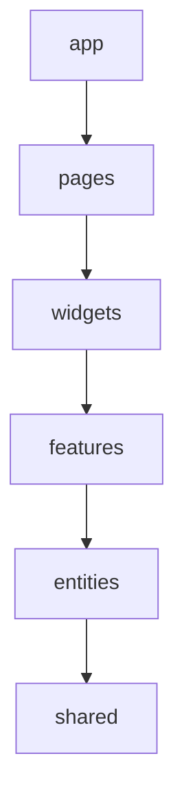
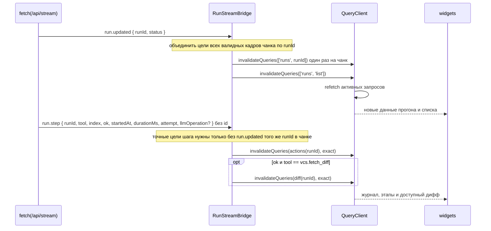
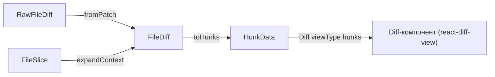
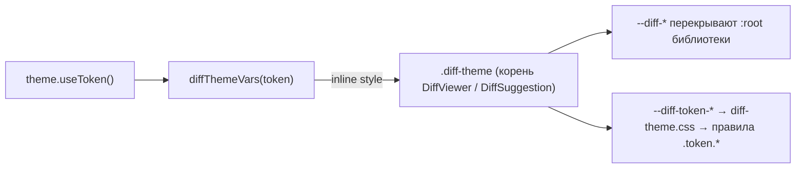

# FRONTEND_ARCHITECTURE — AI Code Reviewer (команда 6)

|                     |                                                                                                                                                                 |
| ------------------- | --------------------------------------------------------------------------------------------------------------------------------------------------------------- |
| Статус              | **утверждён**: PR #31 (approve 2026-09-19, смержен 2026-09-20); изменения — PR со строкой Ф-n в §0                                                              |
| Владелец            | инженер 2, frontend-архитектура (роль 5)                                                                                                                        |
| Связанные документы | [`SYSTEM_DESIGN.md`][sd] (роль 1, канон в `dmc-268-api-t6`), `BACKEND_ARCHITECTURE.md` / api PR #4 (роль 6, ERD), тулинг PR #26 (роль 4), инфра PR #28 (роль 3) |
| Нумерация решений   | `Ф-1…` (frontend), не пересекается с `Р-n` [SD §1][sd-1]                                                                                                        |

**Что это.** Документ фиксирует архитектуру клиента `dmc-268-ui-t6`: слои, состояние, UI-кит,
контракт данных и требования к API, которые frontend выставляет backend'у до того, как тот
готов. Каркас (папки, схемы, адаптеры, четыре виджета, мок) уже в `main`;
документ описывает то, что реализовано, и явно помечает, что осталось открытым.

**Стек.** React 19.3.0, Vite 8.3.0 (rolldown), TypeScript 7.0.2 — компилятор `tsc`, рядом 6.0.3
для typescript-eslint (peer `typescript >=4.8.4 <6.1.0`; side-by-side, Ф-11, #47),
pnpm 12, antd 6.6.5, react-diff-view 3.3.3, Zod 4.6.5, Zustand 5.0.15,
TanStack Query 5.103.2, Vitest 5.0.1, jsdom 30.1.1, Testing Library 16.3.3. Версии — самые свежие
стабильные на 2026-09-19, выбраны ролью 5 в отсутствие ответа команды (Ф-11);
TypeScript поднят до 6.0.3 2026-09-24 (#49), компилятор — до 7.0.2 в тот же день (#47);
antd, TanStack Query и jsdom — патчи от 2026-09-24.

---

## 0. Решения

| Ф-n  | Решение                                                                                                                                                              | Причина                                                                                                                                                                                                                    |
| ---- | -------------------------------------------------------------------------------------------------------------------------------------------------------------------- | -------------------------------------------------------------------------------------------------------------------------------------------------------------------------------------------------------------------------- |
| Ф-1  | FSD (lite) вместо Clean Architecture                                                                                                                                 | UI-клиент без доменной логики; FSD — фронтенд-реализация чистой архитектуры (лекция), см. §1.                                                                                                                              |
| Ф-2  | UI-кит antd 6.6.4                                                                                                                                                    | Tree/Collapse/Descriptions из коробки, peer react ≥ 18, проверено proof-run; подтверждено — [решение техлида][tl-2026-09-24-46] (§3).                                                                                      |
| Ф-3  | RunStatus — 7 значений (`succeeded`, + `publishing/cancelled/skipped`); пересмотрено 2026-09-24                                                                      | UI «зависание/retry/отмена»; согласовано с ERD роли 6 и [SD §6.4][sd-6.4]; `succeeded` — [решение техлида][tl-2026-09-24].                                                                                                 |
| Ф-4  | `RunAction.response \| null` + `responseRef`                                                                                                                         | тела инструментов > 64 КБ выносятся отдельным запросом.                                                                                                                                                                    |
| Ф-5  | Внешний ключ `runId`, тип `RunSession`                                                                                                                               | одно имя во всём контракте: `RunSession` — API-представление `Run` ([SD §12][sd-12]).                                                                                                                                      |
| Ф-6  | Привязка комментария — пара `oldLine \| null` / `newLine \| null`; канон якоря — `path/start_line/line` (+ `side`), уточнено 2026-09-28                              | бэкенд мапит канон в провод по формулам [PIPELINE_SPEC §10][ps-10] (api#20, D6); ключ виджета выводится из пары (§6).                                                                                                      |
| Ф-7  | TanStack Query — серверный кэш; Zustand — UI-состояние, стор живёт в виджете; вид, которым делятся ссылкой (фильтры замечаний), — URL search params                  | `shared` не знает о домене; SSE → invalidateQueries (§2); у фильтров один источник — URL, копии в сторе нет (§2, §6).                                                                                                      |
| Ф-8  | Дифф по проводу — сырой unified diff на файл; парсинг клиентом за адаптером                                                                                          | замена diff-библиотеки = замена одного адаптера (§6).                                                                                                                                                                      |
| Ф-9  | Новый эндпоинт `GET /api/runs/{id}/files?path&offset&limit`                                                                                                          | дочитывание контекста порциями; путь внесён в [SD §12][sd-12] (§5, п. 7).                                                                                                                                                  |
| Ф-10 | JSON на проводе — camelCase                                                                                                                                          | Zod-схемы фронта — источник истины — [SD §12][sd-12]; иначе трансформер на каждом ответе.                                                                                                                                  |
| Ф-11 | Самые свежие стабильные версии (React 19.3, Vite 8.3, Vitest 5.0, TS 7.0.2, линтер — 6.0.3) — решение роли 5 при отсутствии ответа команды; уточнено 2026-09-24      | peer-совместимость проверена по npm registry; у TS 7.0 нет JS API — typescript-eslint (peer `typescript >=4.8.4 <6.1.0`) на 6.0.x, рядом с 7.0 — #47; расхождения с PR #26/#33 — предложениями в их тредах.                |
| Ф-12 | react-router 8 установлен (^8.4.0) для декларативной маршрутизации; Mantine 9 — не установлен                                                                        | SPA-роутер App Shell (/login, /auth/callback, /repositories, /repositories/:repoId/settings, /runs, /review); React 19.3 выполняет peer-требование (≥ 19.2.7).                                                             |
| Ф-13 | Стили: antd tokens для темизации + CSS Modules для layout-контейнеров; Tailwind — нет                                                                                | один источник цветов/отступов, layout без рантайма; stylelint-override для `*.module.css` — [решение техлида][tl-2026-09-24-46] (§3).                                                                                      |
| Ф-14 | SSE — `fetch`-стрим с `Authorization: Bearer`, а не `EventSource`                                                                                                    | `EventSource` не отправляет заголовки, а `/api/stream` требует Bearer ([решение техлида][tl-2026-09-27-api20], api#20 D4); `401` → refresh → переподключение (§2).                                                         |
| Ф-15 | Авторизация — GitHub App user authorization; access-токен только в памяти, refresh — httpOnly-cookie; fail closed                                                    | [решение техлида][tl-2026-09-27-api20], api#20 D4; токен в памяти — дефолт плана api#20; fail closed, общий refresh, старт refresh → `/me` — правила клиента (§11).                                                        |
| Ф-16 | Вердикт (`blocking`/`attention`/`clean`) и `severityCounts` считает сервер; D3 — фильтр, бейдж — пять уровней                                                        | [решение техлида][tl-2026-09-27-api20], api#20 D3: UI вердикт сам не выводит, API отдаёт пять уровней severity (§4).                                                                                                       |
| Ф-17 | Репозиторий подключается установкой GitHub App; настройки — `PATCH /api/repos/{id}`; уточнено 2026-10-14 (ui#93)                                                     | [решение техлида][tl-2026-09-27-api20], api#20 D10: `POST /api/repos` нет; поля настроек — `enabled`, `defaultEngine`, `waitForCi`, `maxComments`, `reviewEvent` (§11) и поля api#149 из api PR #156 (ниже, §5).           |
| Ф-18 | Синхронная подсветка диффа — бюджет ~1000 строк на файл и на весь дифф; выше — без `tokenize` (worker — follow-up)                                                   | AC ui#65 ч. 1; API `summary_only` >3000 строк; замеры в `docs/plans/65-plan.md` (Refs ui#65).                                                                                                                              |
| Ф-19 | Список PR репозитория (`GET /repos/{id}/pulls`) в UI **не** входит в scope #65; навигация — со страницы репозиториев / внешняя ссылка на GitHub                      | Открытый вопрос плана закрыт: follow-up issue при появлении API в продукте (Refs ui#65).                                                                                                                                   |
| Ф-20 | Дизайн-система Flat Console поверх antd: тема, свои компоненты и правила в `src/shared/ui`, витрина в Storybook; спецификация [`DESIGN_SYSTEM.md`](DESIGN_SYSTEM.md) | Единый вид всех экранов без смены UI-кита: Ф-2 и Ф-13 остаются в силе, antd получает нашу тему, а то, что токенами не выражается, собрано в одном файле. Базовые компоненты берутся только из дизайн-системы (Refs ui#98). |
| Ф-21 | Настройки репозитория — страница `/repositories/:repoId/settings`, не модальное окно; история — `/runs?repo=` по курсору; поля — api PR #156, правила — api PR #202  | ui#93: у настроек свой адрес (ссылка, возврат после входа) и место для блока правил; поля — контракт api#149 (§5); `rules-status` — контракт api PR #202, блок правил спрашивает его на каждом окружении (§2, §5).         |
| Ф-22 | Обновление доступа: опрос 5 с / 120 с, резерв статуса вне idle и постоянный live region на странице (§2)                                                             | Запаздывающий репозиторий появляется без блокировки действий строки; поиск и таблица не сдвигаются, status сохраняется между GET и при ошибке без данных (Refs ui#92, ui#120).                                             |
| Ф-23 | Статус `.review/rules.md` без кнопки «Обновить»: свежий ответ — при повторном открытии страницы, `pending` опрашивается раз в 3 с                                    | ui#93, D18: [техлид согласовал][api150-reread] механизм createunix — воркер сам перечитывает файл, ручного обновления нет; «Повторить» — для `unavailable` с `retryable` и сбоя HTTP (§2, §5).                             |
| Ф-24 | Переключатель RAG — `PATCH { ragEnabled }` сразу, вне черновика формы; статус индекса — `ragIndex` из `['repos']`; опрос 5 с / 120 с                                 | Как у авто-ревью (Ф-17); тексты статусов — по api#145 (§5); копии в сторе нет (Ф-7). Опрос — только на `building` и после включения здесь (§2); мок строит индекс по числу GET (§8) (Refs ui#102).                         |
| Ф-25 | SSE: одна инвалидация префикса прогона и объединение целей в пределах разобранного чанка (§2)                                                                        | Перекрывающиеся ключи отменяли и повторяли HTTP-запросы; следующий чанк сохраняет отмену старого refetch ради свежих данных (Refs ui#161).                                                                                 |
| Ф-26 | Язык интерфейса: i18next, словари `en`/`ru` в `src/shared/i18n`, английский по умолчанию; переключатель: `features/language` (меню профиля, рядом с темой)           | #182: продукт открывается по-английски, выбор языка сохраняется (`dmc_language`). Полноту `ru` проверяет `check-types`, кириллицу вне словарей отклоняет `pnpm lint`; тесты идут на RU (`src/test/setup.ts`).              |

Ф-11 уточнено 2026-09-24 (#49): TypeScript поднят 5.9.3 → 6.0.3. Потолок — именно 6.0.x, а не
«6.x»: у TypeScript 7.0 нет JS API компилятора, поэтому peer typescript-eslint остаётся
`typescript >=4.8.4 <6.1.0` ([typescript-eslint#10940][tse-10940]) — специфер в `package.json`
тильдовый (`~6.0.3`), каретка пустила бы 6.1.x за пределы диапазона. Переход на 7.x — #47.

Ф-11 уточнено 2026-09-24 (#47): компилятор — TypeScript 7.0.2 по схеме side-by-side из
[анонса TS 7.0][ts-7.0-side-by-side]. В `package.json` два пакета:
`"@typescript/native": "npm:typescript@^7.0.2"` даёт бинарь `tsc`, поэтому `check-types` и `build`
(`tsc -b`) идут на нативном компиляторе, в том числе в Docker-сборке на `node:24-alpine`;
`"typescript": "npm:@typescript/typescript6@~6.0.2"` — обёртка, которая реэкспортирует
`typescript@6.0.3` и ставит только бинарь `tsc6`, так что `require('typescript')` в
typescript-eslint получает JS API 6.0. Тильда — по той же причине, что в #49. Внутренняя
зависимость обёртки (`typescript@^6`) держится на 6.0.3 только lockfile'ом. #47 закрыт этим шагом
(решение техлида 2026-09-24); follow-up без отдельной задачи — убрать обёртку и оставить один
`typescript@7`, когда typescript-eslint поддержит TS 7
([typescript-eslint#10940][tse-10940]; прототип — draft [typescript-eslint#12803][tse-12803]
под API TS 7.1).

Ф-3 пересмотрено 2026-09-24: в [SD §8.2][sd-8.2] `completed` уже означает GitHub `check_suite` /
`check_run completed` («завершён с любым исходом»), и второй смысл у этого слова ведёт к
ошибкам. Поэтому успешный статус прогона — `succeeded` везде: домен, PG enum, API и Zod
фронтенда.

Ф-6 уточнено 2026-09-28 (api#20, D6): канон якоря — `path` / `start_line` / `line` (+ `side`), так
пишут LLM и датасет api#30. БД и Zod не переименовываются, на проводе остаются `file` / `oldLine` /
`newLine` / `endLine`. Формулы и однострочный случай — §6, первоисточник — [PIPELINE_SPEC §10][ps-10].

Ф-10 уточнено 2026-09-28 (api#20, D9 — дефолт, утверждённый с планом): camelCase на проводе
остаётся, но источник истины для путей и форм HTTP теперь [`contracts/openapi.yaml`][openapi] в
api; Zod-схемы — проверка того же контракта на клиенте (§4, §5).

Ф-7 уточнено 2026-10-09 (ui#84): к двум хранилищам добавился третий источник состояния — URL.
Фильтры замечаний над диффом (`file`, `severity`, `q`) живут в `location.search`: ссылка с
фильтрами открывает тот же вид (перезагрузка, новая вкладка, «назад»), а дублировать их в
Zustand или `useState` нельзя — получится два источника правды. Правила — §2 «Состояние в URL»,
семантика — §6 «Фильтры замечаний».

Ф-7 уточнено 2026-10-18 (ui#115): в сторе diff-viewer остаётся только режим `viewType`
с действием `setViewType`; фильтр файлов по-прежнему живёт в URL. Неиспользуемое состояние
выбора файла и недостижимая страница ревью удалены (§11).

Ф-17 уточнено 2026-10-14 (ui#93): настройки правятся на странице `/repositories/:repoId/settings`,
а не в модальном окне списка (Ф-21). Поля страницы: `enabled` — переключатель «Автоматическое
ревью», отдельный `PATCH { enabled }`; сервер отдаёт итог `enabled AND installationAvailable`
(§5); `waitForCi`, `maxComments`, `reviewEvent` — форма; `defaultEngine` — только текст, не
отправляется. Поля api#149 (контракт api PR #156, §5): `branchFilter`, `severityThreshold` —
форма; обязательное, только для чтения `installationAvailable` — предупреждение у переключателя.

Ф-24 (ui#102, api#145): RAG включают переключателем «RAG» на странице настроек (§2). Как авто-ревью, он
не входит в форму: `PATCH { ragEnabled }` уходит сразу и один, оптимистичное обновление и откат — в
`useUpdateRepository`. Индекс (`ragIndex`) только читается: он приходит в той же строке `['repos']`, что и
все поля, своего ключа и копии в сторе нет (Ф-7). Статус показан текстом по значениям api#145 (§5). Пока у
GitHub App нет доступа, переключатель выключен и недоступен, выбора «на потом» нет (в отличие от
авто-ревью, Ф-17): `PATCH` для такого репозитория UI не шлёт. Страница перечитывает список раз в 5 с, но
не дольше 120 с и только пока индекс в пути: на `building` или на `empty` сразу после включения на этой
странице. `empty` на открытой странице не опрашивается: пока api#143 открыт, он не меняется, и опрос шёл бы
впустую. Мок строит индекс по числу GET, а не по времени (§8).

---

## 1. Слои

Feature-Sliced Design (lite): `app → pages → widgets → features → entities → shared`.



Правила:

- импорты — только вниз по стрелке; наверх и «вбок» — нельзя;
- мокапы дашборда в `docs-site/components/dashboard/` (пакет пользовательской документации,
  вне FSD) импортируют внутренности срезов `src/` по относительному пути: CSS Modules из `ui/`,
  `widgets/diff-viewer/lib/*`. Так картинки документации берут стили самого приложения.
  Переименование файла поймают `pnpm --dir docs-site check-types` и `build`, переименование
  класса CSS Module — нет: после такой правки картинки снимаются заново (`docs-site/README.md`);
- срезы одного слоя друг друга не импортируют (кроме `shared`, у него срезов нет).
  Исключение: `entities/run` импортирует `FindingViewSchema` из `entities/review`
  (разбор `findings[]` в `RunDetail`). `entities/run/api` берёт схему из публичного
  индекса; `entities/run/model/schemas.ts` импортирует файл
  `entities/review/model/schemas.ts` напрямую — генератор снимка Zod в api
  (`tests/generate_ui_zod_contracts.mjs`) грузит схемы в Node ESM, а Node не
  резолвит импорт каталога. ESLint `no-restricted-imports` это допускает;
- `shared` никогда не импортирует `entities` (граница из плана, D18: `shared/api/endpoints.ts` —
  только пути/методы, domain-agnostic; привязка «эндпоинт → Zod-схема» — в `entities/*/api`);
- файл компонента экспортирует только компоненты — следствие `react-refresh` (тулинг PR #26):
  вспомогательные функции и типы выносятся в соседние `lib`/`model` файлы.

Область [SD §2][sd-2] → срез FSD:

| Область [SD §2][sd-2]                            | Срез                                                                                                    |
| ------------------------------------------------ | ------------------------------------------------------------------------------------------------------- |
| Карточка прогона с диффом и инлайн-комментариями | `entities/{diff,review}`, `features/finding-filters`, `widgets/diff-viewer`, `pages/runs/RunDetailPage` |
| Инспектор трейса (`RunSession → RunAction`)      | `entities/run`, `widgets/run-inspector`, `pages/runs`                                                   |
| История прогонов (`/runs?repo=`)                 | `entities/run`, `features/run-list-filter`, `pages/runs/RunsPage`                                       |
| Аутентификация и App Shell                       | `entities/user`, `features/auth`, `features/theme`, `widgets/app-layout`, `pages/{login,auth}`          |
| Репозитории и их настройки                       | `entities/repository`, `features/repository-settings`, `widgets/repository-list`, `pages/repositories`  |
| Правила: статус `.review/rules.md` (мок)         | `entities/repository`, `widgets/repository-rules`, `pages/repositories/RepositorySettingsPage`          |
| Журнал прогонов (`/audit`)                       | `entities/run`, `features/audit-filter`, `pages/audit`                                                  |
| Дашборд качества (`/analytics`)                  | `entities/metrics`, `features/analytics-filter`, `pages/analytics`                                      |

Границы срезов ui#93:

- карта «порог → уровни, которые он публикует» (`features/repository-settings/lib/severityThreshold.ts`)
  живёт в фиче, а не в `entities/repository`: ей нужен `severityBadgeGroup` из `entities/review`, а
  второго пересечения сущностей, кроме run→review, нет. Фича берёт публичные индексы обеих
  сущностей — это импорт вниз;
- `pages/repositories` (ссылка «История проверок») и `pages/runs` (чтение фильтра) берут
  `runListHref` / `useRunListFilterParams` из `features/run-list-filter` и друг друга не импортируют;
- `widgets/repository-list` не знает о роутере: адрес страницы настроек приходит пропом
  `settingsHref(repo)` — он нужен обоим путям к ней, кнопке-иконке «Настройки {fullName}» и ссылке
  «Нет доступа»; переход без перезагрузки — `onOpenSettings(repo)` (как у `NavMenu` /
  `AppSidebar`); путь собирает страница (`pages/repositories/lib/settingsPath.ts`).

Дерево `src/` (`find src -type f | LC_ALL=C sort`):

```
src/App.returnTo.test.tsx
src/App.test.tsx
src/App.tsx
src/app/layouts/ProtectedLayout.returnTo.test.tsx
src/app/layouts/RouteLayouts.module.css
src/app/layouts/RouteLayouts.tsx
src/app/layouts/RoutePages.test.tsx
src/app/layouts/RoutePages.tsx
src/app/layouts/index.ts
src/app/mocks/app-state.test.ts
src/app/mocks/app-state.ts
src/app/mocks/mockRulesStatus.test.ts
src/app/mocks/mockRulesStatus.ts
src/app/mocks/mockRunReview.test.ts
src/app/mocks/mockRunReview.ts
src/app/mocks/mockRunTimeline.test.ts
src/app/mocks/mockRunTimeline.ts
src/app/mocks/mockRunsList.fixture.test.ts
src/app/mocks/mockRunsList.fixture.ts
src/app/mocks/mockTransport.test.ts
src/app/mocks/mockTransport.ts
src/app/mocks/mockTransport.walkingRun.test.ts
src/app/providers/QueryProvider.tsx
src/app/providers/RunStreamBridge.tsx
src/app/providers/UiProvider.diffTheme.test.tsx
src/app/providers/UiProvider.test.tsx
src/app/providers/UiProvider.tsx
src/app/providers/index.ts
src/app/providers/queryClient.ts
src/app/providers/runStreamConnect.runList.test.tsx
src/app/providers/runStreamConnect.test.ts
src/app/providers/runStreamConnect.ts
src/app/providers/useRunStream.test.tsx
src/app/providers/useRunStream.ts
src/app/routes.tsx
src/app/runDetailLoading.page.test.tsx
src/entities/diff/api/index.test.ts
src/entities/diff/api/index.ts
src/entities/diff/index.ts
src/entities/diff/lib/commentKey.test.ts
src/entities/diff/lib/commentKey.ts
src/entities/diff/lib/expandContext.test.ts
src/entities/diff/lib/expandContext.ts
src/entities/diff/lib/extractNewSideLines.test.ts
src/entities/diff/lib/extractNewSideLines.ts
src/entities/diff/lib/fileLanguage.ts
src/entities/diff/lib/fromPatch.test.ts
src/entities/diff/lib/fromPatch.ts
src/entities/diff/lib/toHunks.test.ts
src/entities/diff/lib/toHunks.ts
src/entities/diff/model/schemas.test.ts
src/entities/diff/model/schemas.ts
src/entities/repository/api/index.test.ts
src/entities/repository/api/index.ts
src/entities/repository/api/useRepository.test.tsx
src/entities/repository/api/useRepositoryRulesStatus.test.tsx
src/entities/repository/api/useUpdateRepository.test.tsx
src/entities/repository/index.ts
src/entities/repository/model/schemas.rulesStatus.test.ts
src/entities/repository/model/schemas.test.ts
src/entities/repository/model/schemas.ts
src/entities/review/api/index.test.ts
src/entities/review/api/index.ts
src/entities/review/index.ts
src/entities/review/lib/findingAnchor.ts
src/entities/review/lib/reviewCommentToFinding.ts
src/entities/review/lib/severityBadge.test.ts
src/entities/review/lib/severityBadge.ts
src/entities/review/model/schemas.contract.test.ts
src/entities/review/model/schemas.test.ts
src/entities/review/model/schemas.ts
src/entities/run/api/fetchRunActions.test.ts
src/entities/run/api/fetchRunDetail.test.ts
src/entities/run/api/fetchRunList.test.ts
src/entities/run/api/index.test.ts
src/entities/run/api/index.ts
src/entities/run/api/runStreamParse.test.ts
src/entities/run/api/runStreamParse.ts
src/entities/run/api/useRunList.test.tsx
src/entities/run/index.ts
src/entities/run/lib/duoActions.fixture.ts
src/entities/run/lib/groupActions.test.ts
src/entities/run/lib/groupActions.ts
src/entities/run/lib/runProgress.test.ts
src/entities/run/lib/runProgress.ts
src/entities/run/lib/status.test.ts
src/entities/run/lib/status.ts
src/entities/run/model/runDetailSchema.test.ts
src/entities/run/model/schemas.contract.test.ts
src/entities/run/model/schemas.test.ts
src/entities/run/model/schemas.ts
src/entities/user/api/index.ts
src/entities/user/index.ts
src/entities/user/model/schemas.test.ts
src/entities/user/model/schemas.ts
src/features/.gitkeep
src/features/auth/index.ts
src/features/auth/lib/authCallbackErrors.test.ts
src/features/auth/lib/authCallbackErrors.ts
src/features/auth/lib/returnTo.test.ts
src/features/auth/lib/returnTo.ts
src/features/auth/model/store.test.ts
src/features/auth/model/store.ts
src/features/auth/ui/LoginButton.test.tsx
src/features/auth/ui/LoginButton.tsx
src/features/auth/ui/UserMenu.module.css
src/features/auth/ui/UserMenu.test.tsx
src/features/auth/ui/UserMenu.tsx
src/features/finding-filters/index.ts
src/features/finding-filters/model/findingFilters.test.ts
src/features/finding-filters/model/findingFilters.ts
src/features/finding-filters/model/useFindingFiltersParams.test.tsx
src/features/finding-filters/model/useFindingFiltersParams.ts
src/features/finding-filters/model/useQueryText.ts
src/features/finding-filters/ui/FindingFiltersBar.module.css
src/features/finding-filters/ui/FindingFiltersBar.test.tsx
src/features/finding-filters/ui/FindingFiltersBar.tsx
src/features/repository-settings/index.ts
src/features/repository-settings/lib/autoReviewChoice.test.ts
src/features/repository-settings/lib/autoReviewChoice.ts
src/features/repository-settings/lib/branchMask.test.ts
src/features/repository-settings/lib/branchMask.ts
src/features/repository-settings/lib/serverFieldErrors.test.ts
src/features/repository-settings/lib/serverFieldErrors.ts
src/features/repository-settings/lib/settingsPatch.test.ts
src/features/repository-settings/lib/settingsPatch.ts
src/features/repository-settings/lib/severityThreshold.test.ts
src/features/repository-settings/lib/severityThreshold.ts
src/features/repository-settings/ui/AutoReviewSwitch.module.css
src/features/repository-settings/ui/AutoReviewSwitch.test.tsx
src/features/repository-settings/ui/AutoReviewSwitch.tsx
src/features/repository-settings/ui/RepositorySettingsForm.module.css
src/features/repository-settings/ui/RepositorySettingsForm.test.tsx
src/features/repository-settings/ui/RepositorySettingsForm.tsx
src/features/run-list-filter/index.ts
src/features/run-list-filter/model/runListFilter.test.ts
src/features/run-list-filter/model/runListFilter.ts
src/features/run-list-filter/model/useRunListFilterParams.test.tsx
src/features/run-list-filter/model/useRunListFilterParams.ts
src/features/theme/index.ts
src/features/theme/model/store.test.ts
src/features/theme/model/store.ts
src/main.tsx
src/main.wiring.test.ts
src/pages/auth/CallbackPage.module.css
src/pages/auth/CallbackPage.test.tsx
src/pages/auth/CallbackPage.tsx
src/pages/auth/oauthErrors.test.ts
src/pages/auth/oauthErrors.ts
src/pages/login/HeroGlass.module.css
src/pages/login/HeroGlass.tsx
src/pages/login/LoginPage.module.css
src/pages/login/LoginPage.test.tsx
src/pages/login/LoginPage.tsx
src/pages/repositories/RepositoriesPage.module.css
src/pages/repositories/RepositoriesPage.test.tsx
src/pages/repositories/RepositoriesPage.tsx
src/pages/repositories/RepositorySettingsPage.rules.test.tsx
src/pages/repositories/RepositorySettingsPage.test.tsx
src/pages/repositories/RepositorySettingsPage.tsx
src/pages/repositories/lib/formatError.test.ts
src/pages/repositories/lib/formatError.ts
src/pages/repositories/lib/settingsPath.ts
src/pages/repositories/lib/useRepositoryAccessRefresh.ts
src/pages/review/.gitkeep
src/pages/review/ReviewRedirect.test.tsx
src/pages/review/ReviewRedirect.tsx
src/pages/runs/.gitkeep
src/pages/runs/RunDetailPage.empty.test.tsx
src/pages/runs/RunDetailPage.filters.test.tsx
src/pages/runs/RunDetailPage.module.css
src/pages/runs/RunDetailPage.progress.test.tsx
src/pages/runs/RunDetailPage.search.test.tsx
src/pages/runs/RunDetailPage.test.tsx
src/pages/runs/RunDetailPage.tsx
src/pages/runs/RunsPage.module.css
src/pages/runs/RunsPage.test.tsx
src/pages/runs/RunsPage.tsx
src/pages/runs/lib/runLoadErrors.test.ts
src/pages/runs/lib/runLoadErrors.ts
src/shared/api/apiErrorMessage.test.ts
src/shared/api/apiErrorMessage.ts
src/shared/api/client.test.ts
src/shared/api/client.ts
src/shared/api/endpoints.test.ts
src/shared/api/endpoints.ts
src/shared/api/schemas.ts
src/shared/api/validationError.test.ts
src/shared/api/validationError.ts
src/shared/config/buildFlags.ts
src/shared/config/demoRun.ts
src/shared/config/env.test.ts
src/shared/config/env.ts
src/shared/config/zodJitless.test.ts
src/shared/config/zodJitless.ts
src/shared/fixtures/highlight.patch.ts
src/shared/fixtures/sample.patch.ts
src/shared/lib/safeHttpUrl.test.ts
src/shared/lib/safeHttpUrl.ts
src/shared/ui/CodeBlock/CodeBlock.module.css
src/shared/ui/CodeBlock/CodeBlock.stories.tsx
src/shared/ui/CodeBlock/CodeBlock.test.tsx
src/shared/ui/CodeBlock/CodeBlock.tsx
src/shared/ui/DataTable/DataTable.module.css
src/shared/ui/DataTable/DataTable.stories.tsx
src/shared/ui/DataTable/DataTable.test.tsx
src/shared/ui/DataTable/DataTable.tsx
src/shared/ui/Logo/Logo.stories.tsx
src/shared/ui/Logo/Logo.test.tsx
src/shared/ui/Logo/Logo.tsx
src/shared/ui/NavMenu/NavMenu.module.css
src/shared/ui/NavMenu/NavMenu.stories.tsx
src/shared/ui/NavMenu/NavMenu.test.tsx
src/shared/ui/NavMenu/NavMenu.tsx
src/shared/ui/PageHeader/PageHeader.module.css
src/shared/ui/PageHeader/PageHeader.stories.tsx
src/shared/ui/PageHeader/PageHeader.test.tsx
src/shared/ui/PageHeader/PageHeader.tsx
src/shared/ui/ProgressSteps/ProgressSteps.module.css
src/shared/ui/ProgressSteps/ProgressSteps.stories.tsx
src/shared/ui/ProgressSteps/ProgressSteps.test.tsx
src/shared/ui/ProgressSteps/ProgressSteps.tsx
src/shared/ui/RowButton/RowButton.module.css
src/shared/ui/RowButton/RowButton.stories.tsx
src/shared/ui/RowButton/RowButton.test.tsx
src/shared/ui/RowButton/RowButton.tsx
src/shared/ui/Spinner/Spinner.module.css
src/shared/ui/Spinner/Spinner.stories.tsx
src/shared/ui/Spinner/Spinner.test.tsx
src/shared/ui/Spinner/Spinner.tsx
src/shared/ui/Tag/Tag.module.css
src/shared/ui/Tag/Tag.stories.tsx
src/shared/ui/Tag/Tag.test.tsx
src/shared/ui/Tag/Tag.tsx
src/shared/ui/TraceTree/TraceTree.module.css
src/shared/ui/TraceTree/TraceTree.stories.tsx
src/shared/ui/TraceTree/TraceTree.test.tsx
src/shared/ui/TraceTree/TraceTree.tsx
src/shared/ui/docs/Overview.module.css
src/shared/ui/docs/Overview.stories.tsx
src/shared/ui/docs/Spec.mdx
src/shared/ui/docs/specText.ts
src/shared/ui/icons/icons.stories.tsx
src/shared/ui/icons/icons.tsx
src/shared/ui/index.ts
src/shared/ui/lib/cx.ts
src/shared/ui/stories/Button.stories.tsx
src/shared/ui/stories/Checkbox.stories.tsx
src/shared/ui/stories/Content.stories.tsx
src/shared/ui/stories/Data.stories.tsx
src/shared/ui/stories/Dropdown.stories.tsx
src/shared/ui/stories/Feedback.stories.tsx
src/shared/ui/stories/Form.stories.tsx
src/shared/ui/stories/Input.stories.tsx
src/shared/ui/stories/Layout.stories.tsx
src/shared/ui/stories/Modal.stories.tsx
src/shared/ui/stories/Segmented.stories.tsx
src/shared/ui/stories/Select.stories.tsx
src/shared/ui/stories/Switch.stories.tsx
src/shared/ui/styles/antd.css
src/shared/ui/styles/antd.form.test.tsx
src/shared/ui/styles/antd.input.test.tsx
src/shared/ui/styles/antd.select.test.tsx
src/shared/ui/styles/antd.steps.test.tsx
src/shared/ui/styles/antd.table.test.tsx
src/shared/ui/styles/tokens.css
src/shared/ui/theme/DesignSystemProvider.test.tsx
src/shared/ui/theme/DesignSystemProvider.tsx
src/shared/ui/theme/buildTheme.test.ts
src/shared/ui/theme/buildTheme.ts
src/shared/ui/theme/palette.ts
src/test/responsiveSelectLayout.ts
src/test/setup.ts
src/test/viewport.test.ts
src/test/viewport.ts
src/vite-env.d.ts
src/widgets/app-layout/index.ts
src/widgets/app-layout/ui/AppLayout.module.css
src/widgets/app-layout/ui/AppLayout.test.tsx
src/widgets/app-layout/ui/AppLayout.tsx
src/widgets/app-layout/ui/AppSidebar.test.tsx
src/widgets/app-layout/ui/AppSidebar.tsx
src/widgets/diff-viewer/index.ts
src/widgets/diff-viewer/lib/contextChunkSize.test.ts
src/widgets/diff-viewer/lib/contextChunkSize.ts
src/widgets/diff-viewer/lib/diffTheme.test.ts
src/widgets/diff-viewer/lib/diffTheme.ts
src/widgets/diff-viewer/lib/findingCardKey.ts
src/widgets/diff-viewer/lib/mergeFindings.test.ts
src/widgets/diff-viewer/lib/mergeFindings.ts
src/widgets/diff-viewer/lib/refractorForDiffView.test.ts
src/widgets/diff-viewer/lib/refractorForDiffView.ts
src/widgets/diff-viewer/lib/tokensForHunks.test.ts
src/widgets/diff-viewer/lib/tokensForHunks.ts
src/widgets/diff-viewer/model/store.ts
src/widgets/diff-viewer/model/types.ts
src/widgets/diff-viewer/ui/DiffSuggestion.test.tsx
src/widgets/diff-viewer/ui/DiffSuggestion.tsx
src/widgets/diff-viewer/ui/DiffViewer.test.tsx
src/widgets/diff-viewer/ui/DiffViewer.theme.test.tsx
src/widgets/diff-viewer/ui/DiffViewer.tsx
src/widgets/diff-viewer/ui/InlineComment.test.tsx
src/widgets/diff-viewer/ui/InlineComment.tsx
src/widgets/diff-viewer/ui/LoadMoreContext.tsx
src/widgets/diff-viewer/ui/RunDiff.filters.test.tsx
src/widgets/diff-viewer/ui/RunDiff.test.tsx
src/widgets/diff-viewer/ui/RunDiff.tsx
src/widgets/diff-viewer/ui/diff-layout.css
src/widgets/diff-viewer/ui/diff-theme.css
src/widgets/repository-list/index.ts
src/widgets/repository-list/lib/accessRefreshPresentation.test.ts
src/widgets/repository-list/lib/accessRefreshPresentation.ts
src/widgets/repository-list/lib/useViewportAtLeast.test.tsx
src/widgets/repository-list/lib/useViewportAtLeast.ts
src/widgets/repository-list/ui/RepositoryList.module.css
src/widgets/repository-list/ui/RepositoryList.test.tsx
src/widgets/repository-list/ui/RepositoryList.tsx
src/widgets/repository-rules/index.ts
src/widgets/repository-rules/lib/rulesStatusView.test.ts
src/widgets/repository-rules/lib/rulesStatusView.ts
src/widgets/repository-rules/ui/RulesStatusDetails.tsx
src/widgets/repository-rules/ui/RulesStatusPanel.module.css
src/widgets/repository-rules/ui/RulesStatusPanel.test.tsx
src/widgets/repository-rules/ui/RulesStatusPanel.tsx
src/widgets/run-inspector/index.ts
src/widgets/run-inspector/lib/format.ts
src/widgets/run-inspector/model/store.ts
src/widgets/run-inspector/ui/ActionTree.module.css
src/widgets/run-inspector/ui/ActionTree.tsx
src/widgets/run-inspector/ui/RunControls.test.tsx
src/widgets/run-inspector/ui/RunControls.tsx
src/widgets/run-inspector/ui/RunHeader.test.tsx
src/widgets/run-inspector/ui/RunHeader.tsx
src/widgets/run-inspector/ui/RunInspector.module.css
src/widgets/run-inspector/ui/RunInspector.test.tsx
src/widgets/run-inspector/ui/RunInspector.tsx
src/widgets/run-inspector/ui/RunProgressBar.test.tsx
src/widgets/run-inspector/ui/RunProgressBar.tsx
```

**Ф-1.** FSD вместо Clean Architecture. Лектор курса называет FSD «фронтенд-реализацией чистой
архитектуры»: отдельно данные, отдельно сервисы, отдельно интерфейсы
(`base/prerecorded/architecture/zvonok-arkhitektura-servisov-06af8d40.md:71-76`). Это не
альтернатива, а специализация идей Clean Architecture под UI — противопоставление «FSD или Clean»
ложно. Порты/адаптеры Clean Architecture в чистом виде избыточны для UI-клиента без доменной
логики: у нас нет бизнес-правил, которые нужно защищать от фреймворка. Единственный адаптер,
который мы всё же держим осознанно, — граница diff-библиотеки: `fromPatch`/`toHunks` в
`src/entities/diff/lib/` изолируют `react-diff-view` так, что замена библиотеки — это замена
одного адаптера, а не переписывание виджета (`src/widgets/diff-viewer/ui/DiffViewer.tsx` работает
только с типом `FileDiff`, откуда бы он ни пришёл).

---

## 2. Состояние

| Данное                                | Где живёт                                                                                                                  | Инвалидация                                                                                                                                                                                                                                                                                                                       |
| ------------------------------------- | -------------------------------------------------------------------------------------------------------------------------- | --------------------------------------------------------------------------------------------------------------------------------------------------------------------------------------------------------------------------------------------------------------------------------------------------------------------------------- |
| Репозитории                           | TanStack Query, ключ `['repos']` (`useRepositories`; `useRepository(id)` — тот же ключ + `select`)                         | фокус окна и открытие (`'always'`) + мутация; опрос 5 с / 120 с: «Обновить доступ» — сразу и раз в 5 с, индекс RAG — на `building` или после включения на странице, первый тик через 5 с; тик пропускается при незавершённом PATCH (`UPDATE_REPOSITORY_MUTATION_KEY`); GET отменяется при уходе последнего наблюдателя (см. ниже) |
| Список прогонов                       | TanStack Query, `useInfiniteQuery`, ключ `['runs', 'list', { repo }]`, страница — 20 (`RUN_LIST_PAGE_SIZE`)                | `staleTime: 30s` + `run.updated` (по префиксу)                                                                                                                                                                                                                                                                                    |
| Прогон (детали)                       | TanStack Query, ключ `['runs', id]`                                                                                        | `run.updated` для этого `runId`                                                                                                                                                                                                                                                                                                   |
| Действия прогона                      | TanStack Query, ключ `['runs', id, 'actions']`                                                                             | `run.step` / `run.updated` + резервный опрос 3 с, пока прогон активен                                                                                                                                                                                                                                                             |
| Дифф прогона                          | TanStack Query, ключ `['runs', id, 'diff']`                                                                                | `run.updated` + успешный `run.step` с `tool: vcs.fetch_diff` (Refs ui#113)                                                                                                                                                                                                                                                        |
| Комментарии ревью                     | TanStack Query, ключ `['runs', id, 'comments']`                                                                            | вместе с прогоном                                                                                                                                                                                                                                                                                                                 |
| Событие шага пайплайна                | проверяется `RunStepEventSchema` в `entities/run`, в стор не копируется                                                    | точный `actions(runId)`; успешный fetch-diff также точный `diff(runId)`                                                                                                                                                                                                                                                           |
| Дочитанные срезы файла                | `useState` на `RunDetailPage` (слияние в `FileDiff`); ключ Query `diffQueryKeys.fileSlice` зарезервирован, не используется | не инвалидируется (append-only, живёт с страницей)                                                                                                                                                                                                                                                                                |
| `viewType` (unified/split)            | Zustand, `widgets/diff-viewer/model/store.ts`                                                                              | — (UI-состояние, не сервер)                                                                                                                                                                                                                                                                                                       |
| `expandedKeys`, `selectedActionIndex` | Zustand, `widgets/run-inspector/model/store.ts`                                                                            | —                                                                                                                                                                                                                                                                                                                                 |
| Фильтры замечаний                     | URL search params `file`, `severity` (повторяются), `q`; хук `useFindingFiltersParams` (`features/finding-filters`)        | — (источник — URL; другой прогон начинает чисто)                                                                                                                                                                                                                                                                                  |
| Фильтр истории прогонов               | URL search param `repo` (одно значение); хук `useRunListFilterParams` (`features/run-list-filter`)                         | — (источник — URL)                                                                                                                                                                                                                                                                                                                |
| Фильтр журнала (`/audit`)             | URL `repo` и `status`; хук `useAuditFilterParams` (`features/audit-filter`)                                                | — (источник — URL)                                                                                                                                                                                                                                                                                                                |
| Фильтр дашборда (`/analytics`)        | URL `range` (`7d` или `30d`) и `repo`; хук `useAnalyticsFilterParams` (`features/analytics-filter`)                        | — (источник — URL)                                                                                                                                                                                                                                                                                                                |
| Статус `.review/rules.md`             | TanStack Query, ключ `['repoRulesStatus', id]` — вне `['repos']` (ниже)                                                    | открытие (`'always'`), `gcTime: 0`, опрос раз в 3 с, пока ответ `pending`                                                                                                                                                                                                                                                         |
| Черновик настроек репозитория         | `useState` в `RepositorySettingsForm`: снимок на открытии (baseline) и правки пользователя, не копия кэша                  | — (живёт с формой; `key={repoId}`, `resetTo`)                                                                                                                                                                                                                                                                                     |
| Черновики комментариев                | —                                                                                                                          | future (не реализовано в этом спринте)                                                                                                                                                                                                                                                                                            |

**Обновление доступа к репозиториям (Ф-22, ui#92, ui#120).** Данные остаются в Query,
не копируются в Zustand. Страница после успешного «Обновить доступ» запускает немедленный
`refetch`, затем опрашивает список раз в 5 с в течение 120 с. Хук
[`useRepositoryAccessRefresh`](../src/pages/repositories/lib/useRepositoryAccessRefresh.ts)
пропускает вызов, если `queryClient.isMutating` по `UPDATE_REPOSITORY_MUTATION_KEY`
(`['updateRepo']`) показывает незавершённый PATCH. Дедлайн при этом не продлевается.
`refetch({ cancelRefetch: false })` не заменяет уже выполняющийся GET. По истечении окна
автоматический опрос прекращается; «Обновить список» выполняет один ручной refetch.

При уходе cleanup хука очищает интервал и таймаут, а флаг активности не даёт отложенному
микротаску выполнить первый refetch. Отмена транспорта принадлежит TanStack Query: когда у запроса
не остаётся наблюдателей, он отменяет `AbortSignal`, который
[`useRepositories` → `fetchRepositories`](../src/entities/repository/api/index.ts)
передают в fetch-клиент. Пока другой наблюдатель использует тот же запрос, GET сохраняется.

Intent хранится отдельно от сессии в `sessionStorage` (`dmc_auth_access_refresh`), функции и
проверка значения — в [`returnTo.ts`](../src/features/auth/lib/returnTo.ts). Кнопка
«Обновить доступ» сохраняет `pending` и маршрут возврата `/repositories`, затем запускает
GitHub authorization. Только успешный `handleCallback` переводит `pending → ready` до
перехода со страницы callback; при ошибке callback intent очищается. Обычная кнопка входа
через GitHub тоже очищает intent. Страница репозиториев читает только `ready`, фиксирует
дедлайн, а эффект хука потребляет intent: повторный визит не запускает окно заново.

Визуальный слот `RepositoryList` существует только вне `idle`: резервирует 32 px (56 px
при ширине до 575 px) во время GET окна ожидания, в пустых промежутках между GET и после
таймаута, включая ручной GET. Обычный визит в `idle` не добавляет пустого блока и сохраняет
межблочный grid gap 18 px; при новом входе в ожидание после OAuth допустимо начальное отличие раскладки от idle. Текст ожидания
виден только во время GET активного окна, текст таймаута — до ухода со страницы. Чистый
[`resolveAccessRefreshPresentation`](../src/widgets/repository-list/lib/accessRefreshPresentation.ts)
и константы текста из публичного API виджета задают одинаковую презентацию странице и списку;
таймаут имеет приоритет над выполняющимся ручным GET.

Единственный атомарный `role="status"` живёт на уровне `RepositoriesPage`, включая ошибку
без данных; он визуально обрезан CSS Module (в том числе `white-space: nowrap`), но не скрыт
из дерева доступности. Два отменяемых animation frame откладывают только текст объявления,
чтобы пустой регион успел зарегистрироваться до первого сообщения; таймеры опроса от этого
не зависят. Принята существующая политика: если GET завершается раньше двух кадров, cleanup
может отменить назначение текста, и сообщения загрузки не будет. Каждый достаточно медленный
GET может снова добавить сообщение — примерно до 24 раз за окно 120 с / 5 с; это не гарантия
озвучивания каждого GET. Сообщение таймаута сохраняется. DOM/AX подтверждают регистрацию и
содержимое региона, но не реальную речь; первая речь и таймаут остаются открытыми для ручной
приёмки скринридером. Действия строки доступны при GET, переключатель блокируется на время
своего PATCH. Настройки строки открываются отдельной страницей (Ф-21), поэтому переход в них
уходит со страницы репозиториев и завершает окно обновления доступа; по возвращении окно не
запускается заново: опрос 5 с / 120 с не возобновляется, а список перезапрашивается по
обычному правилу свежести (`staleTime` 30 с).

**Состояние в URL.** Вид, которым делятся ссылкой, живёт в `location.search`, а не в сторе. Сейчас
это фильтры замечаний страницы прогона (§6): `file` (повторяется), `severity` (повторяется;
`critical` / `warning` / `info` — группы D3) и `q` (один), — и фильтр истории прогонов `repo` на
`/runs` (ниже, «Фильтр истории прогонов»). Правила фильтров замечаний:

- Zod на входе. `parseFindingFilters(params)` (`features/finding-filters/model/findingFilters.ts`)
  проверяет каждое значение отдельно и молча отбрасывает негодное: `file` — непустая строка до 1024
  символов, `severity` — одна из трёх групп, `q` — первое значение, обрезается до 200 символов;
  повторы убираются, `severity` идёт в каноническом порядке групп. Парсер не бросает, поэтому
  произвольный URL (в том числе с битым `%`-кодированием) не роняет рендер.
- Санитайзинг только при чтении, обратно в URL не пишется. `file=` с файлом, которого нет в прогоне
  (или `/diff` ещё грузится), остаётся в строке адреса: при чтении его отсекает
  `effectiveFileFilter` (пересечение с файлами прогона; пустое пересечение — фильтра нет). Иначе
  ссылка с `file=` теряла бы файл, пока грузится `/diff`. Мусор (`severity=bogus`, пустой `file=`) не
  применяется, но и не вычищается из адреса: URL переписывает только действие пользователя. Первое
  же изменение пересобирает `file` / `severity` / `q` из разобранных значений (мусор уходит),
  остальные параметры сохраняются (`writeFindingFilters`).
- Выбор в селектах и сброс — `push` (новая запись истории, «назад» возвращает прежние фильтры).
  Селектор шлёт только свои поля и набранный текст (`FindingFiltersChange`), а `setFilters` сливает
  их поверх URL, записанного хуком последним: два выбора подряд до коммита сохраняют оба.
- Поиск — отдельный случай: текст живёт в локальном состоянии поля (`useQueryText`), а в URL `q`
  пишется с паузой 250 мс после последнего символа и с `replace` — набор текста не засоряет историю.
  Привязывать поле прямо к `location.search` нельзя: react-router 8.4 фиксирует состояние роутера
  внутри `React.startTransition`, и пока переход не закоммичен, React возвращает в controlled-поле
  старое значение — быстрые символы пропадают, каретка прыгает в конец (замечено в браузере и
  ревью; `flushSync` не взяли: на большом диффе рендер страницы стал бы задержкой нажатия клавиши).
  Отложенная запись трогает только `q` (`setQuery`), остальные параметры сохраняются. Выбор в
  селекторе при ещё не записанном тексте несёт этот текст в свою же навигацию, а таймер отменяется;
  сброс очищает поле и отменяет запись; размонтирование поля отменяет таймер.
  Поле подтягивает `q` из URL, когда он стал значением, которого поле не писало («назад» /
  «вперёд», сброс, ссылка); когда URL догоняет то, что уже набрано, поле не трогается, иначе пауза
  вернула бы потерю символов. Длина текста ограничена полем (`maxLength` = 200, как и обрезка при
  чтении).
- Навигация не от хука синхронно сбрасывает набранное до коммита React. В data router
  `useFindingFiltersParams` получает фактический адрес и действие истории через изолированный
  `routerLocationAdapter` в `features/finding-filters/model`: только этот файл обращается к
  `UNSAFE_DataRouterContext`, приватным `router.state` и `router.subscribe`. POP всегда внешний;
  PUSH / REPLACE свои только при совпадении ожидаемых pathname и search. Внешний переход сразу
  меняет базу записи и через `subscribeToNavigation` отменяет таймер поля, подставляя `q` нового
  адреса. Ввод после POP пишет поверх нового адреса, сохраняя чужие параметры и не возвращая
  снятые фильтры. При отсутствии `subscribeToNavigation` синхронизация после коммита выполняется
  через `navigationKey`. При переданной подписке этот механизм пропускается, чтобы повторный
  сброс не стёр ввод после навигации. Собственные записи (`q` по паузе, селекты, сброс) не
  сбрасывают текст и каретку.
- Другой прогон начинает с чистых фильтров: содержимое `RunDetailPage` ключуется `runId`, а
  `/runs/<другой>` приходит без query. Отфильтрованный URL переживает вход: `ProtectedLayout`
  сохраняет `pathname + search` в `returnTo`, редирект на `/login` и возврат из OAuth приводят на тот
  же адрес (`app/layouts/ProtectedLayout.returnTo.test.tsx`).
- react-router 8.4: `setSearchParams((prev) => …, { replace })` отдаёт апдейтеру копию параметров
  последнего _отрисованного_ URL и, в отличие от `setState`, не ставит вызовы в очередь — два вызова
  в одном такте строятся на одном `prev`, а пока переход не закоммичен, `prev` устарел. Поэтому
  `useFindingFiltersParams` не опирается на `prev`: он строит следующий URL поверх того, что сам
  записал последним, либо фактического адреса внешнего перехода. Поздний effect старого
  render читает актуальный snapshot адаптера и не возвращает старую базу. Пока экран прежнего
  прогона ещё виден, pathname guard отклоняет его запись на другой прогон.

Адаптер использует внутренний API react-router без гарантий semver; он локализован в одном
файле и не отключает transitions. Подписки роутера и поля снимаются при cleanup. Без data
router или ожидаемой возможности адаптер возвращает fallback на публичные `useLocation` /
`useNavigationType`: обычная навигация работает, но этот режим не защищает окно до коммита.
Upgrade canary в `routerLocationAdapter.test.tsx` проверяет доступность ранней подписки в
реальном `RouterProvider`, синхронный callback и cleanup; обновление роутера не может молча
перевести тесты в fallback. `queryNavigation.test.tsx` удерживает коммит ручным Suspense promise
и проверяет фактический URL при ещё видимом старом поле: переход на другой прогон, POP и ввод,
а также отмену старого pending текста на внешних POP / PUSH / REPLACE (Refs #86).

**Фильтр истории прогонов (Refs ui#93).** `/runs?repo=<owner/name>` показывает прогоны одного
репозитория; ссылку «История проверок» на странице настроек строит
`runListHref({ repo: repository.fullName })` (§9). Правила те же, что у фильтров замечаний, в меньшем
объёме:

- Zod на входе. `parseRunListFilter(params)` (`features/run-list-filter/model/runListFilter.ts`)
  берёт первое значение `repo` и проверяет его `z.string().min(1).max(512)` — теми же границами, что
  `RunListQuerySchema.repo`, поэтому принятое значение всегда уходит в запрос. Пустое, слишком
  длинное или отсутствующее значение — «без фильтра»; парсер не бросает.
- Санитайзинг только при чтении, адрес не переписывается. `writeRunListFilter(prev, next)` меняет
  только `repo`, остальные параметры сохраняются. «Сбросить фильтр» и «Показать все прогоны» —
  навигация `push` (`resetFilter` из `useRunListFilterParams`): «назад» возвращает фильтр.
- Запрос. `useRunList({ repo })` — `useInfiniteQuery` с ключом `runQueryKeys.listFiltered({ repo })`
  = `['runs', 'list', { repo: repo ?? null }]`, `initialPageParam: null`,
  `getNextPageParam: (page) => page.nextCursor`, `limit` = `RUN_LIST_PAGE_SIZE` (20) в каждом
  запросе, `maxPages` нет. Путь с query собирает `runListEndpoint(query)` в `entities/run/api` после
  `RunListQuerySchema.parse` (пустые параметры опускаются); `endpoints.runs.list()` остаётся путём
  без query.
- Инвалидация. `runQueryKeys.list()` = `['runs', 'list']` остаётся префиксом всех списков:
  `invalidateQueries` из `useCancelRun` и `useRerunRun` и `invalidateRunLists` (его зовёт
  `applyRunUpdated`) достают и отфильтрованные списки. Бесконечный список при инвалидации
  перезапрашивает все загруженные страницы по очереди, с первой (поведение `useInfiniteQuery` в
  TanStack Query 5): две загруженные страницы — два запроса на одно `run.updated`. Исключение в
  `invalidateRunLists`: список, у которого грузится страница («Показать ещё», `fetchMeta.fetchMore`),
  не отменяется — обычная инвалидация отбросила бы её и перезапросила только прежние страницы, — а
  инвалидируется один раз, когда страница дошла или упала, сколько бы событий ни пришло за время
  загрузки. Флаг `cancelRefetch: false` не подходит: перезапрос присоединился бы к загрузке, а её
  успех сбросил бы `isInvalidated`, и событие, пришедшее за любой загрузкой списка, потерялось бы.
  Повторная инвалидация после переподключения SSE ключи списков по-прежнему пропускает:
  `cachedRunIds` не считает сегмент `'list'` id прогона.
- `RunsPage`. Строки — все загруженные страницы без повторов по `id` (`useMemo`; прогон может
  прийти дважды, если список сдвинулся между запросами). Активный фильтр — в описании страницы и
  outline-`Tag` с кнопкой «Сбросить фильтр». Пусто под фильтром — «Для репозитория X прогонов ещё
  нет» и «Показать все прогоны», без фильтра — по-прежнему «Нет прогонов ревью». «Показать ещё»
  видна, пока `hasNextPage`. Ошибка следующей страницы (`isFetchNextPageError`) оставляет
  загруженные строки и показывает `Alert` с «Повторить»; ошибкой загрузки списка она не считается.
- Фокус. Кнопки, которыми пользовались, исчезают (последняя страница, сброшенный фильтр, заменённое
  пустое состояние), и фокус уходил бы на `<body>`. После «Показать ещё» (и после «Повторить» у
  упавшей страницы) фокус получает ссылка на PR первой новой строки: `loadMore` запоминает `id`
  показанных прогонов до запроса, а `useEffect` по `runSessions` фокусирует ссылку первой строки,
  которой в этом наборе нет. Страница и конец `fetchNextPage` доходят до React в любом порядке, от
  порядка фокус не зависит. Пометка одноразовая и снимается, когда нового нет (ошибка, страница из
  уже показанных прогонов), поэтому позднее обновление страниц фокус не забирает. Упавшая страница
  убирает «Показать ещё» и показывает `Alert`: если у кнопки был фокус, его получает «Повторить»
  (`loadMore` отмечает это до запроса, `useEffect` по `isFetchNextPageError` переносит фокус, когда
  кнопка уже на экране); упавший повтор оставляет фокус на своей кнопке. Последняя страница без
  новой строки (пустая или из уже показанных прогонов) убирает кнопку, и фокусировать нечего:
  заголовок «Прогоны» получает фокус тем же путём, что после сброса. Повтор, который не принёс
  новой строки, но оставил следующую страницу, убирает `Alert` вместе с «Повторить», а «Показать
  ещё» возвращается новой кнопкой: фокус получает она (`moreRef`; страница и кнопка доходят до
  React в любом порядке, поэтому `moreTakesFocus` проверяется и в `loadMore`, и в `useEffect`).
  Если «Показать ещё» сама запросила страницу без новой строки и с остатком, её узел остаётся на
  месте, и фокус остаётся на нём. Эти три переноса условны: фокус переносится, только если им
  владела кнопка, запросившая страницу, и пользователь за время запроса никуда не ушёл; условие у
  каждого своё (`RunsPage.tsx`, `loadMore` и эффекты): «Повторить» получает фокус, только если он
  на `<body>` (запросившая кнопка уже убрана); заголовок — если фокус на кнопке, запросившей
  страницу, или на `<body>`; «Показать ещё» после повтора — только на `<body>`. Перенос на первую
  новую строку и на заголовок после сброса от этого не зависят. После «Сбросить фильтр» и «Показать все прогоны» фокус получает
  заголовок «Прогоны»: `PageHeader` с необязательным `titleRef` отдаёт `<h1>` и ставит ему
  `tabIndex={-1}` (фокус из кода, не остановка Tab). Сброс снимает и пометку: страница, которую
  «Показать ещё» запросил до сброса, фокус с заголовка не уводит. На `:focus-visible` у заголовка кольцо DESIGN_SYSTEM §7 (2px `--rv-link`,
  отступ 2px); селектор `.title[tabindex]:focus-visible` специфичнее сброса antd
  `[tabindex='-1']:focus`, поэтому порядок таблиц стилей не важен, вёрстка не сдвигается.

**Настройки репозитория и статус правил (Refs ui#93).** Страница `/repositories/:repoId/settings`
(§9) заменила модальное окно настроек в `RepositoryList`.

- Данные — `useRepository(id)` (`entities/repository/api`): `useQuery` с ключом списка `['repos']`,
  тем же `queryFn` и `refetchOnWindowFocus: 'always'`, что у `useRepositories`, плюс
  `refetchOnMount: 'always'` и `select: (list) => list.find(…)`. Своего ключа `['repos', id]` нет:
  `useUpdateRepository` пишет точный ключ `['repos']` (оптимистичное обновление, откат, ответ
  сервера), и запрос по отдельному ключу после сохранения показывал бы старые значения.
  `data === undefined` — это и «грузится», и «в списке такого нет»; различает их `isPending`.
- Форма монтируется только после загрузки репозитория и берёт значения один раз
  (`useState(() => toFormValues(repository))`): фоновые перезапросы, оптимистичное обновление и
  откат до полей не доходят. Чтобы значения были актуальными (AC1), страница ждёт запрос, который
  отправило само открытие (`refetchOnMount: 'always'`; при `staleTime` 30 с кэш списка иначе
  считался бы свежим): пока он идёт, показан `Skeleton`, а не значения из кэша. Ожидание кончается
  один раз (`openingRequestDone` в `RepositorySettingsPage`, по `!isFetching`) и не возвращается:
  перезапрос списка после сохранения форму не размонтирует. Приостановленный запрос ожидание тоже
  кончает — форма открывается со значениями из кэша. Упавший — тоже, и над формой появляется
  предупреждение `Alert` «Не удалось обновить настройки. Показаны значения, загруженные ранее.» с
  кнопкой «Повторить попытку» под текстом, а не в слоте `action`: узкий экран схлопнул бы текст
  (`notice === 'stale'`: ставится вместе с концом ожидания, если запрос кончился ошибкой; сбой после
  открытия страницы уведомления не показывает). Повтор — `refetch`.
  Снимает предупреждение первый же ответ без ошибки, чей бы он ни был — повтор, возвращение в окно,
  перезапрос после сохранения, и ответ на само успешное сохранение (`handleSave`); решает, что с
  формой, `useEffect` страницы, уже после ответа, а не в момент клика (за время запроса пользователь
  мог набрать), и ждёт, пока идёт сохранение: оптимистичная копия патча в кэше — не ответ сервера.
  Что сохранение идёт, говорит `useIsMutating` по ключу мутации обновления
  (`UPDATE_REPOSITORY_MUTATION_KEY`): он считает сохранение формы и переключатель авто-ревью вместе,
  а `isPending` хука видел бы только последнюю мутацию. Три случая (решение D11):
  правок нет — форма берёт свежие значения на месте (`RepositorySettingsFormHandle.resetTo`:
  `setFields` и новый baseline, без перемонтирования, поэтому поле с фокусом его не теряет), и
  предупреждение уходит; правки есть, а свежие значения отличаются от baseline (поле за полем,
  `differsFromBaseline`) — правки остаются как набраны, baseline прежний (в PATCH уйдёт только
  набранное), а предупреждение заменяет `Alert` `type="info"` «На сервере сохранены другие значения.
  В форме — ваши правки поверх загруженных ранее.» с кнопкой «Загрузить значения с сервера» (под
  текстом, не в слоте `action`: узкий экран схлопнул бы текст); правки есть, а свежие значения равны
  baseline — предупреждение просто уходит. Правкой считается всё набранное, включая опустошённое или
  ещё невалидное поле (`hasDraftChanges` сравнивает сырые значения из хранилища формы с baseline, а
  не спрашивает, ушёл бы PATCH). Кнопка «Загрузить значения с сервера» и «Отменить изменения» в этом
  состоянии (`onCancel` формы) кладут в поля последние значения сервера (`resetTo`), а не прежний
  baseline, и закрывают уведомление; оно же уходит после успешного сохранения и не пересчитывается
  последующими перезапросами. Пока идёт сохранение, кнопка «Загрузить значения с сервера» недоступна
  (`disabled` под тем же `saving`): иначе в форму попала бы оптимистичная копия патча, и упавшее
  сохранение оставило бы в ней значения, которых нет на сервере. «Отменить изменения» этим не
  держится: форма сама блокирует её на время своего сохранения, а оптимистичная копия переключателя
  авто-ревью полей формы не трогает. Фокус переходит, только когда уходит элемент, на котором он был:
  у кнопки «Повторить попытку» — в первое поле («Ожидание CI», `focusFirstField`) или, если её
  заменило уведомление о других значениях, на «Загрузить значения с сервера»; с этой кнопки и с
  «Отменить изменения» — в первое поле. Момент ухода кнопки видит `ref`-колбэк (`trackNoticeRetry`):
  в нём `activeElement` ещё на ней; если фокус уже у пользователя в другом месте, он остаётся там.
  Упавший повтор оставляет предупреждение и фокус на кнопке. Содержимое страницы ключуется `repoId`
  (как `RunDetailPage`), поэтому другой репозиторий — новая форма и чистое локальное состояние.
- Patch. `buildSettingsPatch(baseline, values)` (`features/repository-settings/lib/settingsPatch.ts`)
  сравнивает поля с baseline — тем, с чем форма открылась, а после успешного сохранения — с ответом
  сервера; маски веток — поэлементно, после очистки текста. После успешного сохранения каждое поле,
  которое всё ещё равно отправленному (`applySavedValues`, сырое сравнение), берёт значение из ответа
  (поле, показывавшее старое значение, получает свежее, и «Сохранить» не предложит затереть его), а
  поле, изменённое за время запроса, сохраняет набранное. Уходят только изменённые поля;
  `defaultEngine` — текст с подсказкой о фазе 3 и в PATCH не попадает. «Сохранить» (единственная
  primary-кнопка страницы) неактивна, пока нет изменений, которые унёс бы PATCH; «Отменить
  изменения» неактивна, пока нет черновика (`hasDraftChanges`, сырые значения полей против baseline:
  в него входит и то, что PATCH не унесёт, — опустошённый лимит, маски веток, отличающиеся от
  baseline только пробелами и пустыми строками) и пока идёт сохранение формы; нажатая, она делает
  `setFieldsValue(baseline)`. Любая ошибка сохранения оставляет введённые значения. Фокус: после
  успешного сохранения и после «Отменить изменения» обе кнопки становятся неактивными, поэтому фокус
  уходит в первое поле формы («Ожидание CI», `form.focusField`); после неудачного сохранения
  «Сохранить» остаётся активной и сохраняет фокус.
- Автоматическое ревью — `AutoReviewSwitch` над формой: применяется сразу отдельным
  `PATCH { enabled }` ([`DESIGN_SYSTEM.md`](DESIGN_SYSTEM.md) §8: `Switch` применяется сразу),
  ошибка — `Alert` под переключателем; оптимистичное обновление и откат — в `useUpdateRepository`.
  Форма `enabled` не отправляет. Переключатель показывает значение сервера — итог
  `enabled AND installationAvailable` (§5). Пока у GitHub App нет доступа
  (`installationAvailable === false`), сохранённую настройку `GET` не возвращает, и UI её не
  показывает (решение D9): переключатель выключен и недоступен (`disabled`), а выбор делают две
  кнопки под текстом предупреждения «Автоматическое ревью недоступно» (у GitHub App нет доступа,
  поэтому ревью не запустится; не в слоте `action` у `Alert`: рядом с кнопками заголовок и текст
  схлопываются): «Включить авто-ревью» — `PATCH { enabled: true }`, «Оставить выключенным» —
  `PATCH { enabled: false }`. Подписи и тексты сообщений — в
  `features/repository-settings/lib/autoReviewChoice.ts`. Ответ на такой `PATCH` с
  `installationAvailable: false` (при любом значении `enabled`) — `message.info` «Выбор сохранён.
  Авто-ревью включится, когда доступ к GitHub App восстановится.» для `true` и «Выбор сохранён.
  Авто-ревью останется выключенным, когда доступ к GitHub App восстановится.» для `false` вместо
  «Автоматическое ревью включено» / «выключено»; ошибки нет. Остальные `PATCH` дают прежние
  сообщения. Пока `PATCH` идёт, переключатель (или обе кнопки, нажатая в `loading`) недоступен и
  браузер уводит с него фокус: после ответа фокус возвращается на нажатый элемент, если он был у него
  в момент клика и пользователь не ушёл дальше. Если рефетч вернул доступ и фокус был у кнопки
  выбора, предупреждение исчезает, и фокус получает переключатель.
  Список репозиториев (`widgets/repository-list`) для строки без доступа (решения D13 и D17) не
  предлагает выбор: переключателя в строке нет, в ячейке «Ревью» в одну строку, без `wrap`, стоят
  значок предупреждения (`ExclamationCircleFilled`, цвет `--rv-warning`, `aria-hidden`) и ссылка
  «Нет доступа» на страницу настроек этого репозитория (`aria-label` «Нет доступа у GitHub App к
  {fullName}: открыть настройки»). Клик по ней ведёт так же, как кнопка настроек: переход без
  загрузки страницы, а при Ctrl, Cmd или Shift и без `onOpenSettings` — обычная ссылка браузера.
  Выбор («Включить авто-ревью» / «Оставить выключенным») живёт только на странице настроек, где его
  объясняет предупреждение, поэтому список показывает только обычные сообщения переключателя.
  Колонки списка (решение D16, эскиз ревьюера): «Репозиторий» — полное имя ссылкой и под ним
  короткое имя, без значка GitHub и без id; «Ревью» (раньше «Статус») — один `Switch` без подписи
  «Активен» / «Пауза», имя `Ревью для {fullName}` остаётся в `aria-label`; «Ветка» (тег `outline`),
  «Движок», «Ожидание CI», «Лимит»; «Вердикт» — обычный текст («Комментарий» / «Запрос изменений»),
  не `Tag`: настройка репозитория не тревога, а заполненные теги для того, что требует действия
  ([`DESIGN_SYSTEM.md`](DESIGN_SYSTEM.md) §8); действия — кнопка с одной иконкой (`IconSettings`,
  `aria-label` «Настройки {fullName}») и `Tooltip` «Настроить», который открывается и при наведении, и
  при фокусе с клавиатуры (`trigger={['hover', 'focus']}`, как у sha в блоке правил).
  Колонка с кнопкой настроек закреплена справа (`fixed: 'right'`, решение D14): таблица прокручивается
  под ней, кнопка видна при любой ширине; для этого у таблицы `tableLayout="auto"` (закреплённая колонка
  иначе переводит её в `fixed` с равными колонками) и непрозрачные закреплённые ячейки (правило в
  `styles/antd.css`: фон в покое и под наведением). «Ревью» — вторая колонка, сразу после
  «Репозиторий» (решение D15): раньше «Статус» стоял последним, и закреплённая колонка накрывала
  переключатели и «Нет доступа», пока таблица (1211 px) не помещалась в контейнер (982 px при
  1280 px); под неё уходят только информационные колонки.
  Узкое окно: «Ветка», «Движок», «Ожидание CI» и «Лимит» не колонки, а строка под именем на месте
  короткого имени: ветка тегом, движок, `CI: авто`, `лимит 10`; «Ревью», «Вердикт» и кнопка
  остаются колонками. Один порог `FULL_TABLE_MIN_WIDTH` = 1366 px (`useViewportAtLeast`:
  `matchMedia('(min-width: 1366px)')`, ответ известен с первого рендера) выбирает и список колонок,
  и строку. Это не ключ antd: ключи `responsive` и `Grid.useBreakpoint` — 576, 768, 992, 1200
  (`xl`), 1600 (`xxl`) и 1920 px, а между `xl` и `xxl` ключа нет; полный набор не помещается ни на
  1280, ни на 1200, и порог 1366 лежит как раз в этой щели. Замер на моках (имена по 33 символа): полный
  набор 1027,2 px; прокручиваемая область — окно за вычетом меню (232 px), полей страницы (64 px)
  и рамки таблицы (2 px): 982 px при 1280, 1068 при 1366, 1142 при 1440, 1334 при 1920. Набор
  помещается с 1326 px (запас меньше 1 px); с 1366 px запас 41 px на имена длиннее. Узкий набор
  (`scroll.x` 900) помещается при 1199–1365 и прокручивается внутри рамки при 1024 и уже (900 px
  в 726 px). Запрос смотрит на окно, а не на контейнер: окно 1280 со свёрнутым меню остаётся
  «узким».
  Подсказка прокрутки: пока под закреплённой колонкой есть содержимое, у её начала линия 1 px
  цвета `--rv-border-strong` (antd в этот момент ставит на закреплённые ячейки
  `ant-table-cell-fix-end-shadow-show`, а в конце прокрутки снимает). Линия рисуется в `::after` ячейки
  вместо тени antd (`box-shadow: none`): поверхности плоские ([`DESIGN_SYSTEM.md`](DESIGN_SYSTEM.md)
  §6), а тот же блок не сдвигает ячейку. Правило и тест — `styles/antd.css`,
  `styles/antd.table.test.tsx`.
- RAG (Refs ui#102, Ф-24) — `RagSection` (`features/repository-settings`) между `AutoReviewSwitch` и формой.
  Переключатель «RAG» (`aria-labelledby` на подпись) применяется сразу отдельным `PATCH { ragEnabled }`
  (`handleToggleRag` страницы): в черновик формы, `buildSettingsPatch` и «Сохранить» он не входит. Его `PATCH`
  попадает под тот же `saving` страницы (`useIsMutating` по `UPDATE_REPOSITORY_MUTATION_KEY`), что PATCH
  авто-ревью: пока он идёт, недоступна «Загрузить значения с сервера»; «Сохранить» формы живёт на её
  собственном `saving` и остаётся доступной (как при переключении авто-ревью — проверено в браузере,
  `docs/reports/102/verify-browser.md` шаг 7). Оптимистичное
  обновление прежнее, в `useUpdateRepository`; откат при ошибке — только полей упавшего патча (и пары
  `ragEnabled`/`ragIndex`, если патч нёс `ragEnabled`), а не всей строки: иначе ошибка параллельного
  сохранения настроек временно возвращала `disabled` и закрывала окно опроса (ревью ndovnar, P2). Так же и
  успех: `onSuccess` пишет в кэш из ответа только поля патча (`enabled` — серверный, замаскированный; `ragIndex`
  — вместе с `ragEnabled`), а не всю строку: ответ — строка на момент этого PATCH, и поздний ответ сохранения
  настроек после включения RAG нёс бы `ragEnabled: false`/`disabled` и закрывал окно опроса (ревью createunix).
  Остальные поля приходят с перезапросом `onSettled`; `mutateAsync` по-прежнему отдаёт всю строку ответа
  (`handleToggleAutoReview` читает из неё `installationAvailable`). Список полей у отката и слияния общий
  (`patchedFields`). После ответа —
  `message.success` «RAG включён» / «RAG выключен» (ветки `message.info`, как у авто-ревью, нет). Ошибка —
  `Alert` «Не удалось изменить настройку RAG» с текстом `formatErrorMessage` под строкой статуса, переключатель
  возвращается к серверному значению; `Alert` уходит, когда начинается следующая попытка. Пока `PATCH` идёт,
  переключатель в `loading` и недоступен, а фокус после ответа возвращается на него тем же приёмом, что у
  авто-ревью (`flushSync`).
  Подсказка под подписью видна всегда (не `Tooltip`), одной короткой строкой без технических терминов:
  «Учитывает связи между файлами репозитория, делая ревью точнее. Может увеличить стоимость. Хранится только
  структура кода, не его текст.» (`RAG_HINT`; оба утверждения AC5 на месте: что RAG даёт ревью и во что
  обходится, и что хранится только структура кода, не текст, — [ADR 0001][adr-0001] §4). Без доступа GitHub App
  (`installationAvailable === false`) переключатель выключен и недоступен, под подсказкой стоит «Нет доступа
  GitHub App — RAG недоступен», статус — «Выключен». Сервер сам отдаёт там `ragEnabled: false` и `disabled`,
  секция маскирует то же второй раз (`ragEnabled && installationAvailable`). Выбора «на потом» (две кнопки
  авто-ревью, решение D9) и `PATCH` для такого репозитория нет.
  Строка статуса — `role="status"` с `aria-live="polite"`: «Статус индекса:», `Tag` ([`DESIGN_SYSTEM.md`](DESIGN_SYSTEM.md)
  §8: точка — состояние, `pulse` только у «Строится…») и остальное по статусу. Текст даёт чистая
  `ragIndexView(index, ragEnabled)` (секция передаёт ей `ragEnabled && installationAvailable`):

  | Условие                                       | Текст в `Tag`                | Тон           | Рядом с `Tag`                                            |
  | --------------------------------------------- | ---------------------------- | ------------- | -------------------------------------------------------- |
  | RAG выключен (любой `status`) или нет доступа | «Выключен»                   | neutral       | —                                                        |
  | `empty`; `disabled` при включённом RAG        | «Не построен»                | neutral       | —                                                        |
  | `building`                                    | «Строится…»                  | info, `pulse` | —                                                        |
  | `ready`, `fileCount > 0`                      | «Готов»                      | success       | короткий sha, «обновлён …»                               |
  | `ready`, `fileCount = 0`                      | «Готов — репозиторий пустой» | success       | то же                                                    |
  | `stale`                                       | «Устарел»                    | warning       | то же и «индекс отстаёт от default branch, используется» |
  | `failed`                                      | «Ошибка»                     | danger        | причина: текст и код в скобках или один код              |

  `disabled` при включённом RAG — окно оптимистичного обновления: `ragEnabled` уже перевёрнут, а `ragIndex`
  отстаёт на один ответ, поэтому такой статус читается «Не построен»; при выключенном RAG старый статус не
  виден вовсе («Выключен»). Короткий sha — первые 7 символов в `<code tabIndex={0}>` с `Tooltip` на hover и
  focus (в нём полный sha, как в блоке правил), время — UTC `YYYY-MM-DD HH:mm:ss` (`shortSha`,
  `formatIndexedAt`; в срезе фичи написаны заново: из `widgets/repository-rules` их импортировать нельзя, §1)
  без подписи зоны, как «Проверено: …» блока правил: подпись «UTC» убрана из всего приложения в #106, локальное
  время — ui#129.
  Если у `ready` или `stale` нет `indexedCommitSha` или `indexedAt` (контракт этого не допускает), sha и время
  не показываются, ошибки нет.
  `lastErrorCode` при включённом RAG показан у любого статуса (`reason` из `ragIndexView`; api ставит его, когда
  последняя попытка сборки кончилась без публикации, у `disabled` он всегда `null`). Известный код — текстом и
  кодом в скобках в `<code>`, по образцу `UNAVAILABLE_REASONS` блока правил (карта `ERROR_REASONS` в
  `ragIndexView.ts`; код ищется только среди собственных ключей карты, поэтому `constructor` — не известный код):
  `archive_unsafe` — «архив репозитория отклонён проверкой безопасности»; `limit_exceeded:download_bytes` —
  «превышен лимит размера архива», `limit_exceeded:unpacked_bytes` — «превышен лимит распакованного размера»,
  `limit_exceeded:archive_entries` — «превышен лимит числа файлов в архиве», `limit_exceeded:parsed_files` —
  «превышен лимит разобранных файлов», `limit_exceeded:symbols` — «превышен лимит символов»,
  `limit_exceeded:edges` — «превышен лимит рёбер», `limit_exceeded:deadline` — «превышено время сборки»,
  `limit_exceeded:repository_storage` — «превышен лимит хранения для репозитория»,
  `limit_exceeded:workspace_storage` — «превышен лимит хранения для Workspace»; мягкие коды (последняя попытка
  кончилась без публикации, статус не `failed`): `internal_error` — «внутренняя ошибка сборки»,
  `vcs_unavailable` — «GitHub временно недоступен», `vcs_rate_limited` — «GitHub ограничил число запросов»,
  `vcs_access_denied` — «у GitHub App нет доступа к репозиторию» (каталог api, `code_index/domain/codes.py`);
  коды чтения `.review/rules.md`, которые индекс пишет на любом статусе (api#228/#242): `policy_access_denied` —
  «У GitHub App нет доступа к репозиторию» и `policy_revision_unavailable` — «Ревизия default branch
  недоступна: GitHub не подтвердил, есть ли файл правил.» (оба текста дословно из `UNAVAILABLE_REASONS` блока
  правил, межслайсовый импорт запрещён), `policy_fetch_transient` — «GitHub временно не отвечает при чтении
  .review/rules.md», `policy_rate_limited` — «GitHub ограничил число запросов при чтении .review/rules.md»,
  `policy_document_too_large` — «файл .review/rules.md больше лимита», `policy_document_type_unsupported` —
  «неподдерживаемый тип файла .review/rules.md».
  Любой другой код, в том числе `limit_exceeded:<x>` не из каталога, — один код, без текста, ничего по виду
  кода не достраивается; так код (AC3) виден в любом случае. У `failed` причина стоит в строке статуса после «Ошибка»; у `empty`,
  `building`, `ready` и `stale` — отдельной строкой внутри той же `role="status"`: «Последняя сборка не
  удалась: <текст> (<код>)» или «Последняя сборка не удалась: <код>». При выключенном RAG причины нет.
  Опрос — `useRagIndexPolling(status, enabledAt, refetch)` (`pages/repositories/lib`); `refetch` — тот же
  `['repos']` страницы, нового ключа нет. `enabledAt` — `Date.now()` последнего успешного включения на этой
  странице (`useState` страницы, только метка смены; выключение её не трогает). Окно опроса открывается на
  статусе `building` и на `empty` сразу после включения здесь; страница, открытая на `empty`, не опрашивает.
  Пока окно открыто, раз в 5 с (`RAG_POLL_MS`) идёт `refetch({ cancelRefetch: false })`. Сразу при открытии
  запроса нет, в отличие от «Обновить доступ» (Ф-22): первый свежий ответ после включения даёт перезапрос
  самой мутации (`onSettled`), опрос начинается через 5 с, то есть не больше 23 тиков за окно, на самом
  дедлайне тика нет. Тик пропускается, пока идёт `PATCH` (`isMutating`), срок от этого не растёт. Окно длится
  120 с (`RAG_POLL_WINDOW_MS`) с открытия, переход `empty → building` его не продлевает. Хук отдаёт `idle`,
  `waiting` или `timedOut`. Любой статус вне `{building, empty}` (`ready`, `stale`, `failed`, `disabled`)
  закрывает окно (`idle`). `waiting` в интерфейсе не виден: идущую сборку показывает пульс «Строится…».
  По дедлайну хук отдаёт `timedOut`: секция добавляет к строке статуса «Автообновление остановлено — обновите
  страницу» (кнопки нет), опрос остановлен. `timedOut` держится до нового включения (оно открывает свежее
  окно, и после тайм-аута тоже) или до финального статуса, пришедшего любым перезапросом, например при
  возврате в окно (`refetchOnWindowFocus: 'always'` у `useRepository`). Тик на дедлайне или позже (вкладка
  спала) сам переводит хук в `timedOut`. Уход со страницы очищает интервал и таймаут в cleanup эффекта. Внутри хука —
  состояния `round` / `open` / `timedOut`, дедлайн считается в эффекте: правила react-hooks 7 не дают ни
  сравнивать значения через ref в рендере, ни вызывать там `Date.now()`.

- Ошибка сохранения раскладывается `splitServerError`
  (`features/repository-settings/lib/serverFieldErrors.ts`): 422 с `detail[].loc` на поле формы —
  текст под этим полем, остальное — `Alert` над формой (§5, «Контракт api#149 (api PR #156)»). Ошибка
  поля снимается, когда пользователь меняет это поле (`onValuesChange`).
- Уход со страницы с черновиком (решение D12). Пока форма держит черновик
  (`RepositorySettingsFormHandle.hasUnsavedChanges`, то есть `hasDraftChanges`: в него входит и
  опустошённое поле), `useBlocker` в `RepositorySettingsPage` останавливает переход на другой путь
  (ссылка, «Назад», другой репозиторий: форма ключуется `repoId`, и черновик пропал бы); смена одного
  `search` или `hash` страницу не покидает и не блокируется. Вопрос задаёт `modal.confirm` из
  `App.useApp()` (тема antd `App` из `UiProvider`; статический `Modal.confirm` её не получил бы):
  «Уйти без сохранения?» / «Изменения настроек не сохранены и пропадут.», «Уйти» (`danger` с
  рамкой, не primary: единственная главная кнопка страницы — «Сохранить», DESIGN_SYSTEM §8) —
  `blocker.proceed()`, «Остаться» и закрытие — `blocker.reset()`; фокус при открытии на «Остаться»
  (`focusable: { autoFocusButton: 'cancel' }`), чтобы Enter не терял черновик; на одну блокировку один диалог
  (cleanup эффекта закрывает его). Диалог, открытый во время сохранения, остаётся, пока пользователь
  не выберет: сохранение завершится в любом случае, «Уйти» уходит, «Остаться» оставляет страницу, так
  что оба выбора безопасны. Перезагрузку и закрытие вкладки ловит `beforeunload`
  (`preventDefault()` и `returnValue = ''` только при черновике; слушатель снимается вместе со
  страницей), текст вопроса там браузера. `useBlocker` требует data router (`createBrowserRouter`, §9),
  поэтому страница в тестах идёт через `createMemoryRouter` и `RouterProvider`. Без черновика, после
  успешного сохранения и после «Отменить изменения» вопроса нет.
- Статус правил — `useRepositoryRulesStatus(repoId)`, ключ
  `['repoRulesStatus', repoId]` (`repoRulesStatusQueryKey`). Ключ **не** под `['repos']`: мутация
  настроек делает `cancelQueries` и `invalidateQueries` по префиксу `['repos']` и отменяла бы и
  перезапрашивала статус правил на каждом сохранении. `refetchOnMount: 'always'` — каждое открытие
  страницы спрашивает заново, а `gcTime: 0` убирает ответ из кэша, когда его перестают показывать:
  повторное открытие начинается со `Skeleton`, старый sha не виден, пока не пришёл свежий ответ. У
  каждого `repoId` свой ключ и нет `placeholderData`, поэтому ответ другого репозитория, в том числе запоздавший, не показывается.
  Кнопки «Обновить» нет (Ф-23): сервер сам перечитывает файл, а свежий ответ приходит при следующем
  открытии страницы (`refetchOnMount: 'always'`) и пока статус `pending`. `refetchInterval` — функция:
  `RULES_STATUS_PENDING_POLL_MS` (3 с), пока последний ответ в кэше `pending`, иначе `false`; опрос
  кончается с первым результатом и вместе со страницей (`gcTime: 0`). Упавший опрос оставляет в `data`
  прежний `pending`, поэтому опрос идёт дальше, а блок на это время показывает ошибку загрузки.
  «Повторить» (ошибка загрузки; `unavailable` с `retryable`) — обычный `refetch`. Когда эта кнопка
  уходит из DOM вместе с фокусом (повтор удался или опрос принёс результат под сфокусированной
  кнопкой), фокус получает другая «Повторить» блока, если она теперь есть (повтор `unavailable`
  кончился ошибкой HTTP, и на месте кнопки статуса встала кнопка ошибки загрузки), иначе заголовок
  блока — `h2` с `tabIndex={-1}`, как заголовок страницы на `RunsPage`; на `<body>` фокус не падает.
  Ref кнопки (`trackRetry`) отмечает её уход, пока она ещё в документе, а эффект после коммита
  проверяет, что её уже нет (antd отпускает ref и у кнопки, которая осталась), и снимает пометку в
  любом случае, поэтому поздний уход кнопки не отнимет фокус, который пользователь успел унести.
  Если фокус был не на ней, он остаётся там, где был; упавший повтор оставляет фокус на кнопке.
  `pending` — состояние загрузки, а не ошибка и не `missing`: кольцо `Spinner` и «Проверяем
  .review/rules.md в ветке {branch}…» (без sha, времени и кнопок). Гейта нет: блок спрашивает статус и
  на моках, и на любом другом окружении; сбой запроса — ошибка загрузки с «Повторить», а не «файла
  нет» (§5).

TanStack Query — не замена Zustand, а дополнение: серверный кэш и клиентский UI-стейт разнесены
по разным сторонам (issue AC явно требует эту формулировку). Стор Zustand живёт в виджете, а не в
`shared` — UI-состояние принадлежит домену виджета, `shared` о нём не знает (план, D17).

SSE-мост (Ф-14, **реализовано**; Refs ui#65): `RunStreamBridge` внутри `QueryProvider` вызывает
`useRunStreamSubscription` → `runStreamConnect.ts`: `fetch(API_BASE_URL + '/stream')` с
`Authorization: Bearer <accessToken>`, разбор кадров `event:`/`data:` (`runStreamParse.ts`); на
`run.updated` — одна `invalidateQueries` для префикса `['runs', runId]`: она охватывает детали,
actions, diff, comments и дочерние action-response. Отдельной инвалидации этих дочерних ключей нет
(Ф-25, Refs ui#161). Список `['runs', 'list']` тоже инвалидируется: колонка «Статус» на `/runs`
обновляется без перезагрузки (Refs ui#84). На `run.step` payload проходит `parseRunStepEvent` /
`RunStepEventSchema` в `entities/run`: UUID `runId`, строка `tool` (свободное имя, не enum),
целые неотрицательные `index` и `durationMs`, boolean `ok`, UTC `startedAt` с суффиксом `Z`,
обязательное целое `attempt` ≥ 1 и необязательное `llmOperation` (`conventions` | `review`; api
шлёт его только при `tool === 'llm.call'`, но кросс-полевые ограничения OpenAPI не выражает —
схема UI поле не ограничивает и ужесточать заранее не нужно; пин в `schemas.test.ts`, Refs
larchanka-training/dmc-268-api-t6#170). UI разбирает эти поля на границе, но мост по-прежнему
смотрит только `runId`, `tool` и `ok`.
Валидный шаг инвалидирует только `runQueryKeys.actions(runId)` с `exact: true`; успешный
`tool === 'vcs.fetch_diff'` дополнительно инвалидирует точный `runQueryKeys.diff(runId)`, чтобы
страница, открытая до загрузки диффа, показала файлы ещё в `running`. Неуспешный fetch-diff
обновляет только журнал. Данные actions перезапрашиваются, а не дописываются из события:
payload шага не содержит полный `RunAction`. Дочерний action-response, другие прогоны, детали,
комментарии и список не инвалидируются шагом. Неверный JSON/схема и неизвестный `event:`
отбрасываются без инвалидации.

Цели валидных кадров объединяются по `runId` в пределах одного разобранного чанка SSE. Полное
обновление прогона поглощает точные actions/diff цели шагов независимо от порядка кадров;
повторные шаги дают по одному запросу на каждый нужный endpoint. Если в чанке есть хотя бы один
`run.updated`, список инвалидируется один раз через прежний `invalidateRunLists` (его защита
загрузки следующей страницы сохраняется). Все цели запускаются до следующего `reader.read()`:
таймера или ожидания опроса нет. Между разными чанками объединения нет: стандартный
`cancelRefetch: true` сохраняется, чтобы новый кадр заменил ещё выполняющийся refetch, начатый
до этого события. Иначе старый ответ мог бы скрыть последние actions терминального прогона,
когда резервный опрос уже остановлен. Mock-событие вызывает `applyRunUpdated` с тем же одним
префиксом и обновлением списка.

`EventSource` не используется (нет Bearer). `401` — refresh с лимитом повторов
(`MAX_STREAM_401_RETRIES`), затем переподключение с backoff (`STREAM_RECONNECT_DELAY_MS`); refresh
не удался — подписка прекращается (fail closed, §11). Keep-alive (`: keepalive` раз в 15 с,
`STREAM_KEEPALIVE_INTERVAL_MS`) ничего не инвалидирует. При переподключении клиент шлёт
`Last-Event-ID` (последний `id:`, непрозрачная строка; пока `id` не было — без заголовка).
Кадры `run.step` не содержат `id:`, не меняют этот курсор и не повторяются при reconnect;
потерянные шаги догоняет перезапрос журнала. После
каждого успешного подключения, кроме самой первой попытки подписки (неудачная попытка тоже
считается: страница уже загрузила данные, а поток был недоступен; refresh-повтор после `401` — та
же попытка), заново инвалидирует один префикс `runQueryKeys.detail(runId)` для каждого прогона с запросами в кэше (не
префикс `['runs']`; список не трогает — он обновится со следующим `run.updated` или при открытии страницы после `staleTime`). Watchdog: после первого
keep-alive тишина дольше двух интервалов (30 с) обрывает соединение и ведёт к обычному
переподключению; api без keep-alive watchdog не включает.
Известное ограничение: ресинк запускается сразу, до чтения первого чанка, в том числе при
непустом `Last-Event-ID`. API повторяет статусы с перекрытием 30 с; повторный `run.updated`
в первом чанке может снова перезапросить те же endpoint и отменить запрос ресинка. Эти два
источника обновления не объединяются. Ожидать первого чанка нельзя: первым может оказаться
keepalive через 15 с, а потерянные шаги нужно догнать сразу. В mock-режиме поток не открывается
(`useRunStreamSubscription` выходит сразу); `run.updated` там имитирует `startMockRunEvents` (§8), который
зовёт тот же `applyRunUpdated`. Контракт run session для api#20:
[комментарий в api#20](https://github.com/larchanka-training/dmc-268-api-t6/issues/20#issuecomment-6016069919).

Резервный опрос действий (Refs ui#84, ui#113): `useRunActions(runId, status)` ставит `refetchInterval: RUN_ACTIONS_POLL_MS`
(3000 мс, `entities/run/api/index.ts` — единственное место) только пока `isActive(status)`
(`queued`/`running`/`publishing`); статус `RunDetailPage` берёт из `useRunDetail`. Пока деталь не загружена
и на терминальном статусе (`succeeded`/`failed`/`cancelled`/`skipped`) опроса нет: журнал
терминального прогона больше не меняется. Что важно знать:

- Ключ деталей `['runs', id]` — префикс ключей `actions`, `diff` и `comments`. Любая инвалидация деталей
  (`run.updated`, `cancel`, `rerun`) заодно перезапрашивает `/actions`: смена статуса даёт один запрос
  сверх опроса. SSE и `applyRunUpdated` используют этот префикс один раз, без перекрывающихся
  инвалидаций потомков. Тесты опроса (`RunDetailPage.progress.test.tsx`) считают этот запрос.
- В фоновой вкладке опрос стоит. `refetchIntervalInBackground` нигде не задан (ни в `useRunActions`,
  ни в `queryClient.ts`), а в TanStack Query 5.103 тик интервала пропускается, когда
  `focusManager.isFocused()` ложно, то есть при `document.visibilityState === 'hidden'` (проверено по
  исходникам `query-core`). Окно без фокуса, но с видимой вкладкой, опрашивается. `refetchOnWindowFocus: false`, поэтому
  при возврате на вкладку журнал догоняет ближайший тик (до 3 с), `run.step` или `run.updated`; SSE-поток
  видимость вкладки не читает.
- Терминальный статус приходит событием `run.updated` → деталь → `status` → `refetchInterval: false`;
  последний журнал забирает та же инвалидация `actions`. Событие `run.step` обновляет журнал и
  прогресс сразу; опрос сохраняется как fallback при пропущенном событии или разрыве потока.

`QueryProvider` также регистрирует `setOnLogout` → `queryClient.clear()`. `UiProvider` — antd
`ConfigProvider` (локаль `enUS` или `ruRU` по языку интерфейса, Ф-26) и `<html lang>`, без сети.



---

## 3. UI-кит

**Ф-2.** UI-кит — **antd 6.6.4**.

Аргументы: `Tree`/`Collapse`/`Descriptions`/`Tag` закрывают инспектор прогонов без вёрстки с нуля
(см. `RunHeader.tsx`, `ActionTree.tsx`); peer `react ≥ 18` — без бампа React; библиотека
проверена в proof-run роли 5 под jsdom (2026-09-18, п. (d); лабораторный отчёт, в репозиторий не
входит); высокая узнаваемость —
ревьюер видит стандартные паттерны, а не самодельные компоненты.

Альтернатива — **Mantine 9.6.1** (peer `react ^19.2` — выполняется после бампа T10): не выбрана,
потому что antd закрывает `Tree`/`Collapse`/`Descriptions` из коробки, а на Mantine эти компоненты
пришлось бы вендорить самостоятельно.

Что теряем, выбирая antd вместо более лёгкой библиотеки:

| Теряем                        | Комментарий                                                                                           |
| ----------------------------- | ----------------------------------------------------------------------------------------------------- |
| Бандл-вес                     | antd крупнее headless-библиотек (Radix/Mantine core); для внутреннего инструмента приемлемо           |
| Свобода кастомизации разметки | компоненты antd навязывают DOM-структуру; кастом — через токены темы, не через переписывание разметки |
| Нейтральность к CSS-парадигме | antd тянет свою систему токенов/`css-in-js`; сосуществование с Tailwind потребует настройки           |

Подтверждено техлидом 2026-09-24 ([комментарий в #46][tl-2026-09-24-46]). Цена отката при
пересмотре — 29 нетестовых файлов с импортом `antd` (не считая 18 историй Storybook): 6 из них — сама
дизайн-система в `shared/ui`, остальные — `app`, страницы, виджеты и фичи; плюс стабы
`matchMedia`/`ResizeObserver` в `src/test/setup.ts` и ширина для чипов `Select` в
`src/test/responsiveSelectLayout.ts`. Тон тега статуса прогона задаёт `statusTone` в
`entities/run/lib/status.ts` для `Tag` дизайн-системы, цветов `Tag` из antd там больше нет.

**Ф-20.** Вид всех экранов задаёт дизайн-система Flat Console в `src/shared/ui`: тема antd
(`theme/buildTheme.ts`), CSS-токены (`styles/tokens.css`), правки поверх antd (`styles/antd.css`)
и свои компоненты
(`Tag`, `Spinner`, `PageLoader`, `PageHeader`, `DataTable`, `NavMenu`, `RowButton`, `TraceTree`,
`ProgressSteps`, `CodeBlock`, `Logo`). Всё включается одним `DesignSystemProvider`.
Числа, правила и чеклист для нового компонента antd: [`DESIGN_SYSTEM.md`](DESIGN_SYSTEM.md).
Витрина: `pnpm storybook`. Правило: базовые компоненты берутся только из antd в нашей теме и из
`src/shared/ui`; на экране их не перекрашивают. Вид компонента antd меняется только внутри
`src/shared/ui`; `:global(.ant-…)` в CSS-модуле экрана (Ф-13) остаётся только для раскладки:
внешний отступ, ширина, место в сетке.

**Ф-13.** Стилевая парадигма — **antd tokens для темизации + CSS Modules для layout**-контейнеров
(список/сетка/шапка); решение техлида 2026-09-24 ([комментарий в #46][tl-2026-09-24-46]).

- Тема (цвета, отступы, шрифты) — токены antd: единственная точка конфигурации — `ConfigProvider`
  в `UiProvider`, в компонентах — `theme.useToken()`.
- Layout — `*.module.css` рядом с компонентом; классы в camelCase (`styles.fileHeader`), классы antd
  переопределяются только через `:global(.ant-…)`. `stylelint.config.js` несёт override для
  `**/*.module.css`: camelCase, `ant-*` только внутри `:global(...)` (голый `.ant-btn` — ошибка
  линта), `:local`, `composes`; обычные `.css` остаются под kebab-case `stylelint-config-standard`.
- Цвета диффа и токенов подсветки — тоже токены antd; источник, переменные и причина обычного
  `.css` — §6 «Цвета диффа и подсветки».

Рассмотренные варианты:

- **CSS Modules** — плюсы: изоляция без рантайм-накладных, знакомо всей команде, не зависит от
  UI-кита; минусы: два источника стилей (модули + antd-токены), нет доступа к theme-переменным
  antd напрямую; риск: дублирование отступов/цветов вручную.
- **antd tokens / css-in-js (`ConfigProvider` + `useToken`)** — плюсы: один источник правды по
  цветам/отступам, тема меняется в одном месте; минусы: связывает вёрстку с antd (миграция с
  UI-кита дороже), css-in-js добавляет рантайм-стоимость; риск: неявная связность компонентов с
  темой.
- **Tailwind** — плюсы: скорость вёрстки, консистентность утилитами; минусы:
  `stylelint-config-standard` падает на `@theme`/`@apply`/`import-notation` (проверено
  2026-09-24), нужны плагин и новые зависимости; риск: двойная система стилизации поверх
  antd-классов. Не выбран.

---

## 4. Контракт данных

Источник истины для путей и форм HTTP — [`contracts/openapi.yaml`][openapi] в api (Ф-10, уточнено
2026-09-28). На клиенте тот же контракт проверяют Zod-схемы в
`src/entities/{run,diff,review,repository,metrics}/model/schemas.ts`; совпадение ответов API с ними проверяет
`tests/test_ui_zod_contracts.py` в api. Ниже — состав полей Zod (не полный код); объекты не
strict — `z.object` в Zod 4 по умолчанию отбрасывает неизвестные ключи, а не падает на них.

```ts
// entities/run — RunStatus: 7 значений, RunSession, RunAction, RunListPage
RunStatusSchema = enum(queued|running|publishing|succeeded|failed|cancelled|skipped)
RunSession = { id, engine: fast|deep, model, status, trigger: webhook|manual|rerun|dry_run,
  createdAt, startedAt, finishedAt, attempt, cancelRequested, summaryOnly,
  pullRequest: PullRequestRef, actionCount, errorCode,
  usage: { tokensIn, tokensOut, costUsd }, triggeredBy: string|null }
RunAction = { id, runId, index, tool, request: unknown, response: unknown|null,
  responseRef, startedAt, durationMs }
RunListPage = { items: RunSession[], nextCursor }

// entities/diff — DiffLine, Chunk, FileDiff, RawFileDiff (wire), FileSlice
DiffLine = { type: context|added|removed, oldLine, newLine, content }
FileDiff = { filename, chunks: Chunk[], hasPatch }  // клиентская модель, единственный вход DiffViewer
RawFileDiff = { filename, patch: string|null }      // провод: GET /api/runs/{id}/diff

// entities/review
ReviewComment = { id, file, oldLine, newLine, endLine, body, ruleName,
  severity: critical|high|medium|low|info, category: security|correctness|performance|readability,
  title, createdAt }

// entities/repository — Repository, RepositoryUpdate (api#149, api PR #156), RagIndex (api#145,
// api PR #161), RulesStatus (api#150, api PR #202); §5
RepositoryId = uuid                     // RepositoryIdSchema: Repository.id и :repoId в адресе
Repository = { id, fullName, url, defaultBranch, enabled, defaultEngine: fast,
  waitForCi: auto|always|never, maxComments: 1..10, reviewEvent: COMMENT|REQUEST_CHANGES,
  branchFilter: string(1..255)[≤20],
  severityThreshold: all|warning|critical,
  installationAvailable: boolean,       // только чтение
  ragEnabled: boolean,                  // итог ragEnabled AND installationAvailable, как enabled
  ragIndex: RagIndex }                  // только чтение
RagIndex = { status: disabled|empty|building|ready|stale|failed, indexedCommitSha: string|null,
  indexedAt: ISO datetime|null, fileCount: int>=0, symbolCount: int>=0, lastErrorCode: string|null }
RepositoryUpdate = { enabled?, defaultEngine?, waitForCi?, maxComments?, reviewEvent?,
  branchFilter?, severityThreshold?, ragEnabled? }  // хотя бы одно поле; installationAvailable и ragIndex нет
RulesStatus = present | missing | invalid | unavailable | pending   // discriminatedUnion('status')
RulesDiagnostic = { code, message, line: int|null, column: int|null, retryable,
  limit?, actual?, actualIsLowerBound?, patternIndex? }

// entities/metrics — MetricsSummary (GET /api/metrics/summary, api#310)
MetricsSummary = { range: 24h|7d|30d, totals, series: MetricsDay[], workspaces: WorkspaceBudget[] }
MetricsDay = { day: calendar date, findingsByCategory, runCount: int>=0,
  averageDurationSeconds: number>=0, costUsd: number>=0 }
WorkspaceBudget = { name: string, dailyBudgetUsd: number>=0, spentTodayUsd: number>=0, paused: boolean }
```

Инварианты (проверены тестами схем):

- `DiffLine`: `context` ⇒ `oldLine` и `newLine` оба не `null`; `added` ⇒ `oldLine = null`,
  `newLine` не `null`; `removed` ⇒ `newLine = null`, `oldLine` не `null`;
- `ReviewComment`: хотя бы одна из `oldLine`/`newLine` не `null`;
- `RunSession`: `finishedAt ≠ null` ⇒ `status` — терминальный (`succeeded|failed|cancelled|skipped`).
- `RunSession`: `trigger` и `createdAt` обязательны; `createdAt` не бывает `null`, в отличие от
  `startedAt` (Run в `queued` ещё не начат). Значения и диагностика — api PIPELINE_SPEC §1.1.
- `Repository` (api#149, api PR #156): `branchFilter`, `severityThreshold` и `installationAvailable`
  обязательны — ответ без любого из них не разбирается (§5). `severityThreshold` — строгий enum:
  неизвестное значение — ошибка разбора. `branchFilter: []` — все ветки, `null` не принимается, масок
  не больше 20; синтаксис маски Zod не проверяет (`updateRepository` разбирает ввод
  `UpdateRepositorySchema` перед PATCH, и схема смотрит только на размеры): его судит форма настроек
  (`branchMaskError`, зеркало `_pattern_error` api) и сервер, `422` которого остаётся запасным
  путём, если правила разойдутся.
- `Repository` (api#145, api PR #161): `ragEnabled` и `ragIndex` обязательны — ответ без любого из них не
  разбирается (§5). `RagIndex.status` — строгий enum из шести значений, все шесть полей индекса обязательны
  (`null` и `0` в них допустимы), `indexedAt` — `z.iso.datetime()`. Что поля публикации (`indexedCommitSha`,
  `indexedAt`, `fileCount`, `symbolCount`) заполнены только у `ready` и `stale`, схема не проверяет: это держит
  сервер, а UI при пропуске показывает статус без sha и времени (§2). `disabledRagIndex` — индекс выключенного
  RAG, как его отдаёт api (фикстуры, мок).
- `RepositoryUpdate`: `.refine` — хотя бы одно поле. `installationAvailable` в схеме нет: объект не
  strict, и разбор отбрасывает это поле из ввода.
- В схемах репозитория нет `.transform()`: генератор снимка в api строит JSON Schema
  (`z.toJSONSchema`) из `RepositorySchema` и `UpdateRepositorySchema`. `RulesStatusSchema` и
  `RulesDiagnosticSchema` в генератор не входят (в `UI_ZOD_COMPONENTS` api их нет, машинного пина нет);
  локальный тест `stays representable as JSON Schema` держит схемы готовыми к снимку.
- `RulesStatus`: общие члены — `branch` (непустой), `path`, `checkedAt` (`z.iso.datetime()`), `sha`
  (40 hex); `sha: null` — только у `unavailable` и `pending`, `text: null` — только у `invalid`,
  `diagnostics` непуст у `invalid` и `unavailable`. `pending` — без `sha` и `checkedAt` (оба `null`),
  больше членов у него нет.
- `RunListQuery` (в снимок api не входит): `repo` — 1..512 символов, `limit` — целое 1..100.
- `usage` и `triggeredBy` на `RunSession` обязательны, как в api#310 (PR #363).
  `usage` — объект `{ tokensIn, tokensOut, costUsd }` (числа ≥ 0), не `null`: записей нет — нули.
  `triggeredBy` — логин GitHub или `null`, не объект. `Me` и `Workspace` полей
  бюджета не получают.
- `MetricsSummary` (api#310): `range`, `totals`, `series` и `workspaces` обязательны. `paused` —
  обязательный `boolean`, не пропуск. `pullsByVerdict.noVerdict` — обязательное целое ≥ 0, не `null`
  и не сумма с `clean`. `day` — календарная дата (`z.iso.date()`), не date-time.
  `averageDurationSeconds` — секунды. `name` workspace — строка без минимальной длины.

Summary-only прогон (дифф больше 3 000 строк, Р-15 в [SD §1][sd-1], контракт — [SD §12][sd-12],
решение 10 техлида [от 2026-09-24][tl-2026-09-24-10]): снимок диффа хранит только список файлов,
поэтому `GET /api/runs/{id}/diff` отдаёт `[{ filename, patch: null }]`, а `RunSession` приходит с
`summaryOnly: true`. Отсюда `RawFileDiff.patch` — `string | null` (отсутствие поля по-прежнему
отклоняется), `RunSession.summaryOnly` — обязательный `boolean`, как `cancelRequested`. Связь «`summaryOnly`
⇔ все `patch: null`» схемы не проверяют: это два разных ответа API, её держит UI (§6).

Run detail (Ф-16; [PIPELINE_SPEC §11][ps-11], схема `RunDetail` в [`openapi.yaml`][openapi]): Zod —
`RunDetailSchema` в `entities/run`: все пять полей сверх `RunSession` обязательные, `summary`, `verdict` и
`budget` — nullable, `findings` и `severityCounts` — нет; ответ без них — ошибка разбора.
Элементы `findings[]` валидируются через `FindingViewSchema` из `entities/review` (`entities/run/api/index.ts`) —
единственное осознанное пересечение слайсов run→review на границе парсинга API.
Карточки строятся по `findings` (`FindingView`, якорь `endLine ?? newLine`, §6).
`RunSession` и сверх них `findings` (`FindingView` — поля `ReviewComment` без `createdAt`, плюс
`side`, `suggestion`, `confidence`), `summary { problem, doneWell, effort } | null`,
`verdict: blocking | attention | clean | null`, `severityCounts { critical, high, medium, low, info }`
и `budget | null`. Вердикт считает сервер по опубликованным находкам: есть `critical` или `high` →
`blocking`, иначе есть `medium` или `low` → `attention`, иначе `clean`; `null`, пока прогон не
`succeeded`, и у summary-only прогона. UI вердикт сам не выводит. Подпись бейджа находки — её точный
уровень: Critical / High / Medium / Low / Info (`SEVERITY_LABEL`, решение техлида 16.10.2026, #121).
Цвет и вариант бейджа выбираются отдельно для каждого уровня: critical — critical/solid,
high — critical/dot, medium — high/dot, low — warning/dot, info — info/dot
([решение #127](https://github.com/larchanka-training/dmc-268-ui-t6/issues/127#issuecomment-6291809919);
палитра и контраст — `DESIGN_SYSTEM.md` §3, §8). Фильтр «Критичность» сохраняет D3:
Critical = `critical` + `high`, Warning = `medium` + `low`, Info = `info`
(`severityBadgeGroup`); API по-прежнему отдаёт пять уровней.

Отклонения от схем issue:

| Поле issue                       | Стало                                                       | Причина                                                                                           |
| -------------------------------- | ----------------------------------------------------------- | ------------------------------------------------------------------------------------------------- |
| `RunSession.status` — 4 значения | 7 значений                                                  | статусы `publishing`/`cancelled`/`skipped` нужны UI; согласовано с ERD роли 6 и [SD §6.4][sd-6.4] |
| `RunSession.agent`               | `engine: 'fast'\|'deep'`                                    | ERD роли 6 называет поле `Engine`; «agent» — термин из Duo, не наш домен                          |
| `RunSession.jobId`               | удалено                                                     | в системе job = run, поле дублировало бы `id`                                                     |
| `RunSession` +                   | `attempt`, `cancelRequested`, `errorCode`                   | статусы «зависание/retry/отмена» из issue §6 не выразить без этих полей                           |
| `RunAction.sessionId`            | `runId`                                                     | единое имя внешнего ключа во всём контракте                                                       |
| `RunAction.response`             | `response \| null` + `responseRef`                          | тела ответов инструментов > 64 КБ выносятся отдельным запросом                                    |
| `ReviewComment` +                | `endLine`, `severity`, `category`, `title`                  | поля есть в ERD роли 6 (`Finding`); UI показывает severity в списке                               |
| — (новые типы)                   | `RawFileDiff`, `FileSlice`, `RunListPage`, `PullRequestRef` | провод диффа, пагинация списка, дочитывание контекста                                             |

---

## 5. Требования к API

Ниже — 10 пунктов, которые фронт выставляет backend'у. Текст опубликован 2026-09-18
комментариями в [PR #30][req-ui-30] и [api PR #4][req-api-4].

**Статус на 2026-09-24.** Техлид принял требования и внёс их в [SD][sd] (api PR #15, решения —
api#19): п. 2, 4, 6, 7, 8, 9 — в [§12][sd-12]; п. 10 — в [§2][sd-2], [§12][sd-12] и [§14][sd-14] (UI —
nginx-контейнер за edge-Caddy); п. 1 [SD][sd] покрывал и раньше (Zod — источник истины). П. 3 и 5 —
реализация роли 6 (api #17).
Отдельно публиковать комментарии больше не нужно.

**Статус на 2026-09-28 (api#20).** Пути и формы ответов фиксирует
[`contracts/openapi.yaml`][openapi] (OpenAPI 3.1, api PR #36) — это источник истины; пункты ниже —
запись того, что фронт запросил 2026-09-18. Жизненный цикл прогона, якорь и вердикт —
[PIPELINE_SPEC.md][ps]. Что изменилось: п. 3 — `GET /api/runs/{id}` отдаёт `RunDetail` (§4, Ф-16);
п. 5 — формулы якоря в §6 (Ф-6); п. 9 — стрим читается `fetch` с Bearer (Ф-14). Сверх пунктов
ниже: `POST /api/runs/{id}/rerun` (`202` → новый `RunSession` в `queued` для текущего head SHA PR;
`409`, если у PR уже есть активный прогон, PR закрыт, ревью репозитория приостановлено или GitHub App
недоступна). По [OpenAPI][openapi] `ErrorResponse` содержит только строковый `detail` без кода причины,
поэтому UI показывает фиксированный текст из словарей (`runs.errors.rerunConflict`) на языке интерфейса
(Ф-26), по-русски: «Нельзя перезапустить ревью: у PR уже есть активный прогон, PR закрыт, ревью
репозитория приостановлено или GitHub App недоступна». Также добавлены
`/api/auth/*` (Ф-15), `/api/repos`, `/api/repos/{id}` и `/api/repos/{id}/pulls` (Ф-17).
Операции с `x-status: planned` в openapi ещё не реализованы, `x-issue` называет задачу.

1. JSON на проводе — camelCase; Zod-схемы фронта источник истины ([SD §12][sd-12]). — роль 6.
2. `GET /api/runs?status&repo&cursor` возвращает `RunListPage` (конверт с `nextCursor`), а не голый
   массив — поправка к [SD §12][sd-12] (там сейчас `RunSession[]`). — роль 1.
3. `GET /api/runs/{id}` возвращает `RunSession`, собранный из ERD роли 6: `id/status/engine/
attempt/cancelRequested/startedAt/finishedAt/errorCode` из `runs`, `model` из последнего
   `UsageEvent.model`, `actionCount` из `count(run_actions)`, `pullRequest` из `code_changes`. —
   роль 6.
4. `GET /api/runs/{id}/diff` возвращает `RawFileDiff[]`; `patch` — вывод `git diff` на файл,
   обязан начинаться со строки `diff --git a/<path> b/<path>` и содержать `---`/`+++` — без них
   `gitdiff-parser` не привязывает hunks к файлу (подтверждено чтением исходника и proof-run,
   п. (a)). — роль 6.
5. `GET /api/runs/{id}/comments` возвращает `ReviewComment[]`; `side/line_start` → `oldLine/
newLine` (`RIGHT→newLine`, `LEFT→oldLine`), `line_end → endLine`. — роль 6.
6. `GET /api/runs/{id}/actions` возвращает `RunAction[]`; `response` инлайн ≤ 64 КБ, иначе —
   `responseRef` и отдельный `GET /api/runs/{id}/actions/{index}/response`. — роль 6.
7. Новый эндпоинт `GET /api/runs/{id}/files?path&offset&limit` → `FileSlice` для дочитывания
   контекста; для прогонов старше TTL blob-кэша — `404`/`410`, UI покажет «контекст недоступен». —
   роль 6.
8. Статусы в DTO: `publishing` добавить в [SD §12][sd-12]; `POST /cancel` отдаёт
   `RunSession` со `status: cancelled` или `cancelRequested: true`. — роль 1 и роль 6.
9. `GET /api/stream` — SSE `run.updated` с `{ runId, status }` и `run.step` с `{ runId, tool, index, ok, startedAt, durationMs, attempt, llmOperation? }` (§2). — роль 6.
10. Неточности [SD][sd], которые нужно поправить или подтвердить: [§2][sd-2] «фронт не парсит
    дифф» — фронт парсит библиотекой (`react-diff-view`) за адаптером, а не вручную; терминология
    `ReviewJob` → `Run` ([§11][sd-11], ERD роли 6) / `RunSession` ([§2][sd-2], [§12][sd-12]) —
    зафиксировать как одну и ту же сущность; [§14][sd-14] (caddy) расходится с PR #28 (nginx) —
    уточнить прод-раздачу. — роль 1.

Координация с ролями 3 и 4 (не входит в 10 пунктов выше, отдельные заметки):

- роль 4: `@types/node` в `tsconfig.node.json` понадобится для чтения `PORT` из `process.env` в
  `vite.config.ts` — follow-up (§11);
- роль 3 (PR #28): `docker/nginx.conf` сейчас не проксирует `/api/` и `/api/stream`; при
  `VITE_API_BASE_URL=/api` (same-origin) нужен `location /api/ { proxy_pass …; proxy_buffering
off; }` для SSE, либо в документе фиксируется cross-origin вариант с CORS на бэкенде — **решено**
  (api#20, 28.09): один origin, хост UI проксирует `/api/*` в API (`proxy_buffering off` для SSE),
  CORS не нужен; настройка — larchanka-training/dmc-268-api-t6#35.

### Контракт api#149 (api PR #156)

**Статус.** Поля настроек репозитория — контракт
[api PR #156](https://github.com/larchanka-training/dmc-268-api-t6/pull/156) (api#149). Zod-схемы
`Repository` / `RepositoryUpdate` с этими полями пришли в UI из PR #106; снимок UI-Zod в api
сгенерирован из его коммита `3d3071e`. Пометок `// provisional (ui#93)` у этих членов нет. UI
разбирает новые поля как обязательные, поэтому UI PR мержится только после деплоя #156. #156 влит в
`main` api 15.10.2026 (`f27d4c2`); `enabled` в нём — итог, а не настройка (решение D8 по ui#93: UI
следует API).

**1. `Repository` (`GET /api/repos`, `GET /api/repos/{id}`)** — три обязательных члена.

- `installationAvailable: boolean` — обязательный, только чтение: есть ли у GitHub App доступ к
  репозиторию. В PATCH не уходит (api отвечает на него `422`).
- `branchFilter: string[]` — glob-маски целевой (base) ветки PR; `[]` — все ветки (по умолчанию),
  `null` не бывает. `*` — в пределах одного сегмента, `**` — через `/`. Маска 1..255 символов, не
  больше 20 масок. Синтаксис проверяет сервер: `422` на git-ref-небезопасную маску (недопустимые
  символы, `..`, `//`, `/` в начале или в конце, `.lock`, пробелы, управляющие символы) и на повтор.
  Те же правила в том же порядке форма проверяет до отправки (`branchMaskError`), так что `422` —
  запасной путь на случай расхождения; повторы форма убирает до отправки.
- `severityThreshold: 'all' | 'warning' | 'critical'` — порог публикации над тремя группами D3, по
  умолчанию `all`. Подписи и уровни — по общей карте `severityBadgeGroup` (`entities/review`):

  | Значение   | Подпись в UI  | Публикуются                       |
  | ---------- | ------------- | --------------------------------- |
  | `all`      | All           | critical, high, medium, low, info |
  | `warning`  | Warn & Crit   | critical, high, medium, low       |
  | `critical` | Only Critical | critical, high                    |

- `enabled` — **итог**, а не настройка: сервер отдаёт `GET` и ответ `PATCH` как
  `enabled AND installationAvailable` (api `repository_settings.py:27`; `contracts/openapi.yaml`,
  `Repository.installationAvailable`; api `docs/SYSTEM_DESIGN.md` §6.9, «Автоматическое ревью
  [техлид, 14.10.2026, #149]»). `PATCH { enabled }` сохраняет только настройку, и пока у GitHub App
  нет доступа (`installationAvailable: false`), `GET` её не вернёт: она только для записи, а ответ
  всегда `enabled: false`. `enabled: false` при `installationAvailable: true` — пауза пользователя.
  UI показывает значение сервера как есть (переключатель выключен) и не выводит настройку сам:
  оптимистичное обновление `useUpdateRepository` тоже оставляет `enabled: false` у репозитория без
  доступа; оба выбора без доступа («Включить авто-ревью» и «Оставить выключенным») подтверждаются
  сообщением, что выбор сохранён (§2, «Автоматическое ревью»). Моки отвечают так же (§8).

**2. `RepositoryUpdate` (`PATCH /api/repos/{id}`)** — плюс необязательные `branchFilter` и
`severityThreshold` (те же правила). `installationAvailable` не отправляется; пустой объект
по-прежнему отклоняется. UI шлёт только изменённые поля, `enabled` — отдельным PATCH с переключателя.

**3. `422`** — FastAPI `HTTPValidationError`:
`{ detail: [{ loc: (string|number)[], msg: string, type: string, input?, ctx? }] }`. Схема —
`src/shared/api/validationError.ts`, без домена (`HttpValidationErrorSchema` и
`validationErrorLocations(data)` → `{ path }[]`); раскладка по полям формы —
`features/repository-settings/lib/serverFieldErrors.ts`.

- `['body', 'branchFilter']`: так api PR #156 отвечает на любую отказанную маску и на повтор —
  список проверяет один валидатор, номера маски в ответе нет. Под фильтром — «Сервер не принял
  значение», введённый текст остаётся (то же «другое поле» ниже). Форма называет строку и причину
  сама, до отправки (см. ниже), поэтому этот ответ приходит только если правила клиента и api
  разошлись; `loc` с номером маски (`['body', 'branchFilter', i]`) читается так же, номер не
  используется.
- `['body', 'severityThreshold']` — «Сервер не принял порог»; другое известное поле формы — «Сервер
  не принял значение».
- `msg` сервера (английский текст) не показывается никогда. `loc` без поля формы, `detail` не
  массивом, не-422 — `Alert` над формой с текстом `formatErrorMessage`.
- До отправки клиент проверяет размеры (`validateBranchFilterText`: больше 20 масок, маска длиннее
  255 символов — чтобы сохранение не падало на Zod в `updateRepository`), затем грамматику: первая
  по порядку в тексте строка, чья маска отказана `branchMaskError`
  (`features/repository-settings/lib/branchMask.ts`), даёт под фильтром «Маска в строке N: причина»,
  и запрос не уходит. `branchMaskError` повторяет `_pattern_error` api: те же правила в том же
  порядке, причина — у первого нарушенного. Порядок: пробелы, управляющие и одиночные суррогаты;
  `***`; символы `? [ ] { } ! \ ~ ^ :`; `..` и `//`; сегмент с точки; начало с `/` или `-`; конец
  на `/`, `.` или `.lock`; одиночный `@`. Пустые строки отбрасывает очистка текста, длину 255 судит
  Zod (в кодовых точках, как api). N — номер строки поля
  (`visibleLineNumber`).

**Решения api#149** (техлид, 14.10; записаны в api `SYSTEM_DESIGN.md` / `PIPELINE_SPEC.md`, api PR
#156):

- (а) авто-ревью — существующая настройка `enabled`, нового флага нет; `installationAvailable`
  отличает паузу авто-ревью от недоступной установки. Лейбл `ai-review` по-прежнему нужен;
- (б) фильтр веток — glob по целевой ветке PR, применяется при каждом claim, в том числе на rerun:
  неподходящий прогон завершается `skipped` / `rule_not_matched`, check-run называет причину;
- (в) порог — находки ниже порога отбрасываются (в тело ревью не уходят), вердикт считается после
  порога: при `critical` `attention` может стать `clean`, `blocking` и `REQUEST_CHANGES` не меняются.
  UI вердикт сам не выводит и не пересчитывает: показывает тот, что отдал сервер (Ф-16).

### Контракт api#150 (api PR #202)

**Статус.** Статус правил отдаёт [api PR #202](https://github.com/larchanka-training/dmc-268-api-t6/pull/202)
(api#150), влит в `main` api 19.10.2026 (`38649d8`). Zod-схема UI сверена с `contracts/openapi.yaml`
и `app/modules/repositories/api/dtos.py` этого коммита. В `UI_ZOD_COMPONENTS` api статус правил не
входит: машинного пина нет, расхождение поймает только ручная сверка.

**1. Статус правил — `GET /api/repos/{repo_id}/rules-status`** (`endpoints.repos.rulesStatus(id)`).
Ответ — `RulesStatusSchema`, `discriminatedUnion('status')`, члены в camelCase, лишних членов нет. У
каждого из пяти вариантов: `branch` — ветка, из которой читается файл (UI показывает её, а не
`defaultBranch`), `path` (`.review/rules.md`), `sha` (40 hex; `null` у `unavailable` без ревизии и у
`pending`) и `checkedAt` (ISO date-time; `null` у `pending`).

| `status`      | Свои члены                                                                                                                           | Что показывает UI                                                                                                                                                     |
| ------------- | ------------------------------------------------------------------------------------------------------------------------------------ | --------------------------------------------------------------------------------------------------------------------------------------------------------------------- |
| `present`     | `text: string` (≤ 64 КиБ, может быть пустым), `checksum` (UI не читает, Zod отбрасывает), `ignoreMasks`, `diagnostics` (сейчас `[]`) | `Tag` «Файл найден», ветка, короткий sha (полный — в `Tooltip`), время проверки; текст в `CodeBlock` простым текстом, не Markdown; маски или «Масок нет»; диагностика |
| `missing`     | `defaultsVersion: string` (`v1`; `unknown` — у репозитория нет активной версии правил)                                               | предупреждение «Используются дефолтные правила, создайте .review/rules.md» и «Версия дефолтных правил: v1»; при `unknown` строки с версией нет                        |
| `invalid`     | `text: string \| null` (`null` — файл слишком большой или не UTF-8), `diagnostics` (≥ 1)                                             | ошибка «Файл правил содержит ошибки»: диагностика (код, строка:столбец, сообщение) и текст файла                                                                      |
| `unavailable` | `diagnostics` (≥ 1)                                                                                                                  | ошибка «Не удалось прочитать файл правил»: причина по `code` (текст сервера `message` не показываем); «Повторить», если у диагностики `retryable`                     |
| `pending`     | `sha: null`, `checkedAt: null`, больше ничего                                                                                        | загрузка: кольцо и «Проверяем .review/rules.md в ветке {branch}…», без sha, времени и кнопок                                                                          |

`Diagnostic = { code, message, line: int|null, column: int|null, retryable, limit?, actual?,
actualIsLowerBound?, patternIndex? }` — RULES_FORMAT_SPEC §9 в camelCase. Флаг
`actualIsLowerBound: true` значит, что сервер прочёл файл не до конца и `actual` — нижняя граница:
UI пишет «фактически более {actual}», а не точный размер. Для `policy_revision_unavailable` UI берёт
формулировку страницы api: «Ревизия default branch недоступна: GitHub не подтвердил, есть ли файл
правил.»

`pending` — состояние до первого чтения: GET, который его вернул, ставит чтение в очередь воркера, а
следующий GET покажет результат (секунды, в худшем случае минуты); опрос лишних чтений не создаёт. UI
опрашивает раз в 3 с (`RULES_STATUS_PENDING_POLL_MS`), пока последний ответ `pending`, и перестаёт с
первым результатом (§2). Ручного обновления нет: воркер читает файл при подключении репозитория, при
пуше в default branch и при GET, если сохранённая запись старше 10 минут (30 секунд после
retryable-сбоя), POST и кнопки в UI не нужны ([решение техлида][api150-reread], Ф-23).

Любой сбой HTTP-уровня — сеть, 5xx, `401`, `404` (неизвестный id или чужой workspace), `422` (id не
uuid), `503` (авторизация не настроена), ответ не по схеме — отдельное состояние блока: «Не удалось
загрузить статус правил» и «Повторить». Предупреждение о дефолтных правилах — только на `200` со
`status: 'missing'`: сломанный запрос не читается как «файла нет».

**2. Окружения.** Блок правил спрашивает статус на моках и вне них, гейта (`mocksEnabledAtRuntime`) у
него нет; сбой запроса — ошибка загрузки с «Повторить», а не «файла нет».

### Контракт api#145 (api PR #161)

**Статус.** Флаг RAG и статус индекса — контракт
[api PR #161](https://github.com/larchanka-training/dmc-268-api-t6/pull/161) (api#145), влит в `main` api
17.10.2026 (`9748473`). Zod-схемы (`RagIndexStatusSchema`, `RagIndexSchema`, `Repository.ragEnabled` /
`ragIndex`, `UpdateRepositorySchema.ragEnabled`) пришли из PR #109 (ui#102) и сверены с
`contracts/openapi.yaml` api (`RagIndex`, `RagIndexStatus`, `Repository`). Снимок UI-Zod в api пинит коммит UI (`UI_CONTRACT_COMMIT` в
`tests/test_ui_zod_contracts.py`); после мержа PR пин переносит api#224.

**1. `Repository` (`GET /api/repos`, `GET /api/repos/{id}`)** — два обязательных члена.

- `ragEnabled: boolean` — итог, а не настройка, как `enabled`: сервер отдаёт
  `ragEnabled AND installationAvailable`, у репозитория без доступа GitHub App это `false`. UI показывает
  значение как есть и само его не выводит (§2).
- `ragIndex: RagIndex` — только чтение. Поля публикации (`indexedCommitSha`, `indexedAt`, `fileCount`,
  `symbolCount`) описывают индекс, который читают ревью, и заполнены только у `ready` и `stale`, иначе это
  `null` и 0. `lastErrorCode` у `failed` — `limit_exceeded:<лимит>` или `archive_unsafe`; у других статусов в
  нём может стоять код последней попытки, закончившейся без публикации (у `disabled` всегда `null`). UI
  показывает его при включённом RAG у любого статуса: известный код — текстом и кодом в скобках, неизвестный —
  одним кодом; у `failed` — после «Ошибка», у остальных — строкой «Последняя сборка не удалась: …» (§2).
  Пустой репозиторий — `ready` с `fileCount: 0`, отдельного статуса нет.

  | `status`   | Смысл (api#145, [ADR 0001][adr-0001])                               | Текст в UI (RAG включён)                                                         |
  | ---------- | ------------------------------------------------------------------- | -------------------------------------------------------------------------------- |
  | `disabled` | RAG выключен или у GitHub App нет доступа; расширяет перечень ADR   | «Выключен»; при включённом RAG (окно оптимистичного обновления) — «Не построен»  |
  | `empty`    | индекса ещё нет                                                     | «Не построен»                                                                    |
  | `building` | индекс строится, опубликованного нет                                | «Строится…»                                                                      |
  | `ready`    | опубликованный индекс                                               | «Готов» (при `fileCount: 0` — «Готов — репозиторий пустой»), короткий sha, время |
  | `stale`    | опубликованный индекс отстаёт от целевого коммита, ещё используется | «Устарел», sha, время и «индекс отстаёт от default branch, используется»         |
  | `failed`   | сборка отказана насовсем, индекс не используется                    | «Ошибка» и причина: текст и `lastErrorCode` в скобках или один код               |

**2. `RepositoryUpdate` (`PATCH /api/repos/{id}`)** — плюс необязательный `ragEnabled`. UI шлёт его отдельным
PATCH с переключателя, ничем другим не дополняя (`{ ragEnabled }`); `ragIndex` в PATCH не уходит. Ответ —
строка репозитория, как у `GET`. Любая ошибка PATCH — `Alert` в секции и откат значения (§2); успешный ответ
пишет в кэш только поля патча (`ragIndex` — вместе с `ragEnabled`), остальное приходит с перезапросом (§2).

**3. Что строит индекс.** Сборку и жизненный цикл индекса делает api#143 (на 22.10.2026 открыт): пока он не
влит, включение RAG не запускает сборку, и на реальном api статус остаётся `empty`, а `building` и `stale` не
бывают. UI устроен под все шесть значений, опрос ограничен окном 120 с (§2), а когда окно кончилось, секция
говорит «Автообновление остановлено — обновите страницу». Формулировка подсказки у переключателя — по
[ADR 0001][adr-0001]: индекс хранит только граф символов и указатели (путь, строки, commit), текст кода не
хранится; подсказка говорит об этом без терминов — «Хранится только структура кода, не его текст».

---

### Сводка метрик api#310 (ui#186)

`usage` на прогоне — сумма `usage_events` по всем попыткам и совпадает с расходной частью `budget`;
записей нет — нули, не `null`. `triggeredBy` — логин того, чьё действие сделало head пригодным к ревью,
либо логин портала при повторном запуске; старый прогон и неизвестный инициатор — `null`. Объекта
`{ login, name }` нет. `Me` обязательных полей не получает.

`GET /api/metrics/summary?range&repo` — действующий провод api#310. `range` — `24h | 7d | 30d`, `repo`
необязателен (full name, 1..512). Страница шлёт только `7d` и `30d`; нет `range` в адресе — это `7d`.
Тело — `MetricsSummary` (`entities/metrics`): `totals` (статусы прогона, включая активные, вердикты PR
с `noVerdict` отдельно от `clean`, severity, категории, `succeededAverageDurationSeconds`, токены,
стоимость), `series` по календарным дням UTC (`findingsByCategory`, `averageDurationSeconds`) и
`workspaces` (`dailyBudgetUsd`, `spentTodayUsd`, `paused`). Плитки дашборда показывают четыре итоговых
статуса. Ориентировочные `tiles` и `bucketStart` контрактом не являются. UI не считает `paused`,
вердикт и среднюю длительность: это числа и флаг API. UI не сравнивает остаток бюджета с порогом воркера.
День ряда с `runCount = 0` на графике длительности не рисуется: ноль секунд у пустого дня — это
отсутствие прогонов, а не мгновенное ревью. Мок отвечает на этот путь (§8).

## 6. Просмотрщик диффа

Компоненты (`src/widgets/diff-viewer/`):

| Компонент         | Файл                     | Props                                                                                                                                                                                                                                                                                                                                                                            |
| ----------------- | ------------------------ | -------------------------------------------------------------------------------------------------------------------------------------------------------------------------------------------------------------------------------------------------------------------------------------------------------------------------------------------------------------------------------- |
| `DiffViewer`      | `ui/DiffViewer.tsx`      | `file: FileDiff`, `findings?: FindingView[]`, `comments?: ReviewComment[]`, `totalLines?: number`, `diffTotalLines?: number`, `searchActive?: boolean`, `onLoadMore?: (gap: ContextGap) => void`                                                                                                                                                                                 |
| `InlineComment`   | `ui/InlineComment.tsx`   | `finding: FindingView`, `file?: FileDiff`, `defaultExpanded?: boolean` — находка или комментарий, привязанный к строке диффа (виджет `react-diff-view`); свёрнут, пока не раскрыт или не задан `defaultExpanded`                                                                                                                                                                 |
| `DiffSuggestion`  | `ui/DiffSuggestion.tsx`  | `filename: string`, `removedLines: string[]`, `addedText: string` — правка из `suggestion` находки, через `<Diff>`                                                                                                                                                                                                                                                               |
| `LoadMoreContext` | `ui/LoadMoreContext.tsx` | кнопка дочитывания контекста в зазоре между хунками                                                                                                                                                                                                                                                                                                                              |
| `RunDiff`         | `ui/RunDiff.tsx`         | `summaryOnly: boolean`, `files: FileDiff[]`, `findings: FindingView[]`, `comments?: ReviewComment[]`, `budgetFiles?: FileDiff[]`, `fileTotalLines?`, `onLoadMore?`, `filters?: FindingFilters`, `onFiltersChange?`, `onFiltersQueryChange?`, `onFiltersReset?`, `commentsPending?: boolean`, `findingsPending?: boolean`, `filtersNavigationKey?: number` — дифф прогона целиком |

Поток данных:



`fromPatch` (`src/entities/diff/lib/fromPatch.ts`) прогоняет `patch` через `parseDiff`, берёт
`filename` из `RawFileDiff.filename` (не из распарсенного `newPath` — proof-run показал, что без
`diff --git`-заголовка `newPath` пустой), и валидирует результат `FileDiffSchema`. `toHunks`
(`src/entities/diff/lib/toHunks.ts`) — обратное преобразование, нужное `<Diff>` для рендера и
`expandContext` для дозагрузки. `expandContext` (`src/entities/diff/lib/expandContext.ts`)
строит хунк из `FileSlice.lines` через `textLinesToHunk`, вычисляет `oldStart` смещением от
ближайшего предыдущего хунка и сливает его в существующие через `insertHunk`.

`patch: null` `fromPatch` не парсит: возвращает `{ filename, chunks: [], hasPatch: false }`. Для
строкового `patch` `hasPatch: true`, в том числе у бинарного файла (`chunks: []`), а непарсящаяся
строка по-прежнему бросает ошибку. Флаг отделяет «диффа нет в снимке» от «бинарный или пустой
дифф»: `DiffViewer` проверяет `hasPatch` раньше и показывает «Без диффа».

Summary-only прогон рисует `RunDiff`: при `summaryOnly: true` — `Alert` «Дифф слишком большой»
(больше 3 000 строк, построчного ревью нет) и список имён файлов, без `DiffViewer` и хунков; при
`false` — `DiffViewer` на каждый файл (имя файла он выводит, находки по `finding.file` отбирает сам;
комментарии ревью `RunDiff` заранее сливает с находками через `mergeFindings`, `lib/mergeFindings.ts`).
В обычном прогоне сливаются все комментарии: если файла нет в `/diff`, `hasPatch: false` или
чанки пусты, карточка попадает в общий блок «Замечания вне диффа» ровно один раз (#114).
У файлов с чанками сохраняются инлайн-карточки и отдельный блок вне строк конкретного файла.
`RunDiff` получает флаг, а не весь `RunSession`, — виджет не зависит от
`entities/run`. Страница `RunDetailPage` (`/runs/:runId`) передаёт `run.summaryOnly` и
`findings` из `RunDetail` в `RunDiff` (TanStack Query, ключи §2).

Общий бюджет Ф-18 (`highlightBudgetLines`) считает только файлы с грамматикой и только строки
патча как он пришёл (`budgetFiles`, до дозагрузки контекста), а лимит на файл в `tokensForHunks`
по-прежнему видит развёрнутые хунки.

Ключ привязки комментария — `commentKey` (`src/entities/diff/lib/commentKey.ts`), реализует
правило N/I/D:

| Тип строки диффа           | Ключ         |
| -------------------------- | ------------ |
| `context` (есть `oldLine`) | `N<oldLine>` |
| `added` (есть `newLine`)   | `I<newLine>` |
| `removed` (есть `oldLine`) | `D<oldLine>` |

Для `ReviewComment` с `newLine ≠ null` ключ ищется по строке с этим `newLine`: если она `added` —
`I<newLine>`, если `context` — `N<oldLine>` той же строки. Для `oldLine ≠ null` без `newLine` —
поиск по `removed`/`context` аналогично. Если строка не найдена в текущем `FileDiff` (комментарий
вне видимого диффа) — `commentKey` возвращает `null`, виджет для него не рисуется.

Откуда берутся `oldLine` / `newLine` / `endLine` (Ф-6, уточнено 2026-09-28; первоисточник —
[PIPELINE_SPEC §10][ps-10]). Канон якоря — `path` / `start_line` / `line` (+ `side`): так находку
выдаёт LLM и так размечен датасет api#30; `side` в выходе LLM нет, постпроцессор ставит `RIGHT`.
БД и Zod не переименовываются, на проводе — `file` / `oldLine` / `newLine` / `endLine`; `side` есть
только в `FindingView` run detail (§4), в `ReviewComment` его нет. Канон — решение техлида, формулы —
дефолт, утверждённый с планом api#20 ([решения][tl-2026-09-27-api20]):

- БД: `file_path = path`, `line_start = start_line ?? line`,
  `line_end = start_line != null ? line : null`;
- провод: `file = file_path`, `newLine = side == RIGHT ? line_start : null`,
  `oldLine = side == LEFT ? line_start : null`, `endLine = line_end`.

| Случай         | LLM                          | Провод                                      |
| -------------- | ---------------------------- | ------------------------------------------- |
| одна строка 42 | `start_line: null, line: 42` | `newLine: 42, oldLine: null, endLine: null` |
| диапазон 10–14 | `start_line: 10, line: 14`   | `newLine: 10, oldLine: null, endLine: 14`   |

Однострочная находка приходит с `endLine = null`; диапазон строк —
`[newLine ?? oldLine, endLine ?? newLine ?? oldLine]`. `commentKey` ищет строку по `newLine` /
`oldLine` (для диапазона — якорь `endLine ?? newLine`, см. `commentKey.ts`).

«Дочитать контекст» — зазор вычисляется в `DiffViewer.tsx` (`gapBeforeHunk`/`gapAfterLastHunk`):
для каждой пары соседних хунков зазор — это `{ startLine: prev.newStart + prev.newLines, count:
next.newStart - startLine }`; хвостовой зазор после последнего хунка — до `totalLines` файла
(параметр компонента). Зазор с `count ≤ 0` не показывается.

Почему обязателен заголовок `diff --git` — proof-run (a): `gitdiff-parser@0.3.1` открывает новый
файл только по строке `diff --git a/<path> b/<path>`; без неё хунки не привязываются к имени
файла (см. §5, пункт 4).

### Фильтры замечаний

Над диффом `RunDiff` рисует панель `FindingFiltersBar` (`features/finding-filters/ui/`). Панель и
фильтрация включаются только вместе с `onFiltersChange`: без него проп `filters` игнорируется, а
прогон рисуется как раньше. Состояние — в URL (§2 «Состояние в URL»); `RunDetailPage` берёт его
хуком `useFindingFiltersParams` и передаёт `filters` / `onFiltersChange` / `onFiltersQueryChange` /
`onFiltersReset` / `filtersNavigationKey` (его `navigationKey`, §2) (без `onFiltersReset` сброс — `onFiltersChange(EMPTY_FINDING_FILTERS)`; без
`onFiltersQueryChange` текст поиска уходит в `onFiltersChange({ ...filters, query }, { replace: true })`)
и два независимых признака: `commentsPending` — `/comments` ещё не ответил; `findingsPending` —
прогон ещё активен (`isActive(run.status)`). Если ссылка содержит `file` для файла,
известного только из комментария, до ответа этот файл неизвестен и его фильтр не действует;
после ответа файл входит в варианты и фильтр начинает сужать результат. Значение в URL
сохраняется, пока загружаются комментарии.

Панель (`FindingFiltersBar`, props: `filters`, `fileOptions: { file; count }[]`, `shown`, `total`,
`empty?`, `findingsPending?`, `navigationKey?`, `onChange(change: Partial<FindingFilters>, { replace? })`,
`onQueryChange(query)`, `onReset`) — antd `Form layout="inline"` без своего состояния: поля
по-прежнему ведут хуки URL, экземпляра `form` и `name` у полей нет. У каждого поля видимая подпись
(DESIGN_SYSTEM §8 «Поля»): `Form.Item label` «Файлы», «Критичность», «Поиск», связанная с контролом
через `htmlFor` и `id` из `useId`. `aria-label` у контролов остаются («Файлы», «Критичность», «Поиск
по замечаниям»): Chrome включает в доступное имя двоеточие, которое antd рисует после подписи
(«Файлы :»), а имена, по которым поля находят тесты и скринридер, меняться не должны; видимое
«Поиск» входит в имя «Поиск по замечаниям» (WCAG 2.5.3). Отправку формы antd отменяет сам, поэтому
Enter в поле поиска страницу не перезагружает. Плейсхолдеры говорят, что значит пустое поле и что
ищет поиск: «Все файлы», «Все уровни», «Текст, правило». Оба селекта — `maxTagCount="responsive"`:
чипы, которым нет места, сворачиваются в короткий чип «+N» (`maxTagPlaceholder`), и контрол остаётся
в одну строку.

- «Файлы» — `Select mode="multiple"`, вариант `файл (N)`. В чипе — имя файла без каталогов, длиннее
  11 символов (`FILE_TAG_MAX_LENGTH`) — с «...», полный путь — во всплывающей подсказке (`title`
  варианта), так что первый выбранный файл читается при любой ширине панели; список вариантов
  показывает полные пути. N — число показываемых замечаний файла, не зависит от остальных фильтров.
  Файлы прогона — файлы `/diff` ∪ `finding.file`, поэтому файл, которого в диффе нет, тоже можно
  выбрать. Выбранные чипы — пересечение `filters.files` с вариантами панели
  (`effectiveFileFilter`). Неизвестный `file=` остаётся в URL (§2), но не появляется чипом и
  ничего не фильтрует; в смешанном выборе показываются только файлы прогона. При загрузке
  `/diff` и после неё панель не переписывает URL;
- «Критичность» — `Select mode="multiple"` по группам D3 (Critical = critical + high, Warning =
  medium + low, Info), подписи — `SEVERITY_BADGE_LABEL`, порядок — `SEVERITY_BADGE_GROUPS`. Селект,
  а не `Checkbox.Group`, хотя вариантов всего три, — осознанное исключение из таблицы выбора
  DESIGN_SYSTEM §8: три флажка с подписями не уместились бы в строку панели рядом с остальными
  полями, а пустой селект с «Все уровни» прямо говорит, что пустой фильтр — это все уровни, тогда
  как три снятых флажка читаются как «ничего»;
- «Поиск» (имя «Поиск по замечаниям») — подстрока в `title`, `body` или `ruleName` без учёта
  регистра (кириллица тоже), пробелы по краям не считаются. Текст — локальное состояние поля, в URL
  `q` пишется с паузой 250 мс и `replace` через `onQueryChange` (§2 «Состояние в URL»); не больше
  200 символов (`maxLength`, `QUERY_MAX_LENGTH`). Выбор в селектах — `push` и несёт набранный текст
  с собой;
- счётчик «Показано N из M замечаний» — вторичным текстом (`type="secondary"`: на палитре
  дизайн-системы контраст 7,6:1 в обеих темах; прежние 3,32:1 были у палитры antd до неё) и с
  `role="status"` (вежливая live-region: скринридер озвучивает число после паузы). Счётчик следует
  за URL, поэтому меняется после паузы, а не на каждый символ. Для активного прогона вместо
  итогового счётчика та же live-region показывает «Замечания появятся после завершения прогона»;
- «Сбросить фильтры»: кнопка включена при эффективном выборе файлов, критичности, непустом `q`
  в URL или тексте в поле. Один неизвестный `file=` её не включает; поиск из одних пробелов
  считается заданным, иначе его нельзя было бы очистить. Сброс очищает и поле, и отложенную
  запись. Кнопка и счётчик — одна группа (`Flex`), которая переносится целиком, поэтому кнопка
  никогда не остаётся одна в строке. После сброса любой из двух кнопок фокус переходит в «Файлы»,
  в начало панели: кнопка панели становится неактивной, а сообщение с его кнопкой исчезает, и
  иначе фокус упал бы на страницу (`.agents/rules/frontend.md` §3b, п. 3).

Раскладка экрана — только ширины и отступы, в `FindingFiltersBar.module.css`. Поля растут от
базовой ширины (вместе с подписью: «Файлы» 252px, «Критичность» 264px, «Поиск» 212px) и не
становятся шире панели; база «Критичности» оставляет место для одного чипа и чипа «+N», а три поля
встают в одну строку только в колонке от 752px. Между строками 8px, между элементами 12px. В
колонке страницы прогона панель занимает две строки на 768–1920px: на 1440 и 1920px (колонка 840 и
1032px) три поля, затем счётчик с кнопкой; на 768, 1024 и 1280px (колонка 676, 728 и 680px)
«Файлы» с «Критичностью», затем поиск, счётчик и кнопка. На экране 390px (колонка 298px) каждое
поле занимает свою строку, без горизонтальной прокрутки. Как подпись стоит у контрола, задаёт
дизайн-система (`shared/ui/styles/antd.css`, правило inline-формы): от 576px подпись рядом с
контролом и сужается только контрол, уже 576px — подпись над контролом во всю ширину, и контролы
выстраиваются по левому краю. Своего нижнего отступа у панели нет: от первого файла её отделяет
отступ 12px сетки `.run-diff`.

Кнопки очистки обоих селектов (`allowClear`) — остановки табуляции с именами «Очистить выбор
файлов» и «Очистить выбор критичности» (rc-select назвал бы их «Clear»; иконка — та же
`CloseCircleFilled` antd, передана явно). Получив фокус с клавиатуры,
кнопка видна и обведена кольцом фокуса из DESIGN_SYSTEM §7 (2px `--rv-link`), стрелка под ней
скрыта (правило `styles/antd.css`), а Enter или пробел очищают селект, как щелчок. Порядок
табуляции: «Файлы», его очистка, «Критичность», её очистка, поиск, очистка поиска (когда в поле
есть текст; имя «Очистить поиск» несёт её иконка, иначе кнопку звали бы «close-circle»), «Сбросить
фильтры».

Семантика (`matchesFindingFilters`): И между тремя фильтрами, ИЛИ внутри `file` и внутри `severity`.
Фильтр файлов — `effectiveFileFilter(file, файлы прогона)`; если пересечение пусто (в прогоне нет
ни одного из выбранных файлов), он не действует, а `file=` остаётся в URL (§2).

Множество M — все замечания, которые показываются без фильтров:

- обычный прогон: `run.findings` ∪ все комментарии ревью (`/comments`), слитые по `id`
  (`mergeFindings`; находка из `findings` важнее комментария с тем же `id`). Комментарии к
  отсутствующим в `/diff` файлам, файлам без патча или без чанков входят в M и общий блок
  «Замечания вне диффа» (#114). Имя файла, известное только из комментария, входит в варианты
  фильтра файлов; счётчик варианта берётся из M до применения любых фильтров;
- summary-only прогон: только `run.findings` — эта ветка комментариев не рисует.

Страница определяет `findingsPending` через `isActive(run.status)` (`queued`, `running`,
`publishing`) и передаёт его в `RunDiff` и панель. Это состояние отдельно от ожидания `/comments`;
для остальных вызывающих компонентов оно по умолчанию `false`. После перехода прогона в
терминальный статус исходные фильтры URL применяются автоматически, без навигации.

Что рисуется под фильтром:

- выбран файл (эффективный фильтр не пуст) — дифф и находки только этих файлов;
- пока `findingsPending`, содержательный фильтр (критичность или непустой поиск) сохраняется
  в панели и URL, но не скрывает файлы без находок; эффективный выбор файлов продолжает
  ограничивать дифф и список summary-only. Уже доступные карточки фильтруются как обычно;
- после завершения прогона содержательный фильтр скрывает файлы без подходящей находки: дифф, блок «Замечания вне диффа» и строка в списке summary-only. Если скрыты все
  строки, списка нет вовсе — второго пустого состояния antd `List` не появляется;
- блок «Замечания вне диффа» (у файла и общий по прогону) рисуется, только когда в нём есть
  подходящая находка;
- поиск задан — все показанные карточки развёрнуты: `InlineComment` получает `defaultExpanded`, ключ
  карточки — `${id}:q` при поиске и `${id}:` без него, поэтому включение и выключение поиска
  перемонтирует карточки, а ввод следующих символов и переход pending → terminal — нет
  (ручное сворачивание сохраняется);
- ничего не подходит, а фильтр действует (эффективный фильтр файлов не пуст или задан содержательный
  фильтр) — сообщение «Нет замечаний, подходящих под фильтры» с кнопкой сброса; рисует его сама
  панель (`empty`), чтобы кнопка в сообщении очищала и поле поиска. Одинокий `file=` неизвестного
  файла и прогон без замечаний при пустых фильтрах сообщения не вызывают. В summary-only ветке
  сообщение стоит под панелью, выше «Дифф слишком большой». Пока `findingsPending`, итогового
  пустого состояния нет. Пока `/comments` не ответил, сообщения тоже нет: набор ещё неполон, и запрос, который подходит только комментарию, не
  должен мигать «ничего нет» (счётчик при этом может поменяться, когда комментарии придут);
- бюджет подсветки Ф-18 считается по всем файлам, как пришли (`budgetFiles ?? files`), а не по
  видимым: фильтр не включает и не выключает подсветку.

Закреплено тестами: `features/finding-filters/model/findingFilters.test.ts` (разбор, запись,
предикаты, пары и тройка фильтров, кириллица), `ui/FindingFiltersBar.test.tsx` (подписи и их связь
с контролами, плейсхолдеры, чипы по имени файла с подсказкой, Enter без отправки, счётчик и кнопка
одной группой; в jsdom нет раскладки, поэтому ширину для чипов `Select` даёт
`src/test/responsiveSelectLayout.ts`, в узкий селект — один чип и «+N»),
`widgets/diff-viewer/ui/RunDiff.filters.test.tsx` (каждый фильтр, сочетания, блоки «вне диффа»,
summary-only, сохранение ручного сворачивания при завершении прогона, бюджет подсветки), `pages/runs/RunDetailPage.filters.test.tsx` (URL: загрузка,
мусор, `push` / `replace`, другой прогон, сброс, ожидание `/comments`, все три активных статуса
с severity/search URL, переход к успеху, неизвестные и смешанные файлы без переписывания URL),
`pages/runs/RunDetailPage.search.test.tsx` (поле поиска на `RouterProvider` из `react-router/dom` —
роутер приложения: два нативных `input` подряд без `act`, каретка при вставке в середину, «назад»,
сброс, выбор при ещё не записанном тексте, «назад» / «вперёд» и чужая навигация при наборе) и
`model/useFindingFiltersParams.test.tsx` (запись поверх ещё не доехавшего URL, слияние выборов,
`navigationKey`).

### Цвета диффа и подсветки

Источник — токены antd активной темы (Ф-13, Refs ui#74); литералов цвета нет ни в TS, ни в CSS.

Зачем перекрытие: `react-diff-view/style/index.css` объявляет все `--diff-*` на `:root` со
значениями **только для светлой темы**, а `--diff-text-color: initial` отдаёт тексту цвет `body`
(`ThemeBodySync` в `UiProvider`). В тёмной теме это светлый текст на `#eaffee` (≈ 1,04:1).
Классов `.token.*` библиотека не стилизует вовсе — без своих правил подсветка невидима в обеих темах.

Цепочка:



- `diffThemeVars(token: GlobalToken)` (`lib/diffTheme.ts`) — чистая функция: карта CSS-переменных
  (все цветовые `--diff-*` библиотеки + палитра `--diff-token-*`).
- `useDiffThemeStyle()` (там же) читает `theme.useToken()` **во время рендера** (без `useEffect`) и
  возвращает `{ className: 'diff-theme', style }`, `style` мемоизирован по `token`. Применяется на
  корне `DiffViewer` (обёртка `<div>`) и на корне `DiffSuggestion`: находки «вне диффа» (`RunDiff`)
  рисуют `InlineComment` в `Alert` вне любого `DiffViewer`. Вложенное повторение безвредно.
- Инлайновые переменные на корне побеждают `:root` библиотеки по наследованию. Каждый
  `*-text-color` задан явно: библиотека разрешает `var(--diff-text-color)` на `:root`, поэтому
  перекрытие одного `--diff-text-color` до них не дошло бы. `--diff-font-family` не трогаем.

Токен antd → переменная → что красит:

| Токен antd                | Переменная                                                                          | Красит                                                                                |
| ------------------------- | ----------------------------------------------------------------------------------- | ------------------------------------------------------------------------------------- |
| `colorBgContainer`        | `--diff-background-color`                                                           | фон `.diff`                                                                           |
| `colorText`               | `--diff-text-color` и все `--diff-*-text-color`                                     | текст `.diff`, строк, гаттеров, выделения                                             |
| `colorSuccessBg`          | `--diff-code-insert-background-color`                                               | добавленная строка (`.diff-code-insert`)                                              |
| `colorErrorBg`            | `--diff-code-delete-background-color`                                               | удалённая строка (`.diff-code-delete`)                                                |
| `colorSuccessBgHover`     | `--diff-gutter-insert-background-color`, `--diff-code-insert-edit-background-color` | гаттер добавленной строки; изменённый фрагмент внутри неё (`.diff-code-edit`)         |
| `colorErrorBgFilledHover` | `--diff-gutter-delete-background-color`                                             | гаттер удалённой строки                                                               |
| `colorErrorBgActive`      | `--diff-code-delete-edit-background-color`                                          | изменённый фрагмент внутри удалённой строки                                           |
| `colorWarningBg`          | `--diff-code-selected-background-color`                                             | `.diff-code-selected` (приложение `selectedChanges` не передаёт — задано для полноты) |
| `colorWarningBgHover`     | `--diff-gutter-selected-background-color`                                           | `.diff-gutter-selected` (так же)                                                      |
| `colorPrimaryBgHover`     | `--diff-selection-background-color`                                                 | выделение мышью (`.diff::selection`)                                                  |
| `colorError`              | `--diff-omit-gutter-line-color`                                                     | линия пропуска (`.diff-gutter-omit:before`)                                           |

Палитра подсветки — восемь слотов, классы refractor сгруппированы по слотам; каждый класс стоит
ровно в одном правиле `diff-theme.css`, порядок правил цвет не решает:

| Слот `--diff-token-*` | Токен antd          | Классы `.token.*`                                                                |
| --------------------- | ------------------- | -------------------------------------------------------------------------------- |
| `keyword`             | `magenta7`          | `keyword`, `operator`, `important`, `rule`                                       |
| `string`              | `orange7`           | `string`, `template-string`, `triple-quoted-string`, `char`, `url`, `attr-value` |
| `number`              | `blue7`             | `number`, `boolean`, `constant`                                                  |
| `function`            | `cyan7`             | `function`, `class-name`, `builtin`                                              |
| `tag`                 | `volcano7`          | `tag`, `selector`                                                                |
| `attribute`           | `geekblue7`         | `attr-name`, `property`, `key`                                                   |
| `special`             | `purple7`           | `decorator`, `annotation`, `regex`                                               |
| `comment`             | `colorTextTertiary` | `comment`                                                                        |

Индекс 7 пресет-палитры — единственный шаг, читаемый на обоих фонах: тёмный и насыщенный под
`defaultAlgorithm`, под `darkAlgorithm` antd пересчитывает палитры светлее. Остальные классы
(`punctuation`, `null`, `interpolation`, `atrule`, `title`, …) остаются цветом текста;
`punctuation` не стилизуется намеренно: Prism алиасит его на декораторы и интерполяцию, а те
должны сохранить свой цвет.

Тема переключается без перезагрузки: выбор в меню пользователя → `setPreference()` →
`useThemeStore.mode` → `UiProvider` отдаёт `DesignSystemProvider` другой `mode` → `theme.useToken()` в `DiffViewer` /
`DiffSuggestion` возвращает новый токен → `diffThemeVars` → новый inline `style` в том же коммите,
без `useEffect` и вспышки старых цветов. `data-theme` и `@media (prefers-color-scheme)` не нужны.
С пустым `localStorage` и тёмной ОС тема тёмная уже в первом рендере: `getInitialTheme()`
(`features/theme/model/store.ts`) выполняется при создании стора — до рендера — и читает
`dmc_theme_mode`, затем `matchMedia('(prefers-color-scheme: dark)')`; `UiProvider` с первого кадра
даёт `darkAlgorithm`, `useToken()` — тёмные токены.

`ui/diff-theme.css` — **обычный** kebab-case `.css`, не `*.module.css`: override стилелинта для
`**/*.module.css` (Ф-13) разрешает только camelCase и `ant-*`, поэтому `.diff-theme` и
`.token.class-name` / `.token.attr-name` / `.token.template-string` падают на
`selector-class-pattern` даже внутри `:global(...)` (проверено). Классы `token.*` ставит
refractor, а не компонент — CSS Modules их всё равно пришлось бы выносить в `:global`. Файл — первый
авторский обычный `.css` проекта; в нём только правила
`.diff-theme .token.<класс> { color: var(--diff-token-<слот>) }` и ни одного цветового литерала.
Импортируется из `DiffViewer.tsx` и `DiffSuggestion.tsx` — каждый самодостаточен при code-split.

`DiffSuggestion` рисуется через тот же `<Diff>`, не собственной таблицей: из `removedLines` и
`addedText` собирается синтетический `FileDiff` с одним чанком (удалённые строки, затем
добавленные, обе стороны нумеруются с 1; заголовок — `formatHunkHeader`) → `toHunks` →
`tokensForHunks(filename, hunks)` → `<Diff diffType="modify" viewType="unified" gutterType="none">`;
всё это в `useMemo` по `filename`, содержимому `removedLines` и `addedText` (массив
`removedLines` на каждом рендере новый). Классы строк и токенов, переменные и `diff-theme.css` — те
же, что у основного диффа. `filename` приходит из `InlineComment` (`file?.filename ?? finding.file`);
бюджет Ф-18 действует и здесь — на файл, внутри `tokensForHunks` (> 1000 строк — без токенов, но
строки рисуются), неизвестное расширение — `tokens` не строится, без ошибки. Текст идёт через
React, без `innerHTML`.

Новых зависимостей нет и темы Prism нет: цвета берутся из токенов antd, а CDN и внешние стили
режет CSP (`default-src 'self'`, `docker/nginx.conf`).

Что закреплено тестами: `lib/diffTheme.test.ts` — контраст (WCAG, альфа-цвета сперва кладутся на
фон контейнера) в обеих темах: текст на каждой поверхности диффа (контейнер, строки, гаттеры,
`-edit`, выделение) ≥ 4,5:1, цвет каждого слота на фоне контейнера и строк добавления / удаления
≥ 3:1, ни один слот не равен цвету текста; литеральные роли токенов (добавление — `colorSuccessBg*`,
удаление — `colorErrorBg*`, текст — `colorText`, линия пропуска — `colorError`); набор из восьми
слотов `--diff-token-*` задан в тесте литералом, и с ним сверяются и маппер, и CSS; согласованность
`diff-theme.css` с `diffThemeVars` (нет цветовых литералов, у каждого класса ровно одно правило, на
каждую переменную палитры есть ссылка и наоборот, пары `.token.keyword` / `string` / `comment` /
`number` / `function` → одноимённый слот) и подключение: `DiffViewer.tsx` и `DiffSuggestion.tsx`
содержат `import './diff-theme.css'`. `ui/DiffViewer.theme.test.tsx` — значения переменных на
`.diff-theme` различаются под светлым и тёмным `ConfigProvider` и равны ролям antd
(`colorSuccessBg` …), а не результату маппера (так же в `DiffSuggestion.test.tsx` и
`RunDiff.test.tsx`); первый кадр в тёмной теме и смена после `setPreference()` без перемонтирования
(настоящий `UiProvider`) — в `app/providers/UiProvider.diffTheme.test.tsx`;
`ui/DiffSuggestion.test.tsx` — тот же корень `.diff-theme` вне `DiffViewer`, подсветка `.ts` /
`.py` правки и отсутствие токенов выше бюджета в 1000 строк. jsdom CSS не загружает, поэтому
проверяются inline-значения и классы, а не вычисленные стили (отсюда и отдельный тест файла CSS
с диска).

---

## 7. Инспектор прогонов

`RunHeader` (`src/widgets/run-inspector/ui/RunHeader.tsx`) — поля шапки: движок, модель, статус
(`Tag` + предупреждение о «зависании»), пометка «Перезапущен вручную» (только `trigger = rerun`;
`webhook`, зарезервированные `manual`/`dry_run` — без пометки), время создания, время начала,
длительность, PR (ссылка), попытка, число действий, причина. Строка «Причина» (Reason): текст
причины из словарей по коду (`reasonText`) и сам код рядом; для кода, которого сборка не знает,
только «Unknown reason: `<code>`» / «Неизвестная причина: `<code>`».

`errorReason` (`src/entities/run/lib/errorReason.ts`) читает девять фраз лимита из словарей
`limitReasons` (`en` и `ru`) через `i18n.t` и только по собственным ключам, как `ragIndexView`:
неизвестный код, пустая строка и `constructor` дают `null`, исключение не бросается. Русские фразы
совпадают с `_ERROR_TEXTS` (`app/modules/reviews/application/check_runs.py`);
`publication_payload_too_large` — с PIPELINE_SPEC §6: «Результат превышает лимит публикации VCS.»
Английские — по смыслу словаря `reasons`. В английском интерфейсе Alert, список `/runs` и причина
в `/audit` показывают английскую фразу. `policy_*` в карту не входят (api#204); их тексты
уже есть в словаре `reasonText` и этой картой не заменяются. Ч.4 добавляет строки в ту же карту, а не
новый рендер.

Известный код карты показывает `Alert` в `RunHeader`: фраза и сырой код рядом. `failed` —
`type="error"`, `skipped` и `cancelled` — `type="warning"`. Нет текста карты — Alert причины нет.
Строка «Причина» по-прежнему берёт `reasonText`: у трёх кодов (`llm_context_overflow`,
`budget_exceeded`, `deadline_exceeded`) словарь длиннее карты, потому что повторяет совет из
английского текста. Прогресс-бар тоже остаётся на `reasonText` и не переключается на девять фраз
карты. В списке `/runs` рядом со статусом видна фраза карты без кода; неизвестный код и
`errorCode: null` список не меняют. Заголовок summary-only — константа `SUMMARY_ONLY_ALERT_TITLE`
в `RunDiff` (ключ `runs.diff.tooLargeTitle`). Если размер PR так и останется режимом summary-only,
Ч.4 меняет эту константу, а не вёрстку.

`ActionTree` (`src/widgets/run-inspector/ui/ActionTree.tsx`) — дерево действий поверх antd `Tree`.
Ключи узлов: группа — `group-<firstIndex>` (индекс первого действия в группе), одиночное действие
и лист группы — `action-<index>`.

Группировка — `groupActions` (`src/entities/run/lib/groupActions.ts`): подряд идущие действия с
одним `tool` схлопываются в узел `{ kind: 'group', tool, count, actions }`, если длина серии
`≥ 3` (`MIN_GROUP_SIZE`); короче — каждое действие остаётся отдельным узлом `{ kind: 'action' }`.

7 статусов и их разбиение (`src/entities/run/model/schemas.ts`, `src/entities/run/lib/status.ts`):

| Группа                      | Статусы                                       |
| --------------------------- | --------------------------------------------- |
| Активные (`isActive`)       | `queued`, `running`, `publishing`             |
| Терминальные (`isTerminal`) | `succeeded`, `failed`, `cancelled`, `skipped` |

Тон `Tag` из дизайн-системы (`statusTone`): `queued → neutral`, `running → info`,
`publishing → info`, `succeeded → success`, `failed → danger`, `cancelled → warning`,
`skipped → neutral`. У активных статусов точка пульсирует.

«Зависший» `running` — `isStaleRunning`: `status === 'running'`, `finishedAt === null`,
`startedAt` старше 10 минут (`STALE_RUNNING_MS`) — порог совпадает с порогом реконсилера в [SD §6.4][sd-6.4]
(`queued` старше 10 мин без сообщения → повтор публикации).

Отмена и повторный запуск — `RunControls` (`src/widgets/run-inspector/ui/RunControls.tsx`):
«Отменить» на активном прогоне, «Перезапустить» на терминальном. На `running`/`publishing` отмена
статус не меняет: API ставит `cancelRequested: true` на `RunSession`, пока воркер не остановится.
Тогда та же кнопка становится неактивной «Отмена запрошена»: без `danger` — это уже не действие
(DESIGN_SYSTEM §8), с `aria-disabled` и классом отключённой кнопки antd (`useDisabledButtonClass`
из `shared/ui`, DESIGN_SYSTEM §11) вместо `disabled`, чтобы фокус остался на ней
(`.agents/rules/frontend.md` §3b п. 3). По той же причине отмена и «Перезапустить» — одна кнопка в
одном слоте: когда прогон становится терминальным (отмена `queued`, завершение запрошенной отмены или
обычный конец прогона), она становится «Перезапустить», и фокус, стоявший на ней, остаётся на ней же;
фокус в другом месте не трогается. Автоповтор зажатого Enter кнопка гасит
(`event.key === 'Enter' && event.repeat`): иначе он после отмены `queued` запускал бы «Перезапустить»
(§3b п. 4). Space нажимает кнопку на keyup и не повторяется, Tab и стрелки идут дальше; отдельное
второе нажатие Enter — новое действие. `attempt: number` (номер попытки при retry) `RunHeader` показывает в поле «Попытка».

Запросы уже реализованы: `endpoints.runs.cancel` / `endpoints.runs.rerun` в
`src/shared/api/endpoints.ts`, функции `cancelRun` / `rerunRun` и mutation-хуки `useCancelRun` /
`useRerunRun` в `src/entities/run/api/index.ts`. `RunDetailPage` передаёт прогон в `RunControls`;
после успешного повторного запуска кнопка переводит на `/runs/${session.id}` нового прогона.

### Прогресс-бар (Refs ui#84, ui#112)

Под карточкой прогона, во всю ширину над журналом действий и диффом, — три этапа: «Сбор контекста»
(`context`), «Анализ LLM» (`analysis`), «Публикация» (`publishing`). Модель — чистая функция
`runProgress(run, actions)` (`src/entities/run/lib/runProgress.ts`, экспорт через `entities/run`):
`Pick<RunSession, 'status' | 'errorCode' | 'attempt'>` и `RunAction[]` → `RunProgress | null`; для `skipped` — `null`,
бара нет. Этап — `{ key, label, state, errorCode }`, `state` — `wait`, `process`, `finish`, `error` или
`stopped`; `errorCode` (из `run.errorCode`) есть только у этапа `error`/`stopped`. Отрисовка —
`RunProgressBar` (`src/widgets/run-inspector/ui/RunProgressBar.tsx`) через `ProgressSteps` из
`src/shared/ui` — обёртку дизайн-системы над antd `Steps` ([DESIGN_SYSTEM](DESIGN_SYSTEM.md) §2 и §10,
история «Свои компоненты/ProgressSteps»). `RunInspector` ставит бар отдельной строкой своей сетки `.root`
(`RunInspector.module.css`): сразу после `Card` с `RunHeader` и перед `headerExtra` (место для блока во
всю ширину; `RunDetailPage` его сейчас не передаёт), то есть над колонками журнала и диффа. Отступ сверху
и снизу — `gap: 18px` этой сетки, своего отступа у бара нет. `Tag` статуса и строка «Причина» в шапке
остаются.

Порядок инструментов и этапы согласованы в
[api#165](https://github.com/larchanka-training/dmc-268-api-t6/issues/165#issuecomment-6239860269);
[слитый api PR #194](https://github.com/larchanka-training/dmc-268-api-t6/pull/194)
зафиксировал этот порядок. Попытка выполняется так:

`policy.load → [vcs.fetch_diff] → context.build → [llm.call за conventions…] →
llm.repo_conventions → [context.build] → llm.call за review… → llm.review_output,
review.postprocess → github.publish_review | gitlab.publish_review`.

Квадратные скобки обозначают условные шаги: fetch отсутствует при готовом снимке диффа, вызовы
conventions — при попадании в кэш. Второй, prompt `context.build` после `llm.repo_conventions`
API перестаёт писать в api#168, часть 6 (api#130 F3): остаётся запись стадии контекста до
conventions. Старые журналы с двумя build и канонический порядок с одним build после
`llm.repo_conventions` UI читает по тому же правилу (ui#197).

Базовая классификация известных `tool` журнала `/actions` (`RunActionSchema.tool` остаётся
`z.string()`), которую историческая эвристика использует для сравнения этапов:

| Этап         | Инструменты                                                                                |
| ------------ | ------------------------------------------------------------------------------------------ |
| `context`    | `policy.load`, `vcs.fetch_diff`, `context.build`, `llm.repo_conventions`                   |
| `analysis`   | `llm.call`, `llm.review_output`, `review.postprocess`, зарезервированный `engine.fallback` |
| `publishing` | `github.publish_review`, `gitlab.publish_review`                                           |

Текущий API пишет девять инструментов из таблицы. `engine.fallback` зарезервирован для api#107;
его распознавание не доказывает, что текущий worker или исторический production его записывал.
Неизвестный `tool`, в том числе имя свойства прототипа, не двигает бар и не делит попытки.
Базовая классификация не равна свидетельству публикации: `llm.review_output` и
`review.postprocess` относятся к `analysis` в карте, но API сохраняет их вместе с переходом в
`publishing`, поэтому они, как и оба provider publish tool, подтверждают достижение публикации.

В современной попытке conventions-вызовы `llm.call` остаются сбором контекста; анализ начинается
после успешного `llm.repo_conventions`. `llm.call.request.kind` —
`primary | retry | repair | fallback`, а не назначение вызова. Этот бар не требует нового поля
назначения и не выводит фазу из `kind`.

Состояния по статусу `RunSession`:

| Статус                                       | «Сбор контекста»     | «Анализ LLM»         | «Публикация»         |
| -------------------------------------------- | -------------------- | -------------------- | -------------------- |
| `queued` (журнал не смотрим)                 | `wait`               | `wait`               | `wait`               |
| `running`, контекст не готов                 | `process`            | `wait`               | `wait`               |
| `running`, контекст готов                    | `finish`             | `process`            | `wait`               |
| `publishing`                                 | `finish`             | `finish`             | `process`            |
| `succeeded` (журнал не смотрим)              | `finish`             | `finish`             | `finish`             |
| `failed` / `cancelled`                       | см. «Остановка» ниже | см. «Остановка» ниже | см. «Остановка» ниже |
| `skipped` (бара нет, `runProgress` → `null`) | —                    | —                    | —                    |

Готовность контекста для `running`: в современной попытке с `policy.load` нужен успешный
`llm.repo_conventions` (API пишет его и при попадании в кэш, и при промахе), и после него нет
упавшего `context.build`. Build стадии до conventions и conventions-вызовы LLM сами по себе не
переводят бар на анализ, упавший `llm.repo_conventions` тоже. Успех — `response` не является
объектом с ключом `error` (так API пишет упавший шаг, `run_trace`); `null` тоже не ошибка. У
исторических журналов без policy сохраняется прежний переход на анализ после успешного build,
включая старые build-only фикстуры.

Остановка (`failed`, `cancelled`): при свидетельстве публикации остановлен `publishing`;
иначе при готовом контексте — `analysis`, без него — `context`. Упавший prompt `context.build`
старого журнала оставляет контекст неготовым, хотя `llm.repo_conventions` перед ним успешен.
Упавший build стадии до conventions контекст не закрывает, но и не блокирует: если попытка
продолжилась, успешный `llm.repo_conventions` переводит бар на анализ. `traced_step` сохраняет
завершение и ошибку `context.build`; best-effort относится к `llm.call`, а не к этому build.

Успешный `llm.repo_conventions` перед первой review-строкой уже передаёт управление анализу, в том
числе при последующем `failed`/`cancelled`: строка `llm.call` появляется после завершения вызова,
поэтому при остановке во время вызова последним записанным действием может остаться conventions.
Для старого журнала с двумя build это единственное отличие от прежнего правила: журнал, который
кончается между `llm.repo_conventions` и prompt build, уже показывает анализ — `process` в
`running`, `error` или `stopped` при остановке. Такой префикс неотличим от журнала после api#168,
часть 6.
Этапы до остановки — `finish`, после — `wait`, сам этап — `error` (`failed`) или `stopped`
(`cancelled`); только он получает `run.errorCode`.

Текущая попытка: модель и `RunProgressBar` требуют `RunSession.attempt`; `RunInspector` передаёт
полную сессию. При claim API увеличивает `attempt` до появления строк новой попытки. Функция
сортирует копию журнала по `index`, считает `policy.load` и берёт отрезок от последней такой строки
включительно. Внутри него conventions-вызовы и последующие context-инструменты не создают ретрай.
Если число policy-строк не меньше `run.attempt`, используется этот отрезок. Если строк меньше,
по умолчанию текущий отрезок считается пустым: новый `running` показывает `process/wait/wait`,
`failed` — `error/wait/wait`, `cancelled` — `stopped/wait/wait`, даже пока в журнале только старые
анализ или публикация. Это покрывает нулевой префикс ретрая; fetch для границы не требуется.

Ранее захваченная попытка могла не дойти до `policy.load`, поэтому дефицит строк не всегда означает
устаревший последний отрезок. В таком случае настоящий `llm.call` внутри последнего policy-отрезка
с `request.attempt === run.attempt` подтверждает его актуальность. Модель читает неизвестные значения
через Zod `safeParse` с положительным целым `attempt`. Данные других инструментов, неверный номер,
строка вместо числа, дробь или вызов перед последней policy-границей не подтверждают попытку.
Массив вызывающей стороны не меняется. Статусы `queued`, `publishing`, `succeeded` и `skipped`
по-прежнему определяют бар независимо от журнала.

Реальная ошибка подготовки policy записывается как неуспешный `policy.load` перед повторным
выбросом исключения; вместе с предыдущим анализом/публикацией такой ретрай останавливается на
контексте. Если не удалось сохранить сам trace, API классифицирует ошибку записи как
`internal_error`. Отдельного приоритета для списка policy-кодов над журналом нет. Потеря процесса,
checkpoint или ошибка до входа в `traced_step` могут оставить захваченную попытку без policy-строки.

Если policy-строк нет вообще, сохранена ограниченная историческая эвристика: возврат к более раннему
этапу базовой карты либо повтор `llm.repo_conventions` начинает новый отрезок. Повтор conventions
отделяет ретрай даже после context-инструментов без регресса этапа. Это совместимость со старыми
журналами, а не надёжный идентификатор попытки.

Вид. Бар только переводит этапы в шаги `ProgressSteps` — `{ key, title, state, note }`: `state` этапа
совпадает с состоянием шага, `note` у `error`: текст причины по `errorCode`
(`reasonText`), у `stopped`: «Остановлено. `<причина>`» (просто «Остановлено», если кода нет). antd-статус `stopped` нет: `ProgressSteps` показывает его как `wait`
со своей отметкой, поэтому остановка не красная. Состояние этапа в DOM — `data-stage-state` и
`data-testid="run-progress-<key>"` на заголовке этапа (у `ProgressSteps` на заголовке и отметке ещё
`data-state`); обёртка бара — `data-testid="run-progress"` с `role="group"` и именем «Этапы прогона». Бар
не задаёт ни цветов, ни отметок сам: ни `theme.useToken()`, ни инлайн-`style`, ни своих классов (Ф-13,
Ф-20).

Активный шаг. antd помечает активным шаг `current`, поэтому без правки у `queued` первый этап выглядел бы
идущим, а у `succeeded` последний отличался бы от остальных готовых. `ProgressSteps` делает активным только
шаг в работе (`process`), с ошибкой (`error`) или остановленный (`stopped`); когда все шаги `wait`
(`queued`) или все `finish` (`succeeded`), активного шага нет — `current` указывает за последний шаг
(`.ant-steps-item-active` не появляется).

Отметки и цвета задаёт `ProgressSteps` (`ProgressSteps.module.css`), по дизайн-ревью createunix (PR #85):
одна отметка на все состояния — кольцо 20×20px, рамка 1.5px, без заливки (Chrome рисует рамку 1px),
внутри значок 12px со штрихом 1.5 или номер 11px/600. `wait` — кольцо `--rv-border-strong`, номер
`--rv-text-3`, заголовок `--rv-text-2`/400; `process` — кольцо и номер `--rv-link`, заголовок
`--rv-text`/500; `finish` — кольцо `--rv-border-strong`, галочка `--rv-success`, заголовок `--rv-text`/400;
`error` — кольцо и крестик `--rv-danger`, заголовок `--rv-text`/500, текст причины строкой ниже `--rv-text-2`;
`stopped` — кольцо и черта `--rv-warning`, заголовок `--rv-text`/500, «Остановлено. `<причина>`» строкой ниже
`--rv-text-2`. Залитых кругов нет (DESIGN_SYSTEM §8), акцента `--rv-accent` нет: что antd ещё красит
основным цветом (коробку вокруг своей отметки), `components.Steps` в `buildTheme.ts` переводит на
`--rv-link`. Линия между этапами — правила `antd.css`: `--rv-border-strong`, перед готовым этапом
`--rv-success`. Кольцо — индикатор состояния, а не контрол и не иконка из DESIGN_SYSTEM §5; серое кольцо
`wait` и `finish` (около 1.4:1) состояние не несёт — его несут номер (не ниже 4.9:1) и галочка. Контраст
заголовков и описаний не ниже 4.5:1, цветных колец и значков — не ниже 3:1 в обеих темах (держат
`theme/buildTheme.test.ts` и `ProgressSteps.test.tsx`).

Журнал недоступен. Бар не гадает по пустому списку: если запрос `/actions` упал и данных нет,
`RunDetailPage` передаёт `actionsUnavailable`, и бар не рисуется для статусов, которые читают журнал, —
`running`, `failed`, `cancelled` (их называет `runProgressReadsLog`, рядом с `runProgress`). `queued`,
`publishing` и `succeeded` журнал не читают, для них бар остаётся. Данные последнего удачного запроса при сбое очередного опроса
журналом считаются: бар остаётся. Инспектор смонтирован всегда: пока журнал грузится, `RunDetailPage`
передаёт `actionsLoading`, и `Spin` заменяет только дерево действий в колонке «Сессия ревью»; бар в это
время получает `actionsUnavailable || actionsLoading` и для тех же статусов не рисуется, иначе на первой
загрузке он гадал бы по пустому списку (`running` — контекст в работе, `failed`/`cancelled` — остановка на
контексте). `actionsLoading` — `isLoading && errorUpdateCount === 0`, только первая загрузка: запрос,
который ни разу не удался, снова `pending` на каждом опросе (TanStack сбрасывает `status` и `error`, пока
данных нет), и без этой оговорки колонка мигала бы спиннером каждые 3 с; при недоступном журнале в ней
остаётся пустое дерево. По той же причине `actionsUnavailable` считается как `errorUpdateCount > 0` без
данных, а не по `isError`: во время опроса `isError` ложен, и бар показал бы догадку по пустому списку.

Число действий в шапке. «Действий» в `RunHeader` — `Math.max(run.actionCount, длина журнала)`: число из
деталей отстаёт от опрашиваемого журнала (деталь обновляется по `run.updated`, журнал — раз в 3 с).
`RunInspector` передаёт длину журнала в `RunHeader` необязательным пропом `loggedActions`; без него шапка
работает по `run.actionCount`.

Ограничения:

- При дефиците policy-строк после исторической пропущенной попытки свежий отрезок до
  подтверждающего текущего `llm.call` может быть неотличим от старого. Пока такого вызова нет,
  либо его best-effort trace потерян, модель консервативно остаётся на контексте и может позже
  показать анализ. В частности, call-free префикс с кэшированными conventions не устраняет этот
  дефицит даже после успешного `llm.repo_conventions`. Универсального точного восстановления попытки
  эти поля не дают.
- Старый журнал без policy-маркеров использует эвристику и сохраняет её неоднозначности при ретрае;
  `run.attempt` не превращает такой журнал в надёжно размеченный. `RunSession.startedAt` хранит
  первый захват, а не последний. Сравнение времён и publish `request.try` не заменяют policy-границу.
- `llm.review_output` и `review.postprocess` фиксируются вместе с `publishing`; при `running` их нет в
  нормальном журнале. Summary-only прогон использует тот же порядок с вызовами conventions и review;
  его `vcs.fetch_diff.response` содержит `summary_only: true`. Склеенные события
  (`running → succeeded` без наблюдаемого `publishing`, пропущенный `queued`) допустимы: итоговый бар
  строится по текущему статусу и показывает три `finish` у `succeeded`.
- Застрявший в `publishing` прогон (например, без GitHub App) показывает публикацию «в работе».

---

## 8. Мок

Файл: `src/app/mocks/app-state.ts`. Содержит:

- `mockRunSessions` — 7 сессий, по одной на каждый статус (включая «зависший» `running`);
- `mockFileDiffs` — 2 диффа, полученных прогоном фикстур-патчей через `fromPatch`;
- `mockSummaryOnlyRun` + `mockSummaryOnlyDiff` — summary-only прогон (`summaryOnly: true`) и его
  провод `/diff`: 3 файла с `patch: null`; в `mockRunSessions` не входит (там по одному прогону на статус);
- `mockReviewComments` — 3 комментария (два — с `ruleName`, один — без);
- `mockRunActions` — 34 действия в Duo-подобной последовательности (`makeDuoActions`,
  `src/entities/run/lib/duoActions.fixture.ts`: `get_pull_request`, `get_diff`, 19× `get_tree`,
  11× `get_blob`, `get_pull_request`, `post_review`), 2 действия с `responseRef` вместо `response`;
- `mockUiState` — состояние виджетов (выбранный прогон/файл, раскрытые узлы дерева);
- `mockRepositories` — 4 репозитория с полями настроек api#149 и RAG api#145 (ниже, «Репозитории,
  правила и история»).

`GET /runs` применяет `status` (неизвестное значение — 422). У каждого прогона есть `usage` и
`triggeredBy`, как на проводе: нули и `null`, либо логин и ненулевой расход. `GET /metrics/summary`
отвечает формой api#310: `7d` и `24h` — ряд из семи календарных дней, часть с `runCount: 0` и
`averageDurationSeconds: 0`; `30d` — пустая выборка (завершённых прогонов нет, `series: []`).
`workspaces` — обычный бюджет, лимит 0 и `paused: true`. Неизвестный `range` — 422.

Фрагмент одного `RunSession`:

```json
{
  "id": "11111111-1111-4111-8111-000000000004",
  "engine": "deep",
  "status": "succeeded",
  "startedAt": "2026-09-18T11:50:00.000Z",
  "finishedAt": "2026-09-18T11:55:12.000Z",
  "attempt": 1,
  "cancelRequested": false,
  "summaryOnly": false,
  "actionCount": 34,
  "errorCode": null
}
```

### Идущий и упавший прогоны (Refs ui#84, ui#112)

Файл `src/app/mocks/mockRunTimeline.ts`. Оба прогона в `mockRunSessions` не входят (там по-прежнему 7), а
добавлены в `mockRunsListPage.items` (`mockRunsList.fixture.ts`); тесты `app-state.test.ts` с 7 сессиями и
34 действиями не затронуты.

Старые мок-прогоны (`mockRunSessions`) отдают журнал `makeDuoActions` с прежними именами инструментов
(`get_pull_request`, `get_tree`, …), которых нет в карте этапов (§7): бар по ним строится только по
статусу, и, например, `cancelled`-прогон «останавливается» на «Сборе контекста». Это артефакт мока, не
поведение модели; идущий и упавший прогоны ниже используют имена конвейера.

- **Идущий прогон** `11111111-1111-4111-8111-000000000011` (PR #41): чистая `walkingRunAt(elapsedMs, originMs?)`
  → `{ session, actions }`. Шкала: `queued` до 2 с; `running` с 2 с, по новому действию каждые 1,5 с —
  `policy.load` (2 с), `vcs.fetch_diff` (3,5 с), `context.build` (5 с), conventions `llm.call`
  (6,5 с), `llm.repo_conventions` (8 с), review `llm.call` (9,5 и 11 с) — журнал после api#168, часть 6.
  Бар остаётся на контексте через build и conventions-вызов, в 8 с переходит на анализ.
  `publishing` с 12,5 с: одновременно появляются `llm.review_output` и `review.postprocess`;
  `github.publish_review` в 14 с; `succeeded` с 15,5 с, всего 10 действий. LLM-запросы используют
  `kind: 'primary'`, `attempt: 1`; отдельного дискриминатора назначения вызова нет.
  `finishedAt` задан только у терминального, `actionCount = actions.length`,
  `attempt: 1`, `trigger: 'webhook'`, `createdAt` — начало шкалы (раньше `startedAt` на 2 с очереди).
  Метки времени отсчитываются от реального старта, поэтому «зависшим» (§7) прогон не выглядит.
- **Часы** стартуют на первом запросе деталей или `/actions` этого прогона (`startWalkingRun`; повторный
  старт игнорируется). Запрос списка, диффа или комментариев часы не запускает: в списке прогон остаётся
  `queued`, пока его не откроют. Список отдаёт текущий статус прогона. `initMockTransport()` часы сбрасывает
  (`resetWalkingRun`) и таймеров не запускает.
- **Дифф** — демо-дифф с самого начала (снимок существует после `vcs.fetch_diff`). **Находки** пусты до
  `succeeded`, затем — 8 демо-находок и вердикт `blocking`. **Комментарии ревью** — `[]` до `succeeded`,
  затем 3 демо-комментария: до публикации инлайн-комментариев быть не должно.
- **Упавший прогон** `11111111-1111-4111-8111-000000000012` (PR #42), статичный: `failed`,
  `errorCode: 'llm_timeout'`, пять действий: `policy.load`, `vcs.fetch_diff`, `context.build`,
  кэшированный `llm.repo_conventions`, review `llm.call` с `response.error`.
  Действия начинаются каждые 15 с от 10:00:00 до 10:01:00; завершение в 10:01:30 остаётся позже
  последнего действия с его длительностью. Бар — `finish` / `error` / `wait`, код только на анализе.
  `trigger: 'webhook'`, `createdAt` за минуту до `startedAt`, как у остальных мок-прогонов (#96).
  Комментариев нет.
- **`startMockRunEvents()`** (`mockTransport.ts`) стоит вместо SSE-потока, который на моках не открывается:
  интервал 500 мс (`MOCK_RUN_EVENTS_INTERVAL_MS`) и на каждую смену статуса идущего прогона вызов
  `applyRunUpdated({ runId, status })` из `runStreamConnect.ts`. Первое событие — начальный `queued`, затем
  по разу `running`, `publishing`, `succeeded`. Возвращает функцию остановки. Вызывается из `main.tsx`
  сразу после `initMockTransport()` внутри того же условия и того же динамического `import()`, поэтому в
  прод-бандл не попадает; из `useRunStream` его вызывать нельзя — там это протащило бы мок-код в прод.
  `verify:prod-bundle` ловит префиксы фикстурных id и чанк `mockTransport-*.js`; в `dist/assets` нет ни
  `000000000011`, ни `startMockRunEvents`.

### Репозитории, правила и история (Refs ui#93)

- **Репозитории** (`mockRepositories`, `app-state.ts`) — по одному на каждый случай страницы настроек:

  | Репозиторий (id `22222222-2222-4222-8222-…`) | `branchFilter`          | `severityThreshold` | Особенность                                                                                                       |
  | -------------------------------------------- | ----------------------- | ------------------- | ----------------------------------------------------------------------------------------------------------------- |
  | `dmc-268-ui-t6` (`…0001`)                    | `['main', 'release/*']` | `all`               | статус правил `present`                                                                                           |
  | `dmc-268-api-t6` (`…0002`)                   | `[]`                    | `critical`          | статус правил `invalid`; 25 прогонов в истории                                                                    |
  | `dmc-268-infra-t6` (`…0003`)                 | `[]`                    | `warning`           | `installationAvailable: false`, `enabled`: фикстура `true`, отдаётся `false`; правила `unavailable`; прогонов нет |
  | `dmc-268-docs-t6` (`…0004`)                  | `[]`                    | `all`               | правила `missing`                                                                                                 |

  Рабочая копия мока хранит настройку `enabled` как есть (infra-t6 — `true`), а `GET` и ответ
  `PATCH` отдают итог `enabled AND installationAvailable` (`serveRepository`, как api `repository_settings.py:27`), поэтому
  infra-t6 читается с `enabled: false`, а `PATCH { enabled: true | false }` для неё отвечает
  `false` и сохраняет настройку (снаружи её не видно: она только для записи). У доступного репозитория ответ —
  настройка. `GET` и `PATCH` отдают копии (`structuredClone`), экспорт `mockRepositories` не
  меняется.

- **Статус правил** — `mockRulesStatuses` (`src/app/mocks/mockRulesStatus.ts`), по id репозитория:
  ui-t6 — `present`, текст с блоком `review-ignore` и три маски, ветка `release/2.1` (не
  `defaultBranch`); api-t6 — `invalid`, `policy_ignore_pattern_invalid` на строке 14 текста; infra-t6
  — `unavailable`, `policy_access_denied`, `retryable: false`, `sha: null`; docs-t6 — `missing`,
  `defaultsVersion: 'v1'`, но только со второго запроса: первый GET за экземпляр транспорта
  (`initMockTransport` сбрасывает счёт) отвечает `pending` с той же веткой — репозиторий, который
  только что подключили, — как и опрос в UI, дальше идёт `missing`. Ответ приходит на следующем
  тике, и запрос, отменённый к этому моменту (StrictMode в `pnpm dev` отменяет первый GET блока), мок
  отклоняет с `AbortError`, ничего не тратя: `pending` достаётся GET, который остался. «Файл изменился» (другой sha при
  втором запросе), временные сбои и `404` моделируют тесты через `withMockTransportOverlay`, а не мок.
- **Маршруты транспорта.** `GET /repos/{id}/rules-status` сверяется регуляркой раньше
  `GET /repos/{id}` (тот теперь тоже регулярка `^/repos/([^/]+)$`, а не `startsWith`), иначе
  `…/rules-status` читался бы как id; репозиторий не из мока — `404`.
- **`GET /runs`** (`listMockRuns`): путь режется по `?`, query разбирает `RunListQuerySchema`
  (негодный параметр — `422` с `loc: ['query', <поле>]`); фильтр по `pullRequest.repo`, `limit` по
  умолчанию 50 (умолчание api и его потолок мок повторяет: `limit` 1..100 через
  `RunListQuerySchema`, иначе `422`), курсор — непрозрачный `mock:<offset>`, чужой курсор — `422`.
  Режется рабочая копия `runSessions` (#110): перезапуск встаёт в её начало, отмена пишется в неё,
  `initMockTransport` возвращает её к `mockRunsListPage`; идущий прогон по-прежнему подменяется
  текущим состоянием.
- **История api-t6** — 25 завершённых прогонов `larchanka-training/dmc-268-api-t6` в
  `mockRunsListPage` (`mockRunsList.fixture.ts`, `apiRepoRun`): PR #140…#116, id
  `11111111-1111-4111-8111-000000000100`…`…0124`, новые первыми, статусы `succeeded` / `failed` /
  `cancelled` / `skipped`, активных нет, движок только `fast` (продукт fast-only с PR #71). Под
  фильтром это две страницы (20 и 5, после перезапуска одного из них — 20 и 6); у infra-t6 прогонов
  нет — пустой отфильтрованный список.
- **`PATCH /repos/{id}`** (`validatePatchBody`): `UpdateRepositorySchema.safeParse` вместо `parse`;
  нарушение схемы — `422` с `loc: ['body', …путь Zod]` (нарушения `branchFilter` — пустая или
  длинная маска, больше 20 масок — сводятся к одному элементу `['body', 'branchFilter']`), затем
  мок-проверка масок по слитому контракту api (`contracts/openapi.yaml`, `RepositoryUpdate.branchFilter`
  и `_pattern_error` из api PR #156: пробелы, управляющие символы и одиночные суррогаты,
  `\ ~ ^ : ? [ ] { } !`, `..`, `//`, `***`, сегмент с точки, начало с `/` или `-`, конец на `/`, `.`
  или `.lock`, одиночный `@`; `*` и `**` допустимы) и повтор маски — `422` с одним элементом
  `loc: ['body', 'branchFilter']` без номера маски, как у api PR #156 (список проверяет один
  валидатор); под фильтром это «Сервер не принял значение». Настоящую грамматику судит api; мок
  повторяет его отказы как независимая копия (он замещает сервер). Форма настроек отказывает те же
  маски и убирает повторы до отправки (`branchMaskError`), поэтому `422` мока по маске
  достижим только прямым вызовом транспорта и тестами. После `422` сохранённый репозиторий не
  меняется.
- **Индекс RAG** (Refs ui#102; фикстуры — `app-state.ts`, логика — `mockTransport.ts`). Фикстуры: ui-t6 —
  `ragEnabled: true`, `ready` (214 файлов, 3187 символов); api-t6 — `failed` с `limit_exceeded:symbols`;
  infra-t6 — в рабочей копии `ragEnabled: true` и `stale`, но отдаётся `ragEnabled: false` и `disabled` (нет
  доступа); docs-t6 — `ragEnabled: false`, `disabled`. `serveRepository` маскирует `ragEnabled` так же, как
  `enabled` (`ragEnabled AND installationAvailable`), и у замаскированного отдаёт `disabledRagIndex`.
  `ragIndexAfterPatch(stored, patch)`: индекс двигает только смена сохранённого `ragEnabled` — включение даёт
  `empty`, выключение `disabled`; повтор того же значения и `PATCH` без `ragEnabled` индекс не трогают.
  Сборку после включения ведёт `tickRagBuild` и считает по числу GET, а не по времени, поэтому тесты
  детерминированы: ответ `PATCH` — `empty`; первые `MOCK_RAG_BUILD_GETS` (= 2) GET отвечают `building`;
  следующий публикует `ready` (sha `MOCK_RAG_INDEXED_SHA` = `c0ffee0…`, `indexedAt` — момент этого GET, 42
  файла, 310 символов), и счёт снимается. Счёт один на репозиторий (`ragBuildTicks`) и общий для GET списка
  (шаг делает каждая строка) и GET детали; шаг делают именно GET, а не `serveRepository` и не `PATCH`, поэтому
  ответ `PATCH` остаётся `empty`. Выключение посреди сборки и репозиторий без доступа счёт снимают,
  `initMockTransport()` очищает его и возвращает строки к фикстурам. Меняется рабочая копия, `mockRepositories`
  — нет. На странице в `pnpm dev`: `PATCH` → перезапрос после мутации (GET №1, `building`) → опрос через 5 с
  (№2, `building`) → через 10 с (№3, `ready`) → опрос стоит. Срок «около 10 с»: любой другой GET, например при
  возврате в окно, продвигает сборку так же.

Валидация — тестом: `src/app/mocks/app-state.test.ts` прогоняет весь мок через Zod-схемы
(`RunSessionSchema`, `FileDiffSchema`, `ReviewCommentSchema`, `RunActionSchema`, `RepositorySchema`)
и проверяет, что `parse` не бросает исключение; статусы правил — `RulesStatusSchema` в
`mockRulesStatus.test.ts`.

---

## 9. Логирование / конфиг / роутер

**Логирование.** Библиотека — **pino** (browser mode). Названа как решение, **не установлена** —
issue прямо выносит подключение логирования за рамки спринта (non-goal).

**Конфигурация.** `VITE_API_BASE_URL` (`src/shared/config/env.ts`, Zod-схема `EnvSchema`, default
`/api`) — same-origin по умолчанию, требует на проде `location /api/` в nginx (координация с
ролью 3, см. §5). `PORT` для dev/preview — **зафиксированное в этом документе требование**, не
код: чтение `process.env.PORT` в `vite.config.ts` нуждается в `@types/node` в
`tsconfig.node.json` — follow-up (§11). Прод-порт
— зона ответственности инфры (роль 3, PR #28, сейчас `:8080` захардкожен).
`VITE_DOCS_URL` (та же схема, необязательная) — адрес пользовательской документации для пункта
«Документация» в меню пользователя (`AppSidebar` передаёт его в `UserMenu` рядом с выбором темы,
открывается в новой вкладке). Пусто — `DEFAULT_DOCS_URL` (`https://staging.dmc268-t6.axyi.ru/docs`,
документация живёт на хосте лендинга под `/docs`, `docs/CICD.md` §4.2); не `http(s)://` URL — ошибка
разбора env при старте. Задаётся при сборке (`build-args` образа UI, `Dockerfile`), как `VITE_API_BASE_URL`; в `ci-cd.yml` для него build-arg пока нет, образ берёт `DEFAULT_DOCS_URL`.

**Роутер.** Установлен **react-router 8** (^8.4.0, peer react ≥ 19.2.7 — выполняется), настроен в `src/app/routes.tsx`. Лэйауты (`AppLayoutRoute`, `ProtectedLayout`, `PageFallback`, `RouteErrorFallback`) и обёртки страниц (`RoutedRepositoriesPage` и др.) вынесены в `src/app/layouts/`, чтобы файл роутера оставался чистой конфигурацией маршрутов без отключения правил Fast Refresh (`react-refresh/only-export-components`).
`PageFallback` ничего не рисует: это метка ожидания `PageLoading` из дизайн-системы. Та же метка отмечает проверку сессии в `ProtectedLayout` и первичную загрузку данных прогона в `RunDetailPage` (`runQuery.isLoading`). Кольцо одно на приложение, его показывает `PageLoaderHost` в `UiProvider`: по центру окна, не раньше чем через 300 мс непрерывного ожидания, с плавным появлением и исчезновением (`docs/DESIGN_SYSTEM.md` §7). Фоновый refetch с данными в кэше оставляет страницу видимой; ожидание диффа и журнала действий остаётся секционным. Интеграция маршрута, страницы и хоста проверяется в `src/app/runDetailLoading.page.test.tsx`.

**Маршрут настроек репозитория (Refs ui#93).** `/repositories/:repoId/settings` — дочерний маршрут
`AppLayoutRoute` за `ProtectedLayout`; ленивая страница `RepositorySettingsPage` подключена обёрткой
`RoutedRepositorySettingsPage` (`src/app/layouts/RoutePages.tsx`). `repoId` — внешний ввод:
`RepositoryIdSchema` (`z.uuid()`) разбирает его до любого запроса. Не uuid — `Empty` «Некорректная
ссылка на репозиторий» с кнопкой-ссылкой «К списку репозиториев», запроса нет; валидный id, которого
нет в списке, — «Репозиторий не найден или недоступен». Если репозитория нет и в кэше, а запрос
списка упал, показан `Alert` `type="error"` «Ошибка загрузки данных» с primary-кнопкой «Повторить
попытку» под текстом, не в слоте `action` (как у предупреждений страницы: узкий экран схлопнул бы
текст). Содержимое страницы ключуется `repoId` (§2).
Боковое меню оставляет текущим раздел «Репозитории» (`AppSidebar` сравнивает адрес через
`startsWith`), `isSafeAuthReturnPath` адрес принимает, и вход возвращает на него
(`App.returnTo.test.tsx`). На страницу ведут в `RepositoryList` кнопка-иконка «Настройки
{fullName}» (подсказка «Настроить») и ссылка «Нет доступа» в строке без доступа GitHub App, а также
прямой адрес; кнопка «История проверок» в шапке ведёт на `/runs?repo=<fullName>` (§2, «Фильтр истории прогонов»).

**Журнал и дашборд (ui#186).** `/audit` и `/analytics` — ленивые страницы за тем же `ProtectedLayout`
и `AppLayoutRoute`, что `/runs`. В меню после «Прогоны» идут «Аудит» и «Аналитика». Журнал фильтруется
`repo` и `status` в адресе; дашборд — `range` (`7d` или `30d`) и `repo`. Ядерные страницы docs-site
в этот контракт не входят: их обновление — отдельная фаза после выката.

**Сборка и чанки.** `vite.config.ts`: `build.rolldownOptions.output.codeSplitting`
(`vendor-react`, `vendor-query`, `vendor-zod`, `includeDependenciesRecursively: false`);
antd раскладывается по ленивым страницам, как на `main`. `chunkSizeWarningLimit: 500`.
Первая загрузка (script + modulepreload JS): ~961 кБ / ~310 кБ gzip vs `main` ~944 кБ / ~298 кБ gzip
(+~4 % gzip за живой SSE в корне, решение техлида).
Prod без демо: `pnpm build && pnpm verify:prod-bundle` (Refs #65, AC 3.3 / 3.5).

**CSP (`docker/nginx.conf`) и zod JIT (Refs #74, AC 2.6).** К заголовку добавлено `object-src 'none'`,
`img-src` сужен с `https:` до `https://avatars.githubusercontent.com` (решение техлида): единственная
удалённая картинка — аватар GitHub (`UserMenu`, `avatar_url` из OAuth-профиля). Остальное в заголовке
не менялось. zod 4.6.5 при создании первой `z.object` (на загрузке модуля, не на первом `parse`) пробует
`new Function('')`; под `script-src 'self'` это одно `securitypolicyviolation` (`blockedURI=eval`) на
загрузку документа. `src/shared/config/zodJitless.ts` (`z.config({ jitless: true })`) — первый импорт
`src/main.tsx` — отключает зонд. Одного первого импорта в бандле мало: Rolldown клал модуль в entry-чанк,
а `shared/config/env.ts` (первая `z.object`) — в общий чанк, который entry импортирует и исполняет
раньше, так что схема строилась до `jitless` (в Chrome по-прежнему одно нарушение `eval`). Поэтому
группа `vendor-zod` в `vite.config.ts` держит zod и `zodJitless.ts` в одном чанке (бандл −363 Б к
сборке без группы); `zodJitless.test.ts` проверяет, что её `test` ловит оба файла и не ловит `env.ts`.
Альтернатива, не принятая: `output.strictExecutionOrder: true` (+92 КБ, +5,6 %). Проба в Chrome 155 на prod
`dist` с настоящим заголовком из `nginx-unprivileged` (`docker run`): новый заголовок + новая сборка —
0 нарушений при загрузке `/`, аватар GitHub грузится без нарушений, `` с другого https-хоста даёт
`img-src`, `<object>` (`data:` и same-origin) — `object-src`; старый заголовок + сборка без `jitless` —
одно нарушение `script-src` (`eval`), `img`/same-origin `object` не блокируются (`data:`-`object` режет и
старый заголовок через `default-src`). Замеры приложены к PR #81 (Refs #74).

**`sideEffects` убран (Refs #74, AC 2.20).** Ключ `"sideEffects": ["**/*.css"]` из `package.json`
удалён: выигрыша нет (`dist/assets` на тех же исходниках: с ключом 1 639 166 Б в 36 файлах, без ключа
1 638 001 Б в 33 файлах, −1 165 Б, −0,07 %; на исходниках до `zodJitless` −1 170 Б), а ключ молча
выкидывает импорты не-CSS модулей ради побочного эффекта — вызов `z.config` из `zodJitless.ts` пропадал
из бандла.

---

## 10. Тесты и гейты

Что покрыто тестами:

- схемы (`*.model.schemas.test.ts`) — фикстуры на принятие и отклонение по каждому инварианту §4;
- адаптеры диффа — round-trip `fromPatch`/`toHunks` (`fromPatch.test.ts`, `toHunks.test.ts`),
  `commentKey.test.ts`, `expandContext.test.ts`;
- `groupActions` на 34-действенной Duo-фикстуре — ожидание 6 узлов (2 группы: `get_tree`×19,
  `get_blob`×11 + 4 одиночных: `get_pull_request`×2, `get_diff`, `post_review`);
- `src/app/mocks/app-state.test.ts` — валидация всего мока схемами;
- тесты компонентов под jsdom: `DiffViewer.test.tsx`, `RunDiff.test.tsx`, `RunInspector.test.tsx`,
  `RunHeader.test.tsx`, `InlineComment.test.tsx`, `App.test.tsx`, `LoginPage.test.tsx`,
  `CallbackPage.test.tsx`, `RepositoriesPage.test.tsx`, `RepositoryList.test.tsx`,
  `RunsPage.test.tsx`, `UserMenu.test.tsx`, `AppSidebar.test.tsx`;
- тесты сторов и утилит: `auth/model/store.test.ts`, `theme/model/store.test.ts` (включая `getInitialTheme`),
  `client.test.ts`, `formatError.test.ts`, `zodJitless.test.ts` (`jitless` включён, первый импорт
  `main.tsx`, группа `vendor-zod` в `vite.config.ts`).

Гейты (`AGENTS.md`): `pnpm lint`, `pnpm check-types`, `pnpm format:check`, `pnpm test` (`vitest run`),
`pnpm build`. Итого 239 тестов в 43 файлах (`pnpm test`, 2026-10-03).

CI (`.github/workflows/ci-cd.yml`, job `UI quality`) гоняет те же гейты по порядку, последний шаг после
`Build` — `Verify prod bundle` (`pnpm verify:prod-bundle`, `scripts/verify-prod-bundle.sh`): падает без
`dist`, на демо-тексте/токене и на префиксах фикстур `11111111-…`, `22222222-…`, `33333333-…`, а также
когда чанк с `env.ts` не импортирует единственный чанк с вызовом zod `jitless` (и это не один файл с
вызовом впереди): порядок «`jitless` раньше первой схемы» зависит от раскладки чанков, а не от исходников.

Vitest настроен без `globals`, поэтому RTL не чистит DOM сама — в jsdom-тестах (`DiffViewer.test.tsx`,
`RunDiff.test.tsx`, `RunInspector.test.tsx`) `afterEach(cleanup)` вызывается явно.

jsdom-стабы (`src/test/setup.ts`, подключён через `test.setupFiles` в `vite.config.ts`;
proof-run, п. (d)): `window.matchMedia` (нужен `Descriptions`/`useBreakpoint`
antd) и `ResizeObserver` (нужен `Tree` через `@rc-component/virtual-list`) — jsdom 30.1.0 их не
предоставляет. Стаб `matchMedia` не совпадает ни с одним запросом (везде самая узкая раскладка);
тест, которому важна ширина окна, вызывает `stubViewport(width)` из `src/test/viewport.ts`: он
отвечает на `(min-width: …px)` и `(max-width: …px)`, как окно такой ширины. Это `vi.stubGlobal`: после
каждого теста его снимает `vi.unstubAllGlobals()` в `afterEach` из `setup.ts`, и следующий тест снова
видит стаб, не совпадающий ни с одним запросом (`vi.restoreAllMocks()` его не снимает).

---

## 11. Действующие контракты и follow-up задачи

- **TypeScript 7, остаток** — компилятор уже 7.0.2 (#47 закрыт), но typescript-eslint работает на 6.0.3
  через обёртку `@typescript/typescript6` (Ф-11); убрать её, когда typescript-eslint поддержит TS 7
  ([typescript-eslint#10940][tse-10940]). Отдельной задачи нет; сигнал —
  `npm view typescript-eslint peerDependencies` начинает допускать 7.x.
- **`steiger`** — FSD-линтер, форматирует нарушения правил §1 автоматически; не подключён.
- **`PORT` в `vite.config.ts`** — нужен `@types/node` в `tsconfig.node.json` (роль 4); не сделано.
  С TS 6.0 `types` по умолчанию `[]`, поэтому пакет придётся назвать в `types` явно.
- **SSE-мост** (§2, Ф-14) — реализован: `RunStreamBridge`, `runStreamConnect.ts`, лимит `401`,
  `run.step` с точным обновлением actions и успешного fetch-diff, reconnect с перезапросом
  кэшированных прогонов, `Last-Event-ID`, keep-alive watchdog; см. §2 и [`docs/plans/65-api20-comment.md`](plans/65-api20-comment.md).
- **Прогресс-бар шагов и живой список прогонов (ui#84)** — реализовано (§2, §7, §8): три этапа по статусу и
  журналу `/actions`, `run.step` обновляет журнал до следующего тика, резервный опрос `/actions`
  раз в 3 с, пока прогон активен; `run.updated` обновляет и список. Шаги идут без `id:` и
  не replay-ятся: существующий reconnect-resync заново читает наблюдаемый журнал (Refs ui#113).
  Современная граница попытки — последний `policy.load` с проверкой `run.attempt`: при дефиците
  policy-строк нужен подтверждающий текущий `llm.call.request.attempt`, иначе бар консервативно на
  контексте. Журналы совсем без policy-строк сохраняют историческую эвристику (§7, «Ограничения»).
  Список после переподключения SSE обновляется только со следующим `run.updated` или по `staleTime`.
- **Очистка diff-viewer (ui#115, Ф-7)** — неиспользуемые `selectedFile`/`selectFile` удалены из
  `useDiffViewerStore`, поле выбора файла удалено из mock UI state. Недостижимая
  `pages/review/ReviewPage.tsx` и её CSS Module удалены: это заменяет решение ui#65 о сохранении
  файла. Маршрут `/review` и `ReviewRedirect` сохранены: mock-сборка перенаправляет на
  `/runs/${DEMO_RUN_ID}`, prod — на `/runs`, оба перехода заменяют запись истории (`replace`).
  Файлы фильтруются через URL search params (§2, §6).
- **Fetch-клиент и авторизация** (Ф-15) — контракт авторизации и сессии ([решение техлида api#20 D4][tl-2026-09-27-api20] и `/api/auth/*` в [`openapi.yaml`][openapi], реализован в PR #55 и #63):
  - вход — GitHub App user authorization без OAuth scopes; `state` SPA генерирует сама, хранит в
    `sessionStorage` и сверяет на `/auth/callback`;
  - `POST /api/auth/github/callback { code }` → `AuthSession`
    (`{ accessToken, tokenType: 'Bearer', expiresIn, user }`) и ротируемый refresh-токен в
    httpOnly-cookie `refresh_token` (`Path=/api/auth`);
  - access-токен (JWT, 15 мин) хранится только в памяти (дефолт, утверждённый с планом api#20), не
    в `localStorage`/`sessionStorage`; на остальных `/api/*` — `Authorization: Bearer`;
  - запросы к `/api/auth/*` идут с `credentials: 'include'`;
  - `401` → один общий на все запросы `POST /api/auth/refresh`, затем один повтор исходного
    запроса; refresh не удался — выход;
  - старт приложения — `POST /api/auth/refresh`, затем `GET /api/auth/me` (`Me`: пользователь и
    `workspaces`); выход — `POST /api/auth/logout`, затем сброс токена в памяти;
  - fail closed: ошибка callback, refresh или `/me` оставляет пользователя неавторизованным.
- **Контракт репозиториев** (Ф-17) — [`openapi.yaml`][openapi], реализация — api#34; в UI реализовано в PR #55 и #63:
  - подключение — ссылка на установку GitHub App; `POST /api/repos` нет;
  - список — `GET /api/repos` → `Repository[]` (массив без обёртки);
  - настройки — `PATCH /api/repos/{id}` (`RepositoryUpdate`, все поля необязательны): `enabled`,
    `defaultEngine`, `waitForCi: auto | always | never`, `maxComments` 1..10,
    `reviewEvent: COMMENT | REQUEST_CHANGES`; с ui#93 они правятся на странице
    `/repositories/:repoId/settings` (§2, §9), а не в модальном окне списка; `defaultEngine` UI
    показывает текстом и не отправляет;
  - настройки ревью (api#149, контракт api PR #156; §5, «Контракт api#149 (api PR #156)»):
    обязательные `branchFilter`, `severityThreshold` и только для чтения `installationAvailable` в
    `Repository`, первые два — в `RepositoryUpdate`; Zod-схемы — из PR #106;
  - api#150 (api PR #202; §5, «Контракт api#150 (api PR #202)»): `GET /api/repos/{id}/rules-status` —
    блок правил спрашивает его на каждом окружении (§2);
  - RAG (api#145, api PR #161; §5, «Контракт api#145 (api PR #161)»): обязательные `ragEnabled` и только для
    чтения `ragIndex` в `Repository`, необязательный `ragEnabled` в `RepositoryUpdate`; переключатель и
    статус индекса — §2, Ф-24;
  - история репозитория — `GET /api/runs?repo&cursor&limit` (`repo` = `fullName`): UI листает по
    `nextCursor`, по 20 за запрос (§2);
  - решения (а)–(в) api#149 — в §5;
  - PR репозитория — `GET /api/repos/{id}/pulls?state&cursor` → `{ items, nextCursor }`, у
    элемента `latestRun { id, status, verdict } | null` (в клиенте пока не реализовано, открытый follow-up).
- **Индекс RAG на реальном api (ui#102, api#143)** — UI готов ко всем шести статусам, но пока api#143 (сборка
  и жизненный цикл индекса) открыт, включение RAG не запускает сборку: на реальном api индекс остаётся `empty`,
  `building` и `stale` не бывают и видны только на моках (§8). Окно опроса 120 с после включения там кончается
  текстом «Автообновление остановлено — обновите страницу». Когда api#143 будет влит, сценарий стоит
  перепроверить на staging (включить RAG, дождаться `ready`); если сборка окажется дольше 120 с, длину окна
  (`RAG_POLL_WINDOW_MS`) придётся пересмотреть.
- **Экраны 4–5** (правила, метрики) — области [SD §2][sd-2]. Правила — частично (ui#93): статус
  `.review/rules.md` на странице настроек репозитория (§2, §5); редактора правил нет.
  Экран метрик есть: `/analytics` читает `GET /api/metrics/summary` (`entities/metrics`, §4, §5, §9).
  Журнал прогонов — `/audit`. `src/pages/` содержит экраны для реализованных областей (вход, коллбэк,
  репозитории и их настройки, прогоны, аудит, аналитика), а также redirect с `/review` на прогоны.
- **Summary-only прогоны** (diff > 3000 строк, [SD §12][sd-12]) — схемы, адаптер и `RunDiff` поддерживают
  с #42 (§4, §6); страница `/runs/:runId` (`RunDetailPage`) передаёт `run.summaryOnly` и findings в `RunDiff`.
- **Фильтры замечаний** (ui#84, часть про фильтры) — реализованы: файлы, критичность D3 и поиск над
  диффом, состояние в URL (§2, §6). С #114 обычный прогон включает все комментарии, в том числе
  к файлам без патча, без чанков или отсутствующим в `/diff`: общий блок вне диффа, M,
  варианты файлов и все три фильтра используют один слитый набор. Summary-only по-прежнему
  использует только `run.findings`. Во время набора страница не перерисовывается: рисуется
  только поле, а страница — раз
  за паузу, когда `q` записан в URL (все `DiffViewer` без мемоизации); замеров на больших диффах не
  делали.
- **antd `List` на summary-only прогоне** пишет в консоль предупреждение об устаревании. Так было
  с #42, к фильтрам это не относится; follow-up — заменить `List` в `RunDiff` (отдельной задачей).
- **`POST /api/runs/{id}/rerun`** — есть в [`openapi.yaml`][openapi] (реализация — api#34): `202` →
  новый `RunSession` в `queued` для текущего head SHA PR; `409`, если у PR уже есть активный прогон,
  PR закрыт, ревью репозитория приостановлено или GitHub App недоступна. `ErrorResponse` содержит
  только строковый `detail` без кода причины, поэтому UI показывает фиксированный текст из словарей
  (`runs.errors.rerunConflict`) на языке интерфейса (Ф-26), по-русски: «Нельзя перезапустить ревью: у PR уже есть активный прогон,
  PR закрыт, ревью репозитория приостановлено или GitHub App недоступна». Повторный запуск реализован: `endpoints.runs.rerun`
  в `src/shared/api/endpoints.ts`, `runApi.rerun` / `rerunRun` в `src/entities/run/api/index.ts`
  и кнопка `RunControls` в `src/widgets/run-inspector/ui/RunControls.tsx`.

---

## 12. Покрытие issue #17

| Пункт AC/DoD issue #17                                                                  | Где в этом документе / коде                                                  |
| --------------------------------------------------------------------------------------- | ---------------------------------------------------------------------------- |
| `FRONTEND_ARCHITECTURE.md` подан пул-реквестом                                          | этот файл, PR #31                                                            |
| Структура слоёв обоснована, есть схема и правила зависимостей                           | §1                                                                           |
| Разделение состояния: Zustand vs серверный кэш, TanStack Query — дополнение, не замена  | §2                                                                           |
| UI-кит назван и обоснован, альтернатива рассмотрена, выбор — на команду                 | §3; выбор подтверждён техлидом в #46 — Ф-2                                   |
| Zod-схемы `DiffLine`, `FileDiff`, `ReviewComment`, `RunSession`, `RunAction` выписаны   | §4; код — `src/entities/{diff,review,run}/model/schemas.ts`                  |
| Отдельный раздел с требованием к API, передан ролям 6 и 1                               | §5; опубликовано комментариями в PR #30 и api PR #4                          |
| Компоненты просмотрщика диффа: подсветка, инлайн-комментарий, дозагрузка контекста      | §6; код — `src/widgets/diff-viewer/`                                         |
| Инспектор прогонов: шапка, дерево, схлопывание, статусы queued/running/succeeded/failed | §7; код — `src/widgets/run-inspector/` (статусов фактически 7, см. §4 и Ф-3) |
| Мок состояния приложения с заполненными данными                                         | §8; код — `src/app/mocks/app-state.ts`                                       |
| Базовые компоненты для кодовых блоков и диффов (или структура папок)                    | §6, §1 (дерево `src/widgets/diff-viewer/`)                                   |
| Логирование фронтенда названо, конфигурация через env зафиксирована                     | §9                                                                           |
| Пул-реквест отревьюен минимум одним участником команды                                  | PR #31: approve `createunix` 2026-09-19                                      |
| `FRONTEND_ARCHITECTURE.md` смержен в `main`                                             | PR #31, 2026-09-20                                                           |
| Базовые компоненты/структура папок для диффов в репозитории                             | `src/widgets/diff-viewer/`, см. §1                                           |
| Мок состояния в репозитории                                                             | `src/app/mocks/app-state.ts`                                                 |
| ПР отревьюен, замечания учтены/отклонены в треде                                        | PR #31: approve без замечаний, тредов нет                                    |
| Требование к API диффа передано ролям 6 и 1 письменно                                   | §5; комментарии в PR #30 и api PR #4 (2026-09-18)                            |
| Линтеры и сборка проходят на ветке (в объёме, настроенном ролью 4)                      | проходят в `main` — гейты §10                                                |
| Статус задачи в Projects #12 обновлён                                                   | issue #17 закрыт 2026-09-20, в Projects — Done                               |
| Решения, требующие консенсуса (UI-кит, стилевая парадигма), вынесены на команду         | вынесены в #46, решены техлидом 2026-09-24 — Ф-2, Ф-13 (§0, §3)              |

[sd]: https://github.com/larchanka-training/dmc-268-api-t6/blob/main/docs/SYSTEM_DESIGN.md
[sd-1]: https://github.com/larchanka-training/dmc-268-api-t6/blob/main/docs/SYSTEM_DESIGN.md#1-решения
[sd-2]: https://github.com/larchanka-training/dmc-268-api-t6/blob/main/docs/SYSTEM_DESIGN.md#2-границы-ответственности
[sd-6.4]: https://github.com/larchanka-training/dmc-268-api-t6/blob/main/docs/SYSTEM_DESIGN.md#64-состояния-run
[sd-8.2]: https://github.com/larchanka-training/dmc-268-api-t6/blob/main/docs/SYSTEM_DESIGN.md#82-github-события-и-права
[sd-11]: https://github.com/larchanka-training/dmc-268-api-t6/blob/main/docs/SYSTEM_DESIGN.md#11-данные-согласование-с-erd-роли-6
[sd-12]: https://github.com/larchanka-training/dmc-268-api-t6/blob/main/docs/SYSTEM_DESIGN.md#12-контракт-api--ui
[sd-14]: https://github.com/larchanka-training/dmc-268-api-t6/blob/main/docs/SYSTEM_DESIGN.md#14-развёртывание-v1
[ps]: https://github.com/larchanka-training/dmc-268-api-t6/blob/main/docs/PIPELINE_SPEC.md
[ps-10]: https://github.com/larchanka-training/dmc-268-api-t6/blob/main/docs/PIPELINE_SPEC.md#10-якорь-находки-d6
[ps-11]: https://github.com/larchanka-training/dmc-268-api-t6/blob/main/docs/PIPELINE_SPEC.md#11-вердикт-и-бейджи-d3
[openapi]: https://github.com/larchanka-training/dmc-268-api-t6/blob/main/contracts/openapi.yaml
[tse-10940]: https://github.com/typescript-eslint/typescript-eslint/issues/10940
[tse-12803]: https://github.com/typescript-eslint/typescript-eslint/pull/12803
[ts-7.0-side-by-side]: https://devblogs.microsoft.com/typescript/announcing-typescript-7-0/#running-side-by-side-with-typescript-6.0
[tl-2026-09-24]: https://github.com/larchanka-training/dmc-268-api-t6/issues/19#issuecomment-5813179201
[tl-2026-09-24-10]: https://github.com/larchanka-training/dmc-268-api-t6/issues/19#issuecomment-5817060000
[tl-2026-09-24-46]: https://github.com/larchanka-training/dmc-268-ui-t6/issues/46#issuecomment-5819780647
[tl-2026-09-27-api20]: https://github.com/larchanka-training/dmc-268-api-t6/issues/20#issuecomment-5860133963
[api150-reread]: https://github.com/larchanka-training/dmc-268-api-t6/issues/150#issuecomment-6253693222
[adr-0001]: https://github.com/larchanka-training/dmc-268-api-t6/blob/main/docs/adr/0001-graph-rag-v1.md
[req-ui-30]: https://github.com/larchanka-training/dmc-268-ui-t6/pull/30#issuecomment-5725153632
[req-api-4]: https://github.com/larchanka-training/dmc-268-api-t6/pull/4#issuecomment-5725153769
